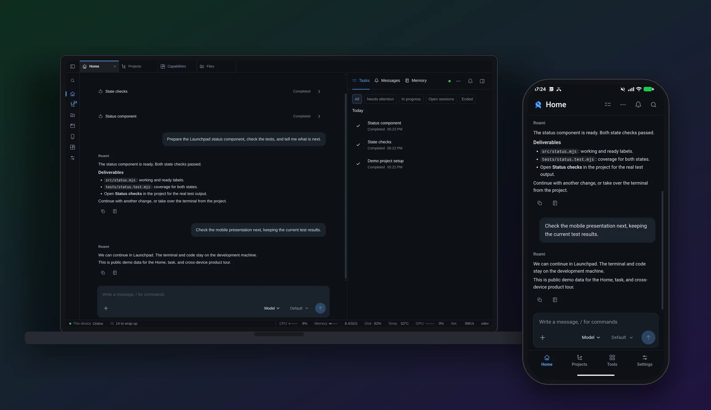
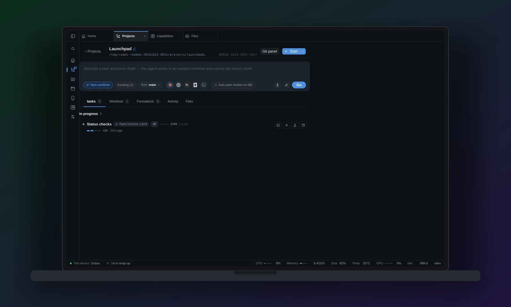
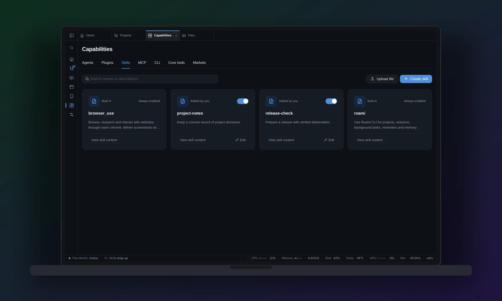
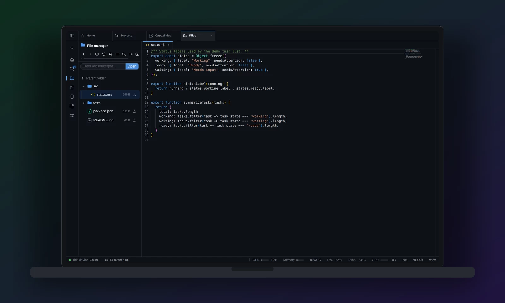
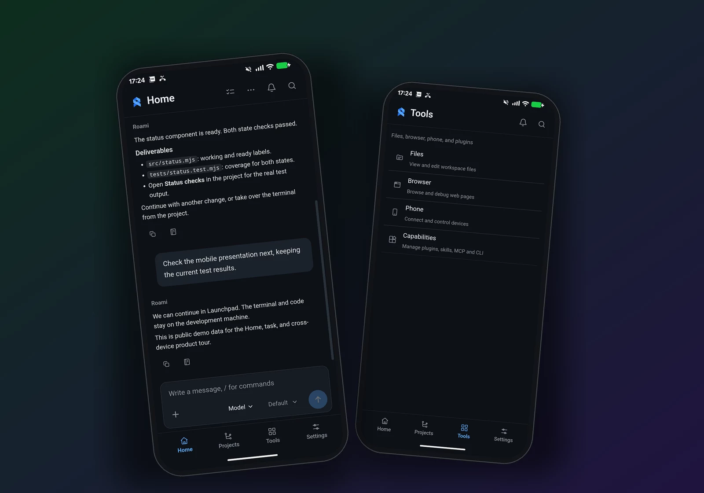

# Roami

**English** | [简体中文](README.zh-CN.md)

> **Roami, god of the agents.**
>
> Control Claude Code, Codex, OpenCode, Pi, and more from anywhere.

In our brand mythology, Roami is the god who commands a pantheon of AI agents.
Claude Code, Codex, OpenCode, and Pi each wield their own power. Standing among
them, Roami holds a phone as his divine instrument, connecting their powers in
the palm of his hand. Through it, you issue instructions, watch the work unfold,
and take command from afar.


That is the idea behind the product: **many agents, one place to command them,
wherever you are.**

Roami puts the coding agents on your development machines under one remote
console. From your phone, tablet, or computer, **start agent sessions, send
instructions, follow their progress, and take over the terminal** through a
browser or the Android app. The built-in assistant helps coordinate tasks,
messages, and memory. Your agents, repositories, and processes keep running on
your own Linux or macOS machines.

**Your agents work on the development machine. You stay in control from your phone.**

[Get started](#get-started) · [Android app](#android-app) · [Product tour](#product-tour) · [All features](docs/features.md) · [Roadmap](ROADMAP.md) · [Downloads](https://github.com/ybz21/Roami/releases)



## What you can do

- **Control your coding agents remotely.** Manage Claude Code, Codex, OpenCode,
  and Pi from one console. Start a persistent session, read its output, send
  another instruction, or take over its terminal from the Android app or a
  browser. Agent-specific installation, version, and launch settings live in
  the capability center.
- **Coordinate work through one conversation.** Ask the built-in assistant to
  handle a task, inspect progress, and continue the discussion. Tasks, messages,
  and memory sit beside the conversation on desktop.
- **Keep work organized by project.** Repositories bring together tasks,
  worktrees, sessions, branches, and activity. Run independent changes in
  isolated worktrees, compare agent attempts, or coordinate a swarm.
- **Continue from another device.** Read results on your phone, send another
  instruction, or return to a full desktop workspace. Closing the client or
  losing its connection does not close sessions on the server.
- **Extend what the assistant can do.** Create or import Skills, configure MCP
  servers and CLIs, install plugins, and discover capabilities through the
  market. Review imported configuration before saving it.
- **Use the actual development tools.** Work with files and Git, operate the
  development machine's Chrome, and mirror a connected Android device. Add a
  hub when you need one console for several machines.

## Get started

### 1. Install on your development machine

Supported release bundles: **Linux and macOS, x86-64 and ARM64**. Install `tmux`
on the host first, then run:

```bash
curl -fsSL https://raw.githubusercontent.com/ybz21/Roami/main/install.sh | bash
```

The installer downloads the complete bundle and starts a persistent service:
**systemd on Linux, launchd on macOS**. The bundle includes the web frontend,
a private Python interpreter, and the built-in agent's production dependencies.
You do not need to install Python, uv, Go, or Node to run the bundled console and
assistant. Optional features have their own requirements:

| Feature | On the development machine |
|---|---|
| Persistent terminals and agent sessions | `tmux` |
| Professional coding agents | The relevant CLI, its login, and provider access |
| Browser mirror and automation | Chrome and Node |
| Android device mirror | ADB and a connected, authorized Android device |

For an installation without service registration:

```bash
curl -fsSL https://raw.githubusercontent.com/ybz21/Roami/main/install.sh \
  | ROAMI_NO_SERVICE=1 bash
roami
```

Download complete packages and Android APKs from
[Releases](https://github.com/ybz21/Roami/releases). Pre-release builds are listed
there too. The standalone server binary does **not** include the Python runtime;
use the complete bundle for the built-in assistant.

### 2. Open the console and configure your assistant

Open the address printed by Roami, normally `https://<machine-address>:13579`.
Set an access password on first use. In **Settings**, configure the built-in
assistant's model provider, endpoint, model, and credentials. In
**Capabilities → Agents**, check your installed coding agents and open a
terminal to finish their login when needed.

Configuration and data default to `~/.roami/`. Run the installer again to
upgrade; an active agent can delay activation until its work is idle.

### 3. Add a project and start working

Open **Projects** and add an existing repository, create a directory, or clone a
repository. Start a task or terminal, then return to **Home** to work through the
assistant. Open the same server from another device to continue.

Your client needs a route to the server: the same LAN, a VPN, or a configured
remote-access tunnel. Roami does not establish that connection automatically.
For off-LAN access, see the [HTTPS tunnel guide](docs/deploy/frp.md).

## Product tour

### Home: a conversation with its work in view

Home is the main assistant conversation. On a wide desktop, the right workspace
has **Tasks / Messages / Memory** tabs. Open a task to see its outcome,
deliverables, and execution details, or open memory to review what the assistant
retains. Task progress and actionable questions stay close to the discussion.

On phones, the four main destinations are **Home / Projects / Tools / Settings**.
Messages and task details open as secondary pages with their own return bar.

### Projects: from a repository to running work

Projects collect sessions, worktrees, tasks, and activity around each repository.
Open an existing session, launch an independent change, or compare attempts.
Professional sessions can be read as a conversation where supported, with the
original terminal available when you need the CLI's full interface.



For larger jobs, swarms provide members, dependencies, a shared board, and a
message feed. The underlying sessions remain real tmux sessions on the host.

### Capabilities: agents, tools, and a market

The capability center has **Agents, Plugins, Skills, MCP, CLI, Core tools, and Markets**
tabs. Check installed agents and versions, configure launch commands and supported
model settings, and inspect available usage information.



Create a Skill or upload `SKILL.md`; register a CLI with its argument list; add
an MCP server and explicitly connect it to discover tools. The market searches
configured sources for Skills, MCP servers, and CLI packages, then lets you
preview and edit an import before saving it.

Roami-managed capabilities serve the built-in assistant. Professional CLIs also
have their own Skill and MCP configuration; importing a capability into Roami
does not automatically configure every CLI.

### Tools: files, browser, and a real phone

The file workspace supports browsing, previews, editing, and Git inspection.
The browser workspace mirrors Chrome on the development machine, including its
existing tabs and login state. The phone workspace mirrors an Android device
connected to that machine over ADB.



The **Android app below is a remote client**. The **phone mirror** is a separate
feature for operating and debugging a device attached to your development
machine.

## Android app

Install **`roami.apk`** from [GitHub Releases](https://github.com/ybz21/Roami/releases)
on **Android 8.0 or newer**. Open it, enter your Roami server's full address,
confirm its certificate if necessary, and log in. The app connects to your own
server; it does not run the coding agents on your phone.



The app adds native integration around the same web workspace:

- **Saved server environments.** Reopen a saved server, or shake the phone to
  return to the environment picker.
- **Session and assistant notifications.** A foreground-service connection
  receives events without Google push services. Supported session confirmation
  prompts offer **Allow / Deny** actions in the notification.
- **A home-screen widget and app badge.** See running sessions and pending work,
  open a session, or start a task. Notification and badge behavior depends on
  Android permissions and the device's launcher and battery settings.
- **Files, voice, and updates.** Upload and download files, grant microphone
  access when needed, and install APK updates through the server's installation
  page when the administrator has made a newer APK available there.

Voice transcription also needs a speech-recognition provider configured on the server.

The APK and server have separate version numbers. Public APK releases use a
fixed signing certificate so later releases can upgrade the installed app.

Prefer a browser? Android Chrome and iPhone Safari can add Roami to the home
screen. On iPhone, Web Push requires an installed home-screen web app and iOS
16.4 or newer. Open **Settings → Install on phone** for certificate, installation,
and notification guidance. See [mobile setup](docs/deploy/mobile.md) for details
and Android source builds.

## Several machines, one console

Each development machine owns its files, agents, and sessions. An optional hub
provides a shared console and an outbound connection from each node, so nodes
behind NAT do not require inbound port forwarding to reach the hub.

```yaml
# On the hub: ~/.roami/config.yaml
cluster:
  mode: hub
  public_url: https://roami.example.com
```

```yaml
# On a development machine: ~/.roami/config.yaml
cluster:
  hub: https://roami.example.com
  token: <one-time enrollment token>
  name: workstation
```

Issue the enrollment token in the cluster settings. Use the machine switcher to
move between nodes; sessions continue on their own host when the client changes
nodes or disconnects.

## CLI and development

`roami` is the command entry point for the console, sessions, browser automation,
and installed plugins:

```bash
roami help
roami session ls --json
roami project ls --json
roami agent status
roami chrome help
roami adb devices -l
```

For a source checkout, install the Go and Node versions required by
[go.mod](go.mod) and [the frontend](frontend/package.json), plus the host tools
for the features you use. Prepare the built-in assistant runtime as described
in [agent-runtime/README.md](agent-runtime/README.md), then:

```bash
git clone https://github.com/ybz21/Roami.git
cd Roami
bash scripts/dev/install-git-hooks.sh
./start.sh --dev fg
```

Repository checks:

```bash
scripts/dev/quality/check.sh quick
scripts/dev/quality/check.sh full
```

Contributors follow [AGENTS.md](AGENTS.md), including the design system, i18n,
session isolation, and screenshot requirements. Android build and signing
instructions are in [mobile setup](docs/deploy/mobile.md).

## Access and security

Roami can operate your terminal, files, browser, and agents. Protect it like
remote access to the development account: use a strong password, enable
optional two-factor authentication, and keep access behind a trusted network,
VPN, or authenticated tunnel.

HTTPS is enabled by default with a self-signed certificate. Trust the server's
CA on clients or provide a trusted certificate for microphone, clipboard, and
web-push features that require a secure context. Closing a client keeps host
processes alive; a host reboot or a deliberately stopped session is a different
boundary.

## Documentation

- [Complete feature inventory](docs/features.md)
- [Roadmap: RSI, personal digital twin, and OKR execution](ROADMAP.md)
- [Mobile setup and Android builds](docs/deploy/mobile.md)
- [HTTPS remote-access tunnel](docs/deploy/frp.md)
- [Installation and deployment reference](docs/install/README.md)
- [Built-in agent runtime](agent-runtime/README.md)
- [Plugin development](docs/design/plugin/README.md)
- [Backend](backend/README.md)

## License

[GNU Affero General Public License v3.0](LICENSE).
