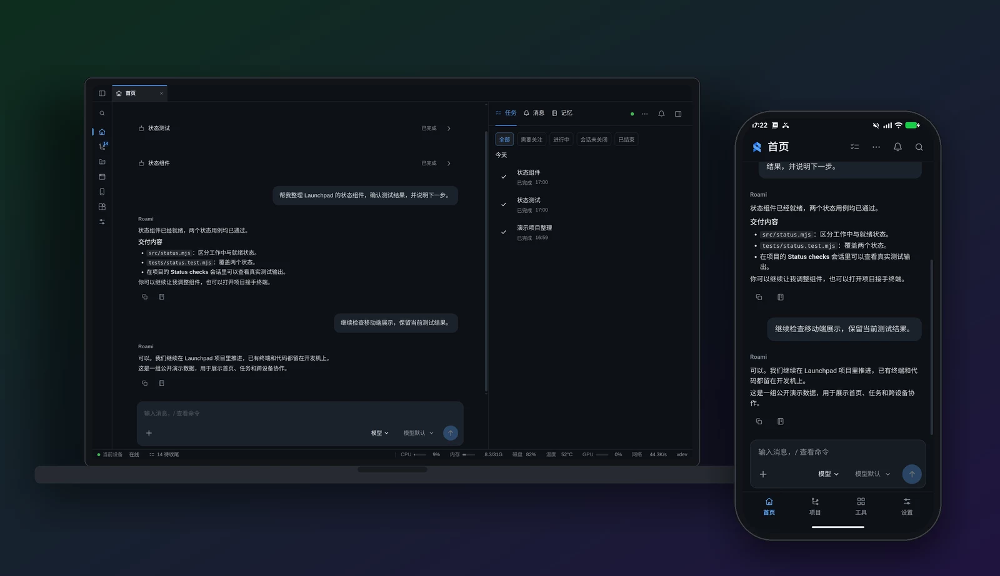
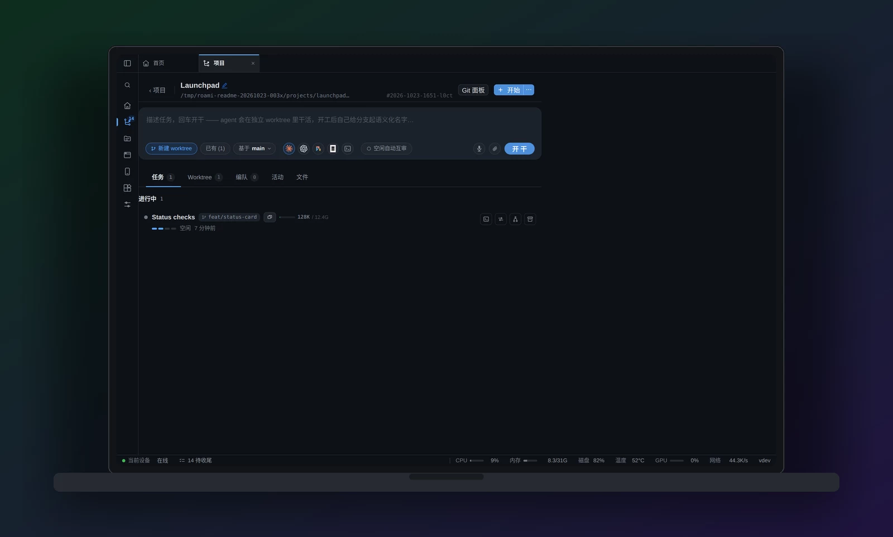
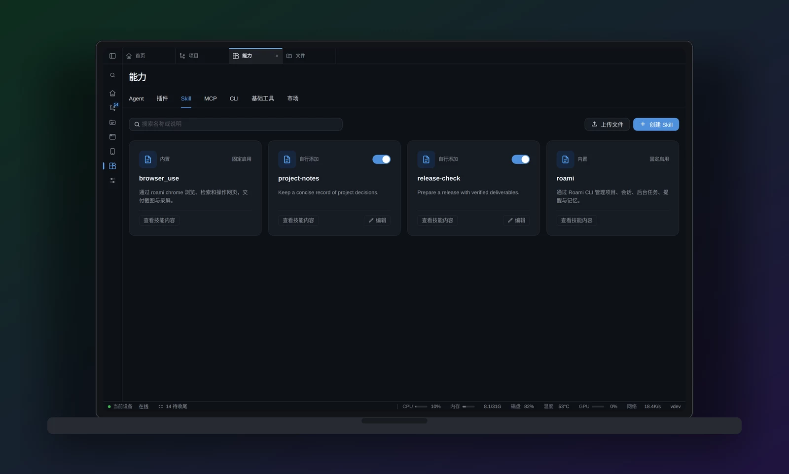
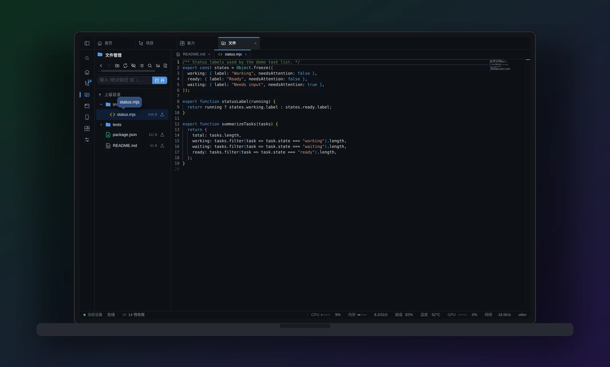
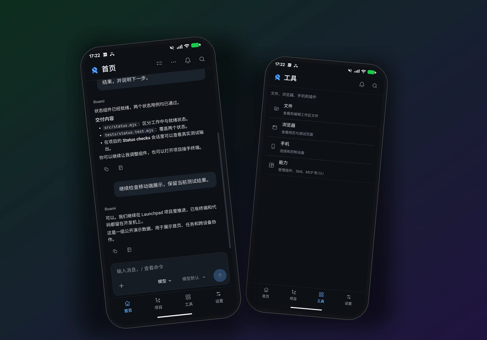

# Roami

[English](README.md) | **简体中文**

> **Roami，掌管众多智能体的神。**
>
> 随时随地，掌控 Claude Code、Codex、OpenCode、Pi 等编程 Agent。

在我们的品牌神话里，Roami 立于众神中央，统御 Claude Code、Codex、OpenCode、Pi 等
各具神力的智能体。他手中的手机，是连接众神的法器，将分散的力量汇于掌中：
指令由此发出，进展尽收眼底，远方的工作也能随时接管。


这也是 Roami 的产品理念：**众多 Agent，一个指挥入口；无论身在何处，掌控始终在你手中。**

Roami 把开发机上的编程 Agent 集中到一个可远程操控的控制台。
用手机、平板或电脑，通过浏览器或 Android App **启动 Agent 会话、发送指令、
跟进进展、接管终端**；也可以让内置助手协调任务、消息和记忆。
Agent、仓库与进程始终在你自己的 Linux 或 macOS 开发机上运行。

**Agent 在开发机上干活，你在手机上掌控全局。**

[快速开始](#快速开始) · [Android App](#android-app) · [产品导览](#产品导览) · [完整功能](docs/features.zh-CN.md) · [Roadmap](ROADMAP.zh-CN.md) · [下载安装](https://github.com/ybz21/Roami/releases)



## 你可以用它做什么

- **远程掌控编程 Agent。** 在同一个控制台管理 Claude Code、Codex、OpenCode 和 Pi。
  从 Android App 或浏览器启动持久会话、查看输出、追加指令，随时接管终端；
  安装、版本检查与启动配置集中在能力中心。
- **在一场对话里协调工作。** 向内置助手描述任务、查看进展、继续讨论。桌面端的任务、
  消息和记忆就在对话右侧，无需离开当前工作。
- **按项目组织任务。** 仓库下集中展示任务、worktree、会话、分支和活动。
  独立改动各用一个 worktree，也可以对比多个 Agent 的尝试，或通过蜂群协作。
- **换个设备继续。** 手机上看结果、补指令，回到电脑接手完整工作台。
  关闭客户端或客户端断网，不会关闭服务器上的会话。
- **扩展助手的能力。** 创建或导入 Skill、配置 MCP 和 CLI、安装插件，
  也能从市场发现能力，预览并修改配置后再确认导入。
- **直接使用真实开发工具。** 浏览文件、查看 Git、操控开发机上的 Chrome、
  镜像已连接的 Android 设备；机器多了，再用中心把它们接到同一个控制台。

## 快速开始

### 1. 安装到开发机

发布包支持 **Linux / macOS，x86-64 / ARM64**。先在宿主机安装 `tmux`，然后执行：

```bash
curl -fsSL https://raw.githubusercontent.com/ybz21/Roami/main/install.sh | bash
```

安装器下载完整运行包并启动常驻服务：Linux 使用 **systemd**，macOS 使用 **launchd**。
运行包包含 Web 前端、独立 Python 解释器和内置助手的生产依赖；运行打包后的控制台与助手，
不需要预装 Python、uv、Go 或 Node。可选功能按需准备：

| 功能 | 开发机上的依赖 |
|---|---|
| 持久终端与 Agent 会话 | `tmux` |
| 专业编程 Agent | 对应 CLI、登录状态与模型服务访问权限 |
| 浏览器镜像与自动化 | Chrome 与 Node |
| Android 设备镜像 | ADB 与已连接、已授权的 Android 设备 |

如果不需要注册常驻服务：

```bash
curl -fsSL https://raw.githubusercontent.com/ybz21/Roami/main/install.sh \
  | ROAMI_NO_SERVICE=1 bash
roami
```

完整运行包与 Android APK 都在 [Releases](https://github.com/ybz21/Roami/releases)，
预发布版本也从这里下载。单独的服务端二进制**不包含 Python 运行时**；需要内置助手时，
请选择完整运行包。

### 2. 打开控制台，配置助手

访问启动时显示的地址，通常是 `https://<开发机地址>:13579`。首次进入先设置访问口令。
在**设置**中配置内置助手的模型服务、接口地址、模型名称与凭证；在**能力 → Agent**
检查编程 Agent 的安装情况，需要时打开终端完成各自的登录。

配置和数据默认保存在 `~/.roami/`。再次运行安装器即可升级；有 Agent 正在工作时，
新版本可能等待其空闲后再激活。

### 3. 添加项目，开始工作

打开**项目**，添加已有仓库、新建目录或克隆仓库。进入项目启动任务或终端，
也可以回到**首页**，通过助手推进工作。换个设备打开同一个服务，就能继续。

客户端需要能访问开发机：同一局域网、VPN 或已配置的远程隧道均可。
Roami 不会自动替你建立这条网络连接；外网接入可参考 [HTTPS 隧道指南](docs/deploy/frp.md)。

## 产品导览

### 首页：对话和工作进展放在一起

首页是与内置助手协作的主对话。宽屏电脑的右侧工作区有**任务 / 消息 / 记忆**三个标签。
点开任务查看结果、产物和执行详情，打开记忆检查助手保留的内容；任务进展和需要你决定的
问题都紧跟当前讨论。

手机底栏固定为**首页 / 项目 / 工具 / 设置**四个入口，消息和任务详情使用带返回栏的二级页。

### 项目：从仓库进入正在进行的工作

每个仓库集中展示会话、worktree、任务和活动。继续已有会话、启动独立改动，
或对比不同尝试。受支持的专业会话既能按对话阅读，也能切回原始终端，使用 CLI 的完整界面。



复杂任务还可以交给蜂群：成员、依赖、共享看板和消息流共同组织协作。
底层仍是开发机上的真实 tmux 会话。

### 能力：管理 Agent，也管理它们需要的工具

能力中心包含 **Agent、插件、Skill、MCP、CLI、基础工具、市场**七个分类。
检查已安装 Agent 与版本、配置启动命令和受支持的模型设置，查看可获得的额度信息。



创建 Skill 或上传 `SKILL.md`，用参数列表注册 CLI，添加 MCP 后显式连接以发现工具。
市场可以从已配置的来源检索 Skill、MCP 服务和 CLI 包，先预览内容，再进入可编辑的导入确认页。

Roami 托管的能力供内置助手调用。专业 CLI 还有各自的 Skill 与 MCP 配置；
导入到 Roami，不代表已经替所有 CLI 完成配置。

### 工具：文件、浏览器与真手机

文件工作区支持目录浏览、预览、编辑与 Git 检查。浏览器工作区镜像开发机上的 Chrome，
复用已有标签和登录状态；手机工作区通过 ADB 镜像连接在开发机上的 Android 设备。



下文的 **Android App 是远程客户端**；这里的**手机镜像**是另一项功能，用于操控与调试
接在开发机上的设备。

## Android App

从 [GitHub Releases](https://github.com/ybz21/Roami/releases) 下载 **`roami.apk`**，
安装到 **Android 8.0 及以上**的手机。打开后输入 Roami 服务的完整地址，必要时确认服务器
证书，再登录自己的服务。App 负责远程接入，编程 Agent 仍在开发机上运行。



App 在同一套 Web 工作空间外增加了原生能力：

- **记住多个服务环境。** 再次打开可直接进入已保存的服务器；摇一摇回到环境选择页。
- **会话与助手通知。** 前台服务通过长连接接收事件，不依赖 Google 推送服务。
  支持的会话确认请求可直接在通知栏选择**允许 / 拒绝**。
- **桌面小组件与应用角标。** 查看运行中的会话和待处理事项，进入会话或发起任务。
  通知与角标的实际表现取决于 Android 权限、桌面启动器和电池管理设置。
- **文件、语音与升级。** 上传下载文件，按需授权麦克风；管理员在服务器提供新版 APK 后，
  可从安装页下载并调用系统安装器升级。

语音转写还需要在服务端配置语音识别服务。

APK 与服务端使用独立版本号。公开发布的 APK 使用固定签名证书，后续版本可以覆盖升级。

也可以继续用手机浏览器：Android Chrome 和 iPhone Safari 都支持添加到主屏幕。
iPhone 的 Web Push 需要主屏 Web App 和 iOS 16.4 及以上系统。
打开**设置 → 装到手机**，按页面完成证书、安装与通知配置。
详细说明与 Android 自行打包方式见[手机安装指南](docs/deploy/mobile.md)。

## 多台机器，一个控制台

每台开发机各自保存文件、运行 Agent 与会话。需要统一管理时，可添加一个中心；
节点主动向中心建立出站连接，因此位于 NAT 后的开发机不必为了接入中心而开放入站端口。

```yaml
# 中心：~/.roami/config.yaml
cluster:
  mode: hub
  public_url: https://roami.example.com
```

```yaml
# 开发机：~/.roami/config.yaml
cluster:
  hub: https://roami.example.com
  token: <一次性注册令牌>
  name: workstation
```

在集群设置中签发注册令牌，然后通过机器切换器进入不同节点。
客户端切换节点或断开连接时，会话仍在各自的宿主机上继续运行。

## CLI 与开发

`roami` 是控制台、会话、浏览器自动化和已安装插件的统一命令入口：

```bash
roami help
roami session ls --json
roami project ls --json
roami agent status
roami chrome help
roami adb devices -l
```

从源码开发时，先准备 [go.mod](go.mod) 与[前端配置](frontend/package.json)要求的 Go、Node，
以及所用功能的宿主机工具。按 [agent-runtime/README.md](agent-runtime/README.md)
准备内置助手运行时，再启动开发服务：

```bash
git clone https://github.com/ybz21/Roami.git
cd Roami
bash scripts/dev/install-git-hooks.sh
./start.sh --dev fg
```

仓库质量检查：

```bash
scripts/dev/quality/check.sh quick
scripts/dev/quality/check.sh full
```

贡献代码遵循 [AGENTS.md](AGENTS.md)，包括设计系统、国际化、会话隔离与截图要求。
Android 构建与签名步骤见[手机安装指南](docs/deploy/mobile.md)。

## 访问与安全

Roami 能操控终端、文件、浏览器和 Agent，权限接近远程登录开发账户。
使用强口令，按需开启两步验证，并通过可信网络、VPN 或带认证的隧道接入。

默认启用自签 HTTPS。客户端应信任服务器 CA，或为服务配置受信任的证书，
让麦克风、剪贴板和 Web Push 等需要安全上下文的能力正常工作。
关闭客户端会保留宿主机上的进程；宿主机重启或主动关闭会话属于不同的边界。

## 文档

- [完整功能清单](docs/features.zh-CN.md)
- [Roadmap：RSI、个人数字分身与 OKR 执行](ROADMAP.zh-CN.md)
- [手机安装与 Android 构建](docs/deploy/mobile.md)
- [HTTPS 远程隧道](docs/deploy/frp.md)
- [安装部署参考](docs/install/README.md)
- [内置助手运行时](agent-runtime/README.md)
- [插件开发](docs/design/plugin/README.md)
- [后端](backend/README.md)

## 许可证

[GNU Affero General Public License v3.0](LICENSE)。
