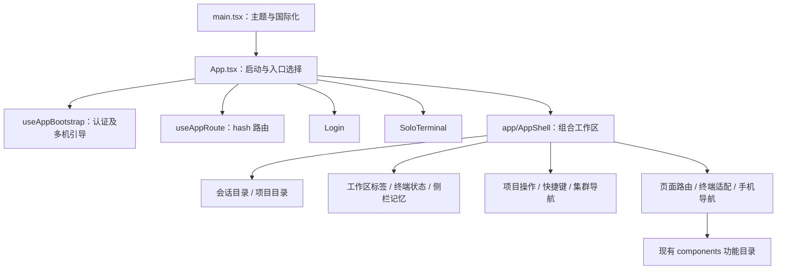

# 前端应用入口与工作区拆分

日期：2026-10-20。范围：原 `frontend/src/App.tsx` 的应用级职责。

## 问题与边界

原入口 1423 行，登录、多机引导、路由、项目树、终端探测、标签持久化、快捷键和页面渲染共用一个闭包。
修改功能时，很难判断哪些状态可以移动、哪些 effect 必须等登录，以及改动是否会卸载终端。

本次以状态所有者和生命周期划分模块，沿用现有 hash 路由、React hooks、外部订阅和功能目录。
不引入路由库或状态管理依赖；已有 `components/agent`、`files`、`sessions`、`shell` 等功能模块继续负责自己的业务。

## 依赖方向

应用层可以导入功能模块；功能模块不反向依赖 `app/`。领域 hook 通过显式参数协作，不导入
`AppShell`，不通过一个包揽全局状态的 Context 把耦合藏起来。跨域操作由组合层或操作 hook 协调。

## 状态归属

| 模块 | 唯一负责的内容 |
| --- | --- |
| `useAppBootstrap` | 登录确认、401 回退、集群引导、偏好加载、退出 |
| `useAppRoute` / `navigation` | hash 解析与导航、页面注册和手机主入口归属 |
| `useSessionDirectory` | 会话 ID 与名字映射、展示名、会话列表、加载成功标记；改名通过 `rename` 操作 |
| `useProjectDirectory` | 项目、归属表、worktree 快照、待收尾数与当前仓库状态 |
| `useTaskWorkspace` | 会话和文件标签、当前任务、URL / 本地恢复、手机终端覆盖层 |
| `useTerminalRuntime` | 终端句柄、连接状态、Agent 探测、对话 / 终端选择、等待输入状态 |
| `useTabInspector` | 每个标签的右栏面板、收起记忆、内容搜索动作 |
| `usePageTabs` | 页面标签和关闭后的导航，不管理终端标签 |
| `useProjectActions` | 项目树派生、开会话、任务收尾、项目和任务弹层，协调目录与工作区刷新 |
| `useWorkspaceShortcuts` | 键位到操作的映射，不持有第二份业务状态 |
| `useClusterNavigation` | 节点菜单及换机时恢复该节点的标签 |
| `useBrowserEnvironment` / `useCanvasScroll` | 在线和全屏状态、版本信息、布局变化时的画布滚动恢复 |
| `AppRoutes` / `WorkspaceTerminals` / `MobileNavigation` | 页面选择和现有组件适配，不自行发起目录轮询 |

`App.tsx` 负责认证门和独立终端入口；`AppShell` 只在认证及节点引导完成后挂载。
登录失效时，工作区卸载，目录定时器和 P2P 控制连接随之清理；独立终端页不挂载整套工作区。

## 必须保留的行为

- `/me` 成功后才能做集群引导，引导完成后才挂业务组件，避免首批请求缺失节点前缀。
- URL 用稳定会话 ID，API / WS 用会话名。改名时立即更新映射，不能等下一轮刷新才修 URL。
- 标签恢复完成前不写回 URL；裸链接回落到本机记录；`terms=none` 不擦除其他页存下的标签。
- 文件标签保留任务归属；关闭文件回到相邻文件，切会话时让出文件视图。
- 桌面通过同一个 `Workspace` 及终端适配组件改变几何，页面切换不重建终端。
- 手机打开会话只挂当前一个，全屏层继续使用原返回手势机制；导航栏仍使用现有 CSS 和 i18n。
- 目录刷新保留原来的 5 秒会话、15 秒项目和 60 秒串行 worktree 节奏；终端活动继续复用
  `useSessionOverview`，没有因拆分新增轮询。此次不作 CPU、内存或请求数下降的性能承诺。
- 可见布局偏好仍由现有 `useWorkspaceLayout` 处理，保留本地首帧镜像和服务端延迟加载规则。

## 后续修改入口

- 增减页面：改 `AppRoutes`；需要导航入口时改 `navigation`。不进入终端状态 hook。
- 改会话身份或列表刷新：改 `useSessionDirectory`；标签恢复策略改 `useTaskWorkspace`。
- 改终端探测与视图选择：改 `useTerminalRuntime` 或已有 `TerminalPane`，不改路由表。
- 改任务创建、改名或收尾：改 `useProjectActions` 及对应功能组件。
- 改手机上下栏：改 `MobileNavigation`；主入口归属只在 `mobileNavRoot` 定义一遍。
- 改工作区布局：组合位置在 `AppShell`；尺寸、持久化及响应式判定继续使用既有布局模块。

## 回归验证

新增应用挂载边界和工作区标签生命周期测试，覆盖认证及引导顺序、登录后的相同边界、401 卸载、
独立终端、异步启动取消、延迟 ID 映射、节点文件恢复、干净页面、改名后的稳定 ID、文件关闭和手机覆盖层。
原有布局偏好、侧栏记忆、路由和标签测试继续运行。

另有换机操作测试：干净页标记在持久化 effect 中变化、没有再渲染菜单时，点击切换仍读取最新值。
这部分使用节点替身验证，没有连接或修改真实 Hub。

实测结果：

- `App.tsx` 从 1423 行缩为 16 行；组合壳层 `AppShell.tsx` 为 284 行。
- `typecheck`、i18n 审计、hover 审计和生产构建通过；仓库 `quick` 门禁通过，含 Go 和 711 个 Python 用例。
- 新增 10 个应用层用例；前端全量 118 个测试文件、822 个用例通过。
- 生产构建桌面检查覆盖 320 / 390 / 820 / 1100 / 1280 / 1600 / 1920 宽度，文档不滚动、无横向溢出；
  切项目 / 设置 / 工作区时终端 DOM 未重建，刷新后仍恢复标签；英文浅色主题检查通过。
- Android 真机通过 LAN HTTPS 验证粗指针主导航点按、内部滚动、搜索键盘打开和收起、
  消息二级页及返回、终端中心命中和系统返回关闭覆盖层；底部 24px 安全区保留，无页面横向溢出。
- 构建入口 JS 的 gzip 体积约由 351.69kB 变为 353.19kB；浏览器、手机镜像和 Agent 对话仍单独分块。
  这次验收针对模块边界和行为保持，不把拆文件当作加载性能优化。

## 设计修订与验收记录

[按日期查看记录](records/README.md)。
