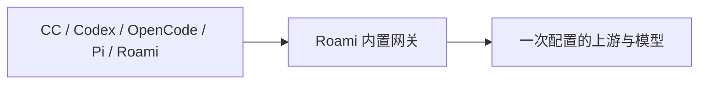

# 能力中心：统一模型网关与智能体

2026-10-31 修订。连接与模型合并管理，Roami 内置网关负责适配客户端协议。同一个上游、同一个模型可以供 CC、Codex、OpenCode、Pi 和 Roami 使用，不再为不同智能体重复建立来源。

新增提案：[本地网关与 Agent 独立计费（HTML）](gateway-billing.html)。覆盖本地模型库复用、本机连接导入、默认智能体各自的 Key、直接按智能体归账和托管会话明细，以及产品交互和技术迁移方案；目前仅设计，未改运行代码。[原型验收](gateway-billing-review.md)。

最新产品提案：[简化添加模型](add-model-design.md) · [交互稿](add-model.html)。默认只填地址与密钥、读取后勾选；已有来源直接选择。定价、聚合策略各放后置选项卡。配置源与批量拉取已在 2026-11-01 落地，见 [模型目录实现与验收](source-catalog-acceptance.md)。提案中的独立聚合策略页签仍是后续范围；下文保留此前实现说明。

[连接合并验收](connections-acceptance.md) · [网关适配验收](gateway-adaptation.md) · [模式切换验收](modes-acceptance.md) · [早期实现记录](implementation.md) · [历史设计](records/2026-10-31/README.md)

## Product Design

能力并列“大模型”和“智能体”。大模型保留三个页签：

| 页签 | 用途 |
| --- | --- |
| 模型 | 按连接分组，在同一表单配置地址、密钥及多个模型 |
| 用量与限额 | 原有用量账本、币种、每日金额限额、时区与费用核对 |
| 模型定价 | 原有默认、逐模型及前缀价格，输入、输出及缓存价格 |

添加连接时填写名称、地址、密钥和模型 ID；显示名称选填，可以继续增加多个模型，一次确认保存。上游的协议和认证方式放在“连接选项”中，普通 OpenAI 兼容服务默认使用 Chat Completions。协议属于连接参数，不再划分可使用它的智能体。列表不展示协议类别或内部路由 ID，名称与地址相同时不重复显示。

连接下面直接展示它的模型。连接编辑表单同时管理所属模型；模型的聚合策略作为单独的高级入口保留。主备候选可以使用不同上游协议，由网关逐个适配。正在使用列表为空时不展示空标题。

智能体页统一安装、升级、启动、登录和模型配置。自动识别本机已有 CC；未安装的 OpenCode 等工具可以安装，已安装则显示版本与升级。模型配置提供：

| 模式 | 操作与结果 |
| --- | --- |
| 原厂模式（Default） | 确认后交回工具自己的登录和默认模型，移除接管的自定义连接 |
| 自定义模式 | 选已保存的来源，再选模型；确认后连接 Roami 网关，凭据与协议由网关处理 |

选择选项只编辑草案，“当前使用”始终显示实际配置；确认应用后才写入真实文件，新会话生效。来源目录只读，未登记的模型也能选；目录不可用时可输入已知模型 ID，确认应用才加入共享列表。旧连接预设与“恢复以前配置”放在高级区域，恢复可以回到以前的第三方设置，原厂模式则使用工具默认行为。

## User Stories

1. 配置一次 OpenAI 兼容来源及多个模型后，CC 和 Codex 都能选择同一个模型，无需另建 Claude 来源。
2. CC 发送 Messages，Codex 发送 Responses，Roami 使用 Chat Completions，均通过 Roami 网关转成上游格式。
3. 工具调用的名称、ID、参数与结果经过完整往返；客户端能够执行真实工具，继续发送结果并收到最终回复。
4. 手机在一个全屏表单完成连接与模型配置；地址、已有密钥、模型和聚合策略不会因分开编辑而丢失。
5. 原有定价、用量、限额继续有效，按真正调用的上游模型和原始用量计价。
6. 保存失败保留输入；编辑不会改变列表顺序；切换原厂仍保留登录、hooks、MCP、权限等非模型设置。

## Technical Design

### 模块

- `ModelHub.tsx`：连接分组、一次提交连接与多个模型，复用原定价与费用表单；协议和认证方式收在连接选项。
- `GatewayModelBinding.tsx`：所有智能体共用来源和模型列表，不再按上游协议过滤；原厂与自定义模式独立。
- `RoamiAgentModels.tsx`：主智能体与执行智能体从同一完整列表选择模型。
- `catalog_http.go`：原生配置写入工具所需的网关协议，独立于上游协议；公开回环推理和私有管理接口分离。
- `protocol_requests.go`：将三种协议的消息、工具、工具结果、图片和常用参数转为上游请求；支持命名空间、自定义文本工具和对话中的 system 消息。
- `protocol_results.go`：解析 JSON 或 SSE，上游文本增量实时输出，完整收集并校验工具参数。
- `protocol_events.go`：输出客户端所需的 JSON 或 SSE 事件，保持调用关联、结束事件和用量字段。
- `native_usage.go` / 原账本：计量读取原始上游响应，一次结算实际候选模型，不依赖转换后的客户端数据。

原生配置中只写 Roami 的回环地址与按智能体派生的凭据。CC 固定使用 Messages，Codex 固定使用 Responses，OpenCode / Pi 默认使用 Chat Completions；三种客户端协议都能由网关适配到三种上游协议。上游密钥只保留在节点，不返回浏览器或复制进 CLI。

目录中的 `protocol` 保留为主来源协议字段，以兼容既有存储，不再代表客户端准入条件。主来源和备用来源可使用不同协议。主备仍仅在连接建立前失败时切换，收到上游响应后不重试其他来源；每个尝试按原账本独立结算，避免重复请求与重复消费。

### 保存、恢复与兼容

连接及多个模型使用同一个目录修订和一次 PUT 保存，保留路由 ID、已有密钥与主备候选。源被其他模型作为备用时不能直接删除；正在使用或保存在原生预设中的模型仍受后端引用保护。修改连接协议不会要求重新配置客户端，网关在后续请求时适配；进行中的请求保留原快照。

旧 `/capabilities/models/sources` 及其详情链接统一进入模型页，原有设置和节点参数继续保留。原厂切换和恢复使用现有备份、修订校验、原子写入与读回确认。Claude 保留 Roami 管理标记，避免本机已有同步服务立即覆盖其设置。

### 适配边界

支持普通回复、文本流、函数工具往返、标准 URL/Base64 图片输入、常用采样参数及可转换的结构化输出。工具参数完整校验后才输出为工具调用；截断、格式错误或缺少可信用量时返回错误，不伪造完成事件或用量。

提供商托管的搜索等能力不能凭协议转换产生。跨协议的 Responses 自动模式会停用不支持的托管搜索/工具检索，保留所有客户端工具并明确告知模型及响应头；强制调用不支持的托管工具则拒绝。同协议透传继续保留原生提供商能力。命名空间恢复到客户端原名称，自定义文本工具用字符串参数承接，并提供原格式说明；语法约束仍由客户端工具验证。

CC/Codex 默认附带的厂商专用思考配置不跨协议强制注入，按上游默认行为执行并通过响应头标明；显式保存的 Chat 推理参数仍按对应字段转发。可见思考文本可进入后续上下文，不伪造提供商签名。CC 的流事件先输出思考再输出正文；若上游在正文后继续追加思考而无法保持这一顺序，明确报错，避免客户端最终回复被覆盖为空。跨协议不接受提供商加密状态、文件 ID 等无法移植的内容；`previous_response_id`、WebSocket 及跨协议的 `responses/compact` 仍不支持。模型本身的图片、推理和上下文能力由上游决定，协议转换不改变模型能力。

协议参考：[OpenAI Responses 迁移与类型化事件](https://developers.openai.com/api/docs/guides/migrate-to-responses)、[Responses 流事件](https://developers.openai.com/api/reference/resources/responses/streaming-events)、[命名空间工具](https://developers.openai.com/api/docs/guides/tools-tool-search)、[Claude 消息流](https://platform.claude.com/docs/en/build-with-claude/streaming)。历史 HTML、发布流程和同协议限制仅用于早期设计对照，不代表当前实现。

默认智能体网关记账 V1 已实现：[模块设计与验收](gateway-billing-implementation.md)。支持本地源导入、独立 Key 的自动应用与轮换、按默认智能体归集费用；无需另建接入身份。

交互修订：下游智能体密钥由内部自动管理，移除密钥页面、尾号和手工操作；模型来源与智能体费用统计保留。

本机 Claude 接入修正：[问题、实现与真实 Token 验收](claude-gateway-binding-acceptance.md)。旧直连预设不再误判为已接入网关。
