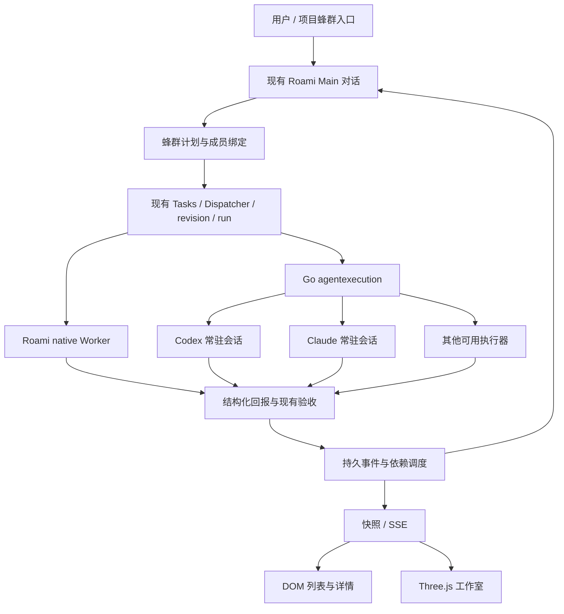

# 技术设计

[返回方案](README.md) · 首版实现说明在前，下方保留原方案供对照。实现差异以本节为准。

## 首版实际实现

- Python migration 15 新增 groups、work items、dependencies、commands、posts；成员身份直接保存在 work item，首版每个成员对应一个可修订的受管任务。未增加独立 memberships 或 Go 索引/outbox。
- Go 的 `/swarms` 发现入口合并旧库和 Python 的实时只读投影；新群详情、写入、事件都代理到 `/api/agent/swarms`。新群状态不双写旧卡片或成员 done。Python 不可用返回错误或部分发现标记，不自动换成 Claude。
- Web 创建绑定已有普通 Main 对话，缺省复用当前节点 Main；Main 工具调用创建时绑定原用户消息，不插入第二条用户请求。群聊发给 Main 进入同一对话，指定成员的消息通过现有 task revision/steer 续派原任务。消息使用持久 commandKey，未知结果重试保持原 key 与 revision。
- Main 可发现 `swarm_create/plan/status/post/control/dependencies`；专业执行器使用任务/run/revision 绑定的私有 CLI 回传入口。成员发言不能改变验收状态；最终回报和需要输入的任务仍走已有 completion turn 返回原 Main。普通讨论消息仅写群聊，不逐条唤起模型。
- 硬依赖按上游 task revision 与实际 succeeded 状态门禁，指定 artifact 时还校验产物 run 所属 revision。启动前再次检查；上游修订后停止仍在运行的下游。依赖修复先要求确认停止，随后使用原任务续派。整群完成要求所有工作已验收，且某个整合项覆盖全部其他工作。
- 控制操作带 expectedRevision。暂停只停新派发，停止调用现有取消，归档不杀会话；停止回执固定原 task revision，重放不能取消较新的修订。unknown 不新建任务补跑。
- 正式 Three.js 0.180.0 作为 npm 依赖，独立懒加载 chunk；使用原生 Three、token 材质、正交相机、几何角色、敲击/呼吸和真实状态变化短粒子。无动画/减少动画/静态状态按需绘制，隐藏或卸载停止绘制，WebGL loss 保留 DOM 成员与重试。最多显示 24 个工位，完整列表保留全部成员；首版未实现相机聚焦或更大规模聚合。
- 桌面与手机三个 Tab 保持挂载，保留草稿、选择、页签与滚动；任务详情桌面内联，手机 MobileSubPage。输入沿用站内 composer，软键盘使用统一 --kb 让位；新文案接中英文 i18n。
- CLI `new --main-conversation <id> --key <key>` 进入受管服务；`plan/control/dependencies/say/post --file` 使用同一接口。既有未指定 Main 的 new/adopt 保留旧兼容行为，未实施旧群自动接管。
- 首版实际路由：`GET/POST /api/agent/swarms`；`GET /:id`、`GET /:id/events`；`POST /:id/plan`、`/:id/dependencies`、`/:id/control`、`/:id/messages`。`member-posts` 只在私有 Unix 通道开放。

真实模型闭环仍被节点凭据 401 阻塞；不把协议测试、暂停的 UI 测试群当成真实模型执行成功。性能目标和旧群接管仍属于后续工作，详见验收记录。

---

## 1. 复用边界



Main 的模型、对话、记忆、权限和工具仍来自现有 `app.py`、`core/loop.py`、`tools/main_catalog.py`。编排是对既有能力的扩展，不在 Go 或前端新增模型循环，也不让某个成员冒充 Main。

Roami 成员的公开身份是 `Roami`，内部映射现有 `executor=native`。复用 `Tasks.create` 的 native branch、worker 路线、工具和能力；成员只得到任务范围上下文。复杂工作仍遵守现有路由契约，不因为加入蜂群就把所有复杂工作强塞给 native，也不绕过能力限制。用户指定 Roami 而现有能力不足时给出具体阻塞，不能静默改为 Claude。

Codex / Claude 等复用 `internal/agentexecution` 的 persistent session、生命周期、供应商 conversationId、回报和停止证据；由 Go 执行器注册表发现可用类型，不在蜂群另写命令模板白名单。安装可用不代表已认证或有额度。所有额度准入仍由 Go gateway 决定。

## 2. 状态与存储所有权

现状：Go 主库有 `swarms / swarm_members / swarm_cards`；每群 posts 留在独立 swarm DB。Python Agent 库持有 Tasks、attempts、jobs、报告与验收。两个库不能假装拥有跨库事务。

建议新蜂群使用 `engine=roami_v2`：Python 拥有协作计划和受管任务关联；Go 主库只保留项目发现所需的薄索引和旧群数据。**新群 task 状态不双写到 swarm_members.done 或 swarm_cards.col。** Go 索引由持久 outbox 异步幂等投影，可从 Python 重建，短暂落后不影响派发真相。新群的详情、看板和动作统一经过 Python 协作服务；Go 继续承担用户鉴权和受管资源操作。

建议在 Python 版本化迁移中新增：

| 结构 | 关键字段与用途 |
| --- | --- |
| `swarm_groups` | id、owner_id、project_id、main_conversation_id、goal、plan_revision、engine、lifecycle、created_ms |
| `swarm_memberships` | id、swarm_id、display_name、executor_kind、role、duty；角色身份长期保留，执行批次另存 |
| `swarm_work_items` | id、swarm_id、membership_id、plan_revision、task_id、title、acceptance_json；绑定已有 Tasks，不复制任务状态 |
| `swarm_dependencies` | from_work_item、to_work_item、required_task_revision、required_artifact_ref、mode；区分硬依赖与讨论关系 |
| `swarm_commands` | owner_id、command_key、payload_hash、expected_plan_revision、receipt；持久幂等和乐观并发 |
| `swarm_outbox` | event_id、swarm_id、sequence、payload、published_ms；索引投影与事件发布可恢复 |

`task_id / revision / run_id` 仍由既有 Tasks 与 attempt 体系管理。成员可先后承接多个工作项；任务、成员、tmux 会话、native 分支是不同身份，不拿展示名拼 sessionId。

蜂群本身是协作聚合，不是额外的 Worker 根任务。当前 `Tasks.create(parent_task_id=...)` 要求父任务处于 running，不能为了分组制造一个永不结束的父任务。真正的原生子任务关系继续沿用现有 `parent_task_id`；蜂群分组用上面的 work item 绑定。

新群生命周期建议为 active / archived；显示状态从当前计划关联的任务与整合验收推导为规划中、执行中、阻塞、待验收、已完成或已取消。混合失败和运行必须同时保留计数与阻塞，不能一个绿色总状态覆盖失败。旧群保持 legacy 状态及来源标记，不将旧 done 转成 verified。

## 3. 发起、协调与结果回流

1. Main 调用协作服务建立群和计划，携带真实 owner、来源 conversation / message、项目与用户约束；幂等键和计划修订由宿主校验。
2. 对无硬依赖、权限与能力满足的工作项创建现有受管任务。既有 Tasks 幂等键绑定 `swarm/work-item/plan-revision`，不直接 `swarm add` 启动另一套未跟踪 TUI。
3. 调度任务发送成功只记录 accepted / delivered；开始执行由当前 attempt 的生命周期确认。未知投递保留 unknown，先检查原任务，禁止换执行器或新建会话补跑。
4. 成员回报使用现有 revision/run 绑定的 report 协议，旧 revision、重复或错误 owner 的回报不得推进新计划。完成回报进入既有验证流程。
5. 验证、需要用户输入和重要里程碑经持久事件回到原 Main。沿用现有 completion job / 对话事件，合并短时间的同群进展；不每条终端输出都唤起 Main 模型，不在 Main 前台轮询等待。
6. Main 可以继续分配、请求修订或安排整合任务；整合任务明确消费产物版本并独立验证。全部必需工作项通过、依赖版本匹配、整合检查通过且无未解决阻塞，整群才能显示已完成。

用户补充在原 Main 对话通过 `task_steer` 续改原任务，保持 executor/session/workspace 亲和性。需要修改整体计划时生成新 plan revision，记录受影响下游；已运行旧版本下游不能被静默当作新版本成功，先停止并取得证据，再按现有修订流程续派。

### 依赖门禁

- 硬依赖在创建实际执行任务前检查，支持多个上游；DAG 检查拒绝环和跨 owner / 跨群非法引用。
- 满足条件是指定 revision 的任务已通过验收且必需产物可访问，不是“成员说做完了”。验收通过与派发决策在同库事务中记录，实际启动通过现有 job 执行。
- 两个上游同时完成只能产生一个下游任务；重启重放依赖事件也不重复开会话。
- 上游失败时下游保持 blocked，展示具体原因；重试沿原任务 revision 流程，不覆盖原回报。
- 旧 `--depends-on` 继续是软依赖，迁移时不偷偷改变其语义；新受管接口显式记录 dependency mode。

### 控制与资源生命周期

“暂停派发”只冻结新调度；“停止”调用已有取消树并等待实际停止证据；“归档”仅整理展示；关闭会话与清理 worktree 使用现有用户侧关闭接口，保留未提交、未合入和非任务独占资源。Main、Worker 和动画都不能直接批量 kill 用户会话。

## 4. API 与 CLI 过渡

以下为目标协议草案，实施时复用现有 API 命名与错误契约。浏览器只访问 Go 鉴权入口，Python 仍通过私有通道调用。

| 入口 | 行为 |
| --- | --- |
| `POST /api/swarms` | v2 请求显式携带 engine、mainConversationId、projectId、commandKey；与 legacy 请求按 engine 分流，返回稳定 swarmId 与 receipt |
| `GET /api/swarms/:id/snapshot` | 计划、成员、任务引用、验证与阻塞摘要、sequence；主路径一次读取，不为每个工位单独查询 |
| `GET /api/swarms/:id/events?after=...` | 使用既有 SSE 基础设施，补发持久序列；保留窗口以外返回 resync，客户端重新取快照 |
| `POST /api/swarms/:id/commands` | 计划 / 分配 / 暂停 / 继续 / 归档；校验 expectedPlanRevision、commandKey 与来源权限 |
| 任务继续 / 取消 / 关闭 | 继续调用既有任务接口，不新建一套“swarm done 就验收成功”快捷通道 |

事件示例：`plan.changed`、`work.assigned`、`task.progress`、`task.reported`、`task.verified`、`task.blocked`、`group.archived`。每条包含 eventId、swarmId、sequence、planRevision 及有关 task/revision/run 引用。客户端按 sequence 去重，发生缺口或旧计划事件时补快照；重连不重播已过期的派发动画。事件只作展示提示，快照是重新收敛的依据。

CLI 仍从 `roami session swarm` 进入，新增显式 v2 的 Main 对话绑定参数；v2 命令转到同一 Python command service。保持一个写入入口，不让 CLI 直接改新群表后再让 Python 猜。若 runtime 不可用，返回可恢复错误，不能退回启动 Claude。`--no-master`、legacy adopt、旧角色别名和普通会话能力在兼容期保留。

旧群接管按群显式执行：只建立 Main 绑定与旧数据引用，原 supervisor、成员 sessionId、日志和分支全部保留。无法建立 provider / task / owner 身份链的成员显示“未受管”，可以查看和续投递，但投递回执不等于受管成功；用户授权后才把后续新工作转入受管任务。不伪造历史 taskId、不无感重建当前会话。

## 5. 代码与模块架构

```text
frontend/src/components/swarm/
  Swarm.tsx                      路由页组合，保留对外入口
  swarm-protocol.ts              快照与事件类型
  useSwarmSnapshot.ts            缓存、SSE、共享恢复读取
  swarm-event-reducer.ts         sequence / plan revision 去重
  SwarmStudio.tsx                canvas 宿主、可访问列表联动
  studio/
    studio-scene.ts              renderer / camera / resize / dispose
    studio-workstation.ts        角色、工位几何与材质复用
    studio-animation.ts          状态动作、事件粒子、时间插值
    studio-selection.ts          raycast / DOM 选中映射
    studio-theme.ts              CSS token 到材质的映射
  SwarmMembers.tsx                成员平面列表
  SwarmWorkItems.tsx              复用任务结果与详情
  swarm.css                      基于 data-size / data-pointer 的 UI

agent-runtime/src/roami_agent/
  dispatch/swarm_plans.py         计划、成员、依赖与调度决策
  dispatch/swarm_events.py        任务事件、Main 唤醒与 outbox
  tools/swarm_catalog.py          Main 可发现的协作工具
  storage/swarm_repository.py     所有协作写入及关联查询
  server/…                       在现有私有服务中挂接口

backend/api/swarm.go              Go 鉴权与 engine 路由，legacy adapter
internal/cli/swarm/               v2 command service 客户端 + legacy 兼容
internal/agentexecution/          复用现有执行器资源，不复制运行时
internal/storage/                薄索引 engine/Main 绑定与迁移
```

Main 的新协作工具通过现有能力发现加载；避免每轮注入几十条编排命令。现有 `Tasks.create / TaskDispatcher / TaskRevisions` 扩展群关联和事件钩子，报告、验收与执行器身份校验仍只有原先一套。

Three.js 动态 import，只在工作室被使用时加载；正式依赖通过 npm 与 lockfile 固定，离线和 LAN 不依赖 CDN。React 持有选择与业务快照，Three 持有场景对象；稳定 member/workItem ID 建立映射，轮询或事件更新只修改变动对象，不重建整个场景。ResizeObserver 仅量 canvas 容器，不判断设备；响应档位仍唯一来自 `useLayout()`。

## 6. 验证计划与风险

| 风险 | 必须验证的情形 |
| --- | --- |
| Main 被成员进度淹没 | 多成员密集事件只形成合并里程碑，用户输入可即时插入，工具细节留执行记录 |
| 重复开工 / 旧状态误覆盖 | 并发命令、任务回报重放、两个上游同刻完成、重启、旧 plan revision、未知投递 |
| 假完成 | 会话退出、空日志、执行器自称成功均不能推动 verified；验收拒绝或产物失效后显示可恢复状态 |
| 新旧库不一致 | 投影失败后重试恢复；CLI / Web 同时写只经唯一服务；旧群不受 v2 不可用拖累 |
| 手机 GPU 与电量 | 真机 1/8/24 成员、前后台切换、context lost、连续开关场景；记录帧时长、draw calls、主线程和资源趋势 |
| 品牌与色差 | 三种执行器身份可读；深浅主题材质同步；采用线性 / sRGB 正确转换，不能复制 token hex 再调成另一支蓝 |

当前请求规模：详情页自身的三个定时器约 `60/3 + 60/3 + 60/2 = 70` 次读取/分钟，未计首屏、列表、会话概览和网络重试。目标是健康事件连接下无详情定时轮询；断线恢复按可见性和退避共享请求。该计算是静态代码推导，**不是生产 CPU、内存或实际请求测量结论**。实施时同一生产构建、同样成员数与机器做改前改后测量。

前端门禁执行完整 typecheck、i18n、hover、Vitest 与 build；运行时变更 PR 执行 full 质量门禁。Python 变更才执行对应 uv/ruff/pytest。所有开发实例经 `isolated-roami.sh` 创建和停止，tmux 精确目标、长 prompt 提交和停止证据复用原实现。

## 7. Three.js 官方依据

- [WebGLRenderer](https://threejs.org/docs/pages/WebGLRenderer.html)：WebGL2 与 animation loop。决定无 WebGL2 时使用 DOM 视图，并统一管理渲染循环。
- [Responsive Design](https://threejs.org/manual/pages/responsive.html)：显示尺寸和绘制缓冲分别处理。DPR 上限与分档预算属于本提案的工程选择，待真机测量。
- [Cleanup](https://threejs.org/manual/pages/cleanup.html)：GPU 资源需主动 dispose，路由卸载与主题材质替换应有明确资源所有者。
- [InstancedMesh](https://threejs.org/docs/pages/InstancedMesh.html)：重复几何可减少 draw calls。是否实例化某类物体以实际性能分析为准，不声称当前稿已完成优化。
