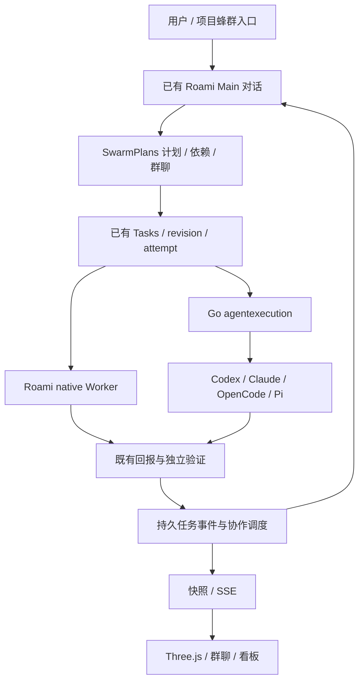

# 技术设计

[返回产品设计](README.md) · 本文描述最终实现，旧兼容方案已按用户要求取消。

## 架构

Main 复用 app.py、core/loop.py、模型设置、记忆与工具注册。创建默认复用节点 Main，也可明确指定普通 Main 对话。Main 工具创建时绑定原用户消息；网页创建投递一次 kickoff 并保存来源，不能另起指挥。额度准入仍由 Go gateway 决定。

## 数据与调度

Python migration 15 新增 swarm_groups、swarm_work_items、swarm_dependencies、swarm_commands、swarm_posts。成员身份存于工作项，首版每名成员关联一个可修订的受管任务；不增加 Go 索引或复制卡片状态。

- owner 与绑定 conversation 必须有效。工作状态实时读取 Tasks 与当前 attempt，群聊发言不能写任务状态。
- commandKey 持久去重，绑定完整请求摘要；相同键不同请求冲突。计划、依赖和控制要求 expectedRevision。
- 工作项经稳定请求键创建 Task，保存 task_id。调度器处理持久 swarm.advance jobs，重启恢复后不重复建任务/会话。
- 硬依赖绑定上游 task revision；只有 succeeded 才满足，指定 artifact 还校验未删除/清理及其 run 所属 revision。派发前和执行前都检查。
- 多上游同时就绪只生成一个下游。上游修订后停止活动下游；修复依赖先确认已停止，再续派原任务，不换 executor。
- unknown 保留原身份和恢复入口，不自动补跑。停止回执固定被取消的 task revision，重放不取消较新的修订。
- 整群完成要求所有工作已验收，且至少一个 integration 项的依赖覆盖全部其他工作。只有执行器报告不构成验证。

## 群聊与 Main 回流

Main 工具包括 swarm_create、swarm_plan、swarm_status、swarm_post、swarm_control、swarm_dependencies。Main 编排操作绑定原对话，成员只可读取所属群与发布绑定当前任务/run/revision 的讨论。

用户发给 Main 的消息进入同一对话；指定成员则通过 Tasks.revisions 继续原任务。投递结果持久保存；不确定投递时前端保留原 commandKey、接收人和 task revision，重试不静默改投 Main。群聊区分待确认与 accepted。

任务结果和需要输入的任务沿已有 completion turn 回到原 Main。普通讨论只写群聊，不逐条唤起模型。快照包含该群关联的 Main replies、成员 posts 与当前结果摘要；完整产物仍在原任务详情。

## HTTP 与 CLI

浏览器只访问 Go 鉴权代理，Python 通过私有 Unix socket：

| 路径 | 行为 |
| --- | --- |
| GET/POST /api/agent/swarms | 目录 / 创建 |
| GET /api/agent/swarms/:id | 拥有者范围快照 |
| GET /api/agent/swarms/:id/events | 既有 conversation events 驱动的 SSE；10s heartbeat 不轮询库 |
| POST /api/agent/swarms/:id/plan | 追加工作项，校验 DAG 与修订 |
| POST /api/agent/swarms/:id/dependencies | 停止确认后的依赖修复 |
| POST /api/agent/swarms/:id/control | pause / resume / stop / archive |
| POST /api/agent/swarms/:id/messages | 用户群聊投递 |

member-posts 只在私有 Unix 通道开放，不挂到公共 Go 代理。CLI new 默认进入此服务，不再需要选择新旧引擎。new 要求 --key、--goal，可用 --main-conversation 指定对话；ls/status/board/feed/collect 读取新数据，plan/dependencies/control/say/post 使用 --file JSON。add/adopt/done/activate/task/sql/listen/watch 与旧 /api/swarms* 路由均移除。

旧 Go internal/swarm、独立 Claude 指挥启动、广场/手动卡片、角色 prompt 模板及 CSS 办公室均删除。项目与搜索改读新模型。安装技能同步更新到 Main/Tasks 协议，不再下载旧指挥文档。历史 schema/备份保持可读取，不删除用户旧会话、工作区或文件。

## 前端模块

| 文件 | 责任 |
| --- | --- |
| Swarm.tsx / NewSwarmModal.tsx | 新目录、路由、创建与 Main 选择 |
| swarm-directory.ts | 节点范围共享 in-flight 目录读取 |
| ManagedSwarm.tsx | 协作、群聊、看板三页签；选择、草稿、详情和动作 |
| useSwarmSnapshot.ts | 首次读取、SSE、sequence 去重、隐藏暂停、断线退避 |
| SwarmStudio.tsx | 动态加载、DOM 标签、减少动画、失效和重试 |
| studio/studio-scene.ts | 几何、材质、动画、拾取、渲染与 dispose |

Three.js 与页面数据完全分离；场景不发请求、不抓终端、不调用模型。独立懒加载 chunk，主题从现有 token 同步，帧中只更新 Three 对象。手机、桌面使用统一 useLayout；粗指针 DOM 命中区至少 44px。软键盘使用统一 --kb，让输入与发送保持可达。

## 验收边界

[验收记录](acceptance.md) 区分概念稿、实际协议/页面检查与真实模型执行。Main 端到端调用返回 MODEL_HTTP_401；未覆盖真实多执行器闭环。桌面 1/8/24 的渲染/暂停/dispose 是诊断，不是 CPU、帧率、内存达标结论。当前不实现相机聚焦、大规模聚合、旧群接管或历史数据转换。

Three.js 官方依据：[WebGLRenderer](https://threejs.org/docs/pages/WebGLRenderer.html)、[Responsive Design](https://threejs.org/manual/pages/responsive.html)、[Cleanup](https://threejs.org/manual/pages/cleanup.html)。
