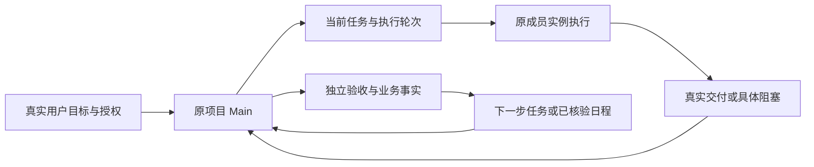

# 长期团队怎样自行推进

## 产品设计

用户向项目 Main 给出持续目标和账号/操作范围；Main 指挥原有长期成员，成员回报真实结果，宿主把回报交回原 Main。用户无需逐个接管设备或在每个阶段重复发“继续”。任务交付、独立验收、对外提交、平台公开和数据入账分别有证据，任何一个成功标签都不能代替后面的结果。

本次改进针对通用 OKR 协作机制，宣传项目只是验收实例，不把 X、B站账号、设备或每日数量写入框架规则。

## 用户故事

- 作为项目负责人，我改变同一成员的工作阶段后，Main 根据其当前指令判断下一步，而不是再次执行最初的接管核验。
- 作为长期成员，我在原实例接收当前有界任务；旧轮次是记忆和证据，不是多组同时生效的任务。
- 作为项目负责人，我能看到停在哪个机制、谁处理、什么证据会唤醒恢复；不需要盯每次点按。
- 作为 Main，我只能在用户已有授权内推进；成员成功声明、旧资料和我自己的任务指令不能产生额外授权。

## 实际机制审计

| 环节 | 已查事实 | 影响与处理 |
| --- | --- | --- |
| 当前任务投影 | CodingExecutor 对原会话提交 continuation.text；GoalContinuityReview 则提交累积 goal，其中包含旧指令及追加历史 | 同一任务的执行输入与“是否欠下一步”判断输入不一致。本轮统一选择规则，保留历史供追溯 |
| 原生内容审核 | 本轮完整冻结正文/ALT读取成功，但专用 review 返回 PUBLICATION_TEXT_NOT_REVIEWED；原生图片与宿主 prompt manifest 也未接通 | #974 跟踪实际原生模型输入证据；不能把工具执行成功直接当作模型看到了正文/像素，也不能伪造批准 |
| Main 投递时序 | 一次用户回合返回 SESSION_NOT_IDLE，随后协调回合接续；普通任务 Runner 有 defer_session_submission，NativeMain 的 launch 路径没有同样恢复策略 | 需独立验证接收、启动前拒绝、未知提交三种情况；只有证明未投递的原请求才能安全重试，不重复输入或重发业务 |
| 阻塞分类 | goal checkpoint 接受真实能力/配置/登录不可用等错误，不接受 PUBLICATION_TEXT_NOT_REVIEWED | 不能简单加入所有错误放行结束。应区分参数可纠正、证据未读取和提供者不支持真实输入证明，暴露具体缺口与恢复条件 |
| 原始成员执行 | 当前成员已复用原 Claude/free 会话；单次 UI 命令并不等于阶段完成 | 开发验收看任务、回执、续派和下一次唤醒，不由开发者逐步替成员导航 |

上表是证据与缺口，不代表所有修复已实现。尤其“旧指令投影不一致”不等于执行器一直提交旧指令；执行器的当前选择本来正确。

## 技术实现：当前指令一致性

`storage/task_instruction.py::current_instruction` 是纯选择函数，与既有执行器语义一致：原 session 且 continuation.text 非空时选该文本，其余使用 goal。它不改用户来源、任务修订、provider、授权、正文或历史。

- `executors/roami_cli.py` 使用这个函数形成实际成员输入。
- `dispatch/swarm_goal_continuity.py` 用同一函数形成 currentOriginalTasks.assignment；不同的累积 goal 留在 assignmentHistory，明确标记为历史。
- 持续目标的 literalGoal、真实 humanSources、当前 task/revision/run、验收及日程证据保持独立。Main 的新任务不覆盖用户限制。
- 现有策略缓存对完整 payload 做指纹；当前指令变化使旧策略失效，不新增未经版本控制的另一个状态源。

## 完整闭环的验收边界

每次交付后必须存在当前原任务、明确的恢复条件或真实未来日程；不能用“稍后继续”、群聊投递、成功标签或无关任务代替。发布未知时只对账同一尝试，不能自动重发。实现中保留用户暂停、上下文隔离、停止证明、工作区串行写与原会话身份。

## 本轮验证

当前指令选择、持续目标缓存、用户后续暂停、成员伪造停止请求和日程等待的专项共 41 项通过。新的集成回归确认：原实例续接时判断器收到当前任务、历史仍可读、任务文本不会变成人类授权、当前指令变化会失效旧缓存。完整检查待运行；本条不声称真实运营闭环或平台发布已完成。

完整检查已通过：Go 全套、Python 5131 passed / 48 skipped / 6 subtests passed（2014秒）、前端 typecheck/i18n/hover/生产构建及扫描通过。完整检查期间只补机制设计与审计 Markdown，运行时代码未改；提交前通过冻结树比较确认仅文档差异，再执行 quick 与提交钩子。以上是机制代码与设计验收，不是平台发布回执。

## 2026-11-19：持续运行的机制、产品与模型

### 产品设计

持续运行表示目标在授权范围内持续推进：有当前执行、可恢复的阻塞处理或已登记的下一次日程。它不要求所有智能体持续生成文本，也不能用进程存活、任务 running 或定时器存在代替真实业务推进。用户暂停立即生效；页面关闭不停止目标，服务重启不新建负责人。

用户只面对原项目 Main。运行页优先回答四件事：当前阶段、负责人、最近已验证结果、下一步及触发条件。正常执行只显示这些；展开详情再看任务轮次、工具记录和恢复证据。需要用户处理时显示具体缺口和一个下一步操作；成员等 Main 验收不能显示为用户尚未批准。历史团队、旧发布和未验证声明不能混入当轮结果。

沿用现有项目/团队页面和任务详情，不增加独立监控首页。运行状态建议收敛为执行中、等待协作、等待日程、恢复中、需要处理、已暂停；这些是由宿主事实推导的展示语义，不在本次 PR 偷换任务状态或承诺已落地 UI。

### 用户故事

- 用户说清持续目标和授权后，原 Main 规划、派工、审核、取数和复盘，不需要每天再说“继续”。
- 成员的问题能交回 Main；原实例保留，Main 的回复与正式续派共同恢复工作。
- 模型或工具暂时不可用时，用户看到真实恢复状态；恢复后继续原任务，不能重复发送平台内容。
- 重开网页看到原团队、已核验成果和下一步。某个渠道有进展不能掩盖其他必需工作始终未启动。

### 技术设计

#### 一条原始身份链

沿用 project → 原 Main conversation → 原 Swarm/delegation → member → task/revision/run → provider/session。成员长期复用，后续动作使用受管 steer；历史 generation 和发布业务键保留。任何模型、消息或观察不能凭显示名换人，也不能创造新发布授权。

#### 三层职责

| 层次 | 必须负责 | 不能替代 |
| --- | --- | --- |
| 宿主机制 | 原身份与准入、持久 jobs、回调、停止证据、幂等、重启恢复、原日程及有界退避 | 不凭超时杀健康执行，不清 busy 伪造恢复 |
| 产品 | 当前阶段、负责人与结果、下一步、阻塞/恢复/暂停，以及可进入的原会话 | 不用常绿 running 或投递成功表示闭环 |
| 模型 | Main 依据当前任务与交接作有界决策，成员执行并交证据，Main 独立验收与复盘 | 不以一句“稍后继续”代替派发，不自行升级权限/换模型 |

模型配置沿用当前用户选择。正常任务模型、原生工具前置分类、独立验收和持续性评估是不同调用，分别保留失败来源。历史分类超时不等于当前任务失败；模型请求成功不等于发布成功。临时调用错误按同一请求与真实提交边界恢复；可能已经提交的调用先对账，不能泛化成重试。原生工具失败缺少正式观察入口的问题继续由 #982 跟进。

Claude 原生 Main 的路由耗尽由宿主按 [原生 API 失败对账](claude-api-failure.md)核验，覆盖直接网关拒绝及网关拒绝导致的自动上下文压缩失败。只有首轮模型调用的可信终止回执、当前租约及授权有效，并且既无工具调用也无已提交回复，自动协作轮才保留同一个 job、turn 和冻结批次，在 1、3、10、15 分钟后依次重试，随后间隔维持 15 分钟。每次执行用递增键并复用原会话和原模型配置。等待保存在 SQLite，重启后继续使用原期限；认领前再次核验授权、暂停和当日有效范围。手动聊天保留明确失败，由用户决定是否再发。

团队群聊和 Main 对话在当前轮等待期间显示下次重试时间，沿用现有快照事件。恢复执行或团队暂停时提示消失。暂停新派发会保留已对账的等待轮，继续派发后重新认领；明确停止和已撤销的授权仍终止执行。成员对话显示各自当前任务。投递、退避和重新认领都不记为业务进展。

#### 恢复升级前已收口的协作轮

宣传项目出现过成员回执已冻结入库、原 Main 却在首个请求上被拒绝的情况。失败前写入的模型清单只能证明输入已经构造。它与旧失败一起保留，在原生证据和当前授权均有效时，宿主可恢复同一个待处理批次。

启动阶段只读取原准备实例最近一次已核实停止的路由拒绝。只恢复仍为该分支最新、只有一个失败模型清单、原绑定和停止摘要均吻合、没有已完成回复或工具调用的协调轮。恢复前重查原委托、工作暂停、停工请求和日槽。同一个 turn、job、成员回执及历史继续保留，通过已登记退避再次认领。正常终止、旧轮次、未知提交、人工消息和已完成执行保持由原入口处理。

#### 闭环与触发

原目标/日期唤醒 → Main 读当前事实并派原成员 → 当前轮真实执行 → 交接与停止证明 → 原 Main 独立验收 → 授权后单次发布 → 平台读回 → Connector 候选/确认 → 看板 → 复盘/记忆 → 原下一轮或已登记日程。

执行、交接、停止、验收、平台回执和数据入账分别留证。同目录写入保护保留；成员需要 Main 指挥时显式申请让出，宿主在真实停止后才运行 Main。停止未知保持保护，平台提交未知只对账。受管让出和缺失完成钩子的对账分别见 [运行中监督](member-supervision.md) 与 [原生伴随记录](claude-completion-companions.md)。

现有 GoalContinuation 会在行动批次收尾前核对真实原任务、登记日程或具体工具阻塞。它目前把原任务 running 视为存在下一步，尚不能证明业务推进；运行中可信观察和非打扰式监督仍属 #979，不能用本 PR 的状态概览替代。监督应复用 Scheduler：仅对当前持续目标选中的原成员检查，证据变化才合并唤醒，无变化退避；暂停/撤销/旧轮次不得重启工作。不增加第二套 cron，不以执行时长作为业务失败。

长期目标的各必需工作流还需有覆盖记录：到期动作、最近已验收业务结果、未决动作和下一次触发。Main 依据实际用户目标分配，不能让一个活跃渠道永久遮住另一个渠道。宣传项目的 X/B站/评论/取数只是实例，框架不写死角色与日发数量。覆盖提醒、可信监督与产品状态投影需要后续独立实现与验收。

#### 本轮实现：让 Main 看清当前协作（#987）

现场大型 swarm_status 快照为 363695 字节，含 14 个当前/历史职责、100 条帖子和 50 条 Main 消息。外置结果只留 4000 字节前缀；Main 为找当前交接多次读取历史附件深处。与此同时，原 Main 协调 turn 已运行并实际调用工具，快照却仍显示 completed：旧查询漏掉协调 continuation。

本次只修这两个可复现的观察入口：

1. 保留外置完整快照的字节/SHA，并额外返回有字节预算的 overview。协调批次按宿主已准入 delegation 的原成员集合筛选；其他调用明确标记为所有注册成员概览。保留 member/task/revision/run、任务与执行状态、原 provider/session，原字段不改写成业务成功。
2. 概览明确 total/hasMore。当前任务用 task_status，待回应消息用 swarm_inbox_read，原成员历史用 swarm_member；正式准入与独立验收仍走原入口。历史不裁剪、不搬迁；完整 artifact 仍可读回。
3. mainState 查询同一已鉴权 Swarm 的原 Main conversation，优先真实 running、其次 queued、最后最近结束。其他项目 turn 和后来排队的消息不能遮盖正在运行的原 Main。

模块：tools/swarm_status_overview.py 负责有界只读投影；registry.py 负责大型结果完整外置与概览；SwarmCoordinationPolicy 仅提供宿主已准入成员用于显示筛选；swarm_repository.py 修正 Main 状态来源。网页与 CLI 的完整历史结构、权限和任务生命周期保持原契约。

### 宣传项目应用与验收

已有原团队保留，不新开管理者。PR984/986 已部署为 okr-native-completion-f99f6524：原 X 的完整结束证据已正式确认，原 Main 由现有收件箱自动进入原生 continuation，随后独立读取留存文件和第一方 XML/图片，通过正式 swarm_verify 验收帖子 2123278996024836500。该自动接回与验收阶段无人给 Main 再发“继续”；此前对账是部署后一次正式恢复，不能将它宣称为全链路已无人干预。

这证明一段回路恢复。B站新发布、两次完整业务循环、取数/看板/复盘/下一次真实日程与运行中监督仍需逐项验证，尚未全自动验收。本 PR 不修改现有运行中的成员或其模型，也不部署未通过门禁的候选。

验收顺序：有界概览和原任务/run → 大历史完整读回 → 协调准入与跨项目隔离 → Main 真实运行状态 → 代码完整门禁 → 对应产物安全部署 → 原团队后续真实读取 → 无人工催促的完整循环。不能把前几步的测试当最后一步通过。

#### 原生 Main 按需读取项目规则

宣传原协作轮的真实重试输入约 358 KB。同一轮自动注入项目流程全文与九份 Skill 正文，之后原生 Main 还会按当前项目要求实际读取它们。运行时已确认进入原生 Main 的自动协作轮时，宿主只自动注入该轮授权团队的记忆、主智能体职责、规则路径和内容哈希。Main 在本轮使用对应工作流之前，从已绑定项目文件或正式项目上下文入口读取所需正文。手动聊天及其他执行路径沿用既有投影。完整指令、存储历史、原用户目标、冻结回执和正式读回入口均仍可用。这样可缩小每轮重复输入，实际模型恢复仍需真实运行验收。

用宣传项目原有的原生请求做只读重放，输入从 357883 字节降到 307249 字节，减少 14.15%。原本的对话、当前冻结批次、团队记忆和 Main 职责均逐字节保留。隔离测试覆盖原授权团队与执行回执、工作流与 Skill 路径和哈希、完整读取入口及普通会话投影。重放未请求模型。

#### #987 本地代码验收

当前协作/状态专项43项及新增真实准入边界组合35项通过；完整检查通过，Python 5169 passed / 48 skipped / 6 subtests（1530.56秒），Go全套、前端typecheck/i18n/hover/生产构建和扫描通过。完整检查期间只追加本设计迭代，运行时源码与冻结树一致。候选对既有原团队快照只读生成概览3076字节、保留4个已选原成员，完整快照仍保留。这是代码/候选验收，尚未部署 #987，不代表运行中监督或完整自动运营已通过。
