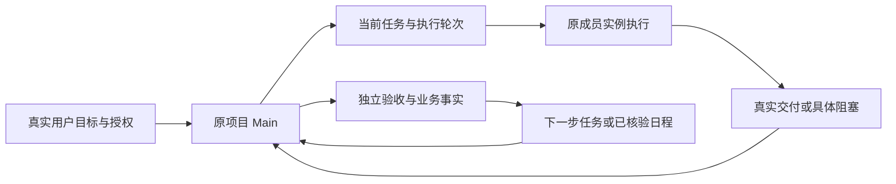

# 长期团队怎样自行推进

## 产品设计

用户向项目 Main 给出持续目标和账号/操作范围；Main 指挥原有长期成员，成员回报真实结果，宿主把回报交回原 Main。用户无需逐个接管设备或在每个阶段重复发“继续”。任务交付、独立验收、对外提交、平台公开和数据入账分别有证据，任何一个成功标签都不能代替后面的结果。

本次改进针对通用 OKR 协作机制，宣传项目只是验收实例，不把 X、B站账号、设备或每日数量写入框架规则。

## 用户故事

- 作为项目负责人，我改变同一成员的工作阶段后，Main 根据其当前指令判断下一步，而不是再次执行最初的接管核验。
- 作为长期成员，我在原实例接收当前有界任务；旧轮次是记忆和证据，不是多组同时生效的任务。
- 作为项目负责人，我能看到停在哪个机制、谁处理、什么证据会唤醒恢复；不需要盯每次点按。
- 作为 Main，我只能在用户已有授权内推进；成员成功声明、旧资料和我自己的任务指令不能产生额外授权。

## 实际机制审计

| 环节 | 已查事实 | 影响与处理 |
| --- | --- | --- |
| 当前任务投影 | CodingExecutor 对原会话提交 continuation.text；GoalContinuityReview 则提交累积 goal，其中包含旧指令及追加历史 | 同一任务的执行输入与“是否欠下一步”判断输入不一致。本轮统一选择规则，保留历史供追溯 |
| 原生内容审核 | 本轮完整冻结正文/ALT读取成功，但专用 review 返回 PUBLICATION_TEXT_NOT_REVIEWED；原生图片与宿主 prompt manifest 也未接通 | #974 跟踪实际原生模型输入证据；不能把工具执行成功直接当作模型看到了正文/像素，也不能伪造批准 |
| Main 投递时序 | 一次用户回合返回 SESSION_NOT_IDLE，随后协调回合接续；普通任务 Runner 有 defer_session_submission，NativeMain 的 launch 路径没有同样恢复策略 | 需独立验证接收、启动前拒绝、未知提交三种情况；只有证明未投递的原请求才能安全重试，不重复输入或重发业务 |
| 阻塞分类 | goal checkpoint 接受真实能力/配置/登录不可用等错误，不接受 PUBLICATION_TEXT_NOT_REVIEWED | 不能简单加入所有错误放行结束。应区分参数可纠正、证据未读取和提供者不支持真实输入证明，暴露具体缺口与恢复条件 |
| 原始成员执行 | 当前成员已复用原 Claude/free 会话；单次 UI 命令并不等于阶段完成 | 开发验收看任务、回执、续派和下一次唤醒，不由开发者逐步替成员导航 |

上表是证据与缺口，不代表所有修复已实现。尤其“旧指令投影不一致”不等于执行器一直提交旧指令；执行器的当前选择本来正确。

## 技术实现：当前指令一致性

`storage/task_instruction.py::current_instruction` 是纯选择函数，与既有执行器语义一致：原 session 且 continuation.text 非空时选该文本，其余使用 goal。它不改用户来源、任务修订、provider、授权、正文或历史。

- `executors/roami_cli.py` 使用这个函数形成实际成员输入。
- `dispatch/swarm_goal_continuity.py` 用同一函数形成 currentOriginalTasks.assignment；不同的累积 goal 留在 assignmentHistory，明确标记为历史。
- 持续目标的 literalGoal、真实 humanSources、当前 task/revision/run、验收及日程证据保持独立。Main 的新任务不覆盖用户限制。
- 现有策略缓存对完整 payload 做指纹；当前指令变化使旧策略失效，不新增未经版本控制的另一个状态源。

## 完整闭环的验收边界

每次交付后必须存在当前原任务、明确的恢复条件或真实未来日程；不能用“稍后继续”、群聊投递、成功标签或无关任务代替。发布未知时只对账同一尝试，不能自动重发。实现中保留用户暂停、上下文隔离、停止证明、工作区串行写与原会话身份。

## 本轮验证

当前指令选择、持续目标缓存、用户后续暂停、成员伪造停止请求和日程等待的专项共 41 项通过。新的集成回归确认：原实例续接时判断器收到当前任务、历史仍可读、任务文本不会变成人类授权、当前指令变化会失效旧缓存。完整检查待运行；本条不声称真实运营闭环或平台发布已完成。

完整检查已通过：Go 全套、Python 5131 passed / 48 skipped / 6 subtests passed（2014秒）、前端 typecheck/i18n/hover/生产构建及扫描通过。完整检查期间只补机制设计与审计 Markdown，运行时代码未改；提交前通过冻结树比较确认仅文档差异，再执行 quick 与提交钩子。以上是机制代码与设计验收，不是平台发布回执。
