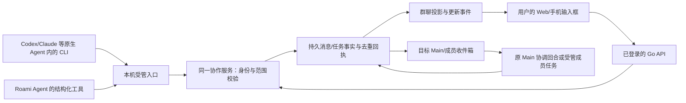

# 统一通信引擎与多个 OKR（设计提案）

先看 [HTML 机制演示](communication-engine.html)。本提案解释 CLI、群聊、Main、成员如何连接，以及一套底层如何服务多个 OKR；不代表新协议已实现。

## 结论

采用一套平台协作引擎，承载多个相互隔离的 OKR 空间。CLI 和 Web 都是客户端；消息由后端持久化、路由和对账，群聊从同一份事实读取。每个 OKR 保留自己的原 Main、Swarm、长期成员、对话、任务与记忆。

这里先将用户所说的“C”按 CLI/底层客户端理解。当前代码是 Go CLI、Go Web 入口与 Python Agent Runtime，不需要为每个 OKR 写一个 C 消息进程，也不让智能体通过临时脚本互相往终端打字。

## 消息具体怎样走

### 1. 成员发普通进展

原生成员在自己的当前执行上下文调用 `roami swarm post <实际SwarmID> --file <请求JSON>`；Roami 成员调用注册的 `swarm_post`。CLI 是发送工具，不维护另一套消息队列，也不直接操控网页。

服务检查真实 Swarm、项目、作者及 task/revision/run，写共享 post 与幂等回执。群聊通过查询/更新事件显示该记录。普通进展不触发每个成员的模型；其他成员可以主动读同群上下文。

普通私有 CLI 回传目前验证 task/run 归属与新鲜度；环境中的角色标记只用于限制调用，不能授予身份。新协议的作者从受管工具/执行上下文取得，不把任意作者字段或本机同用户脚本视作强隔离边界。

原生 Codex/Claude/OpenCode/Pi 的完整终端输出属于各自会话；它不会自动全部广播到群聊。共享的是显式 post、受管任务的结果，以及有明确群聊关联的 Main 回复。进入原生对话使用当前可信 provider 绑定，不根据最近目录或显示名选一个会话。

### 2. 成员提问或报告阻塞

消息正文与目标收件箱在同一事务落定。question/blocker 进入原 Main 的持久收件箱；Main 忙或等待用户时保持待处理，空闲后合并为一个协调回合。进入处理的是团队事件，不冒充新用户消息。

Main 读取相关消息与本轮证据，答复后群聊显示同一线程的回复。若需改变任务，Main 另走受管 steer；“已回复”不表示任务已经完成。

### 3. Main 派工

Main 用 plan/steer 提交有界 assignment，宿主核对原用户目标委托和当前任务身份，然后投给原成员/原 provider 对话。群聊显示这次受管交接的引用与真实回执。

“在群里写 @成员”本身不能伪造任务控制。用户明确选择成员的直接消息仍使用当前原任务通道，未知投递沿用原键对账；不回落首页 Main、不新建替身。

### 4. 成员交付与执行完成

handoff post 和执行器结果可能先后到达。它们关联同一个 task/revision/run/result 身份，沿用已有完成回报入口，只安排一次 Main 处理。成员说“完成了”但尚无执行结果时保留交付，不把任务改成成功。

Main 独立读取并核验后，任务才按宿主验证规则结束。消息发送、送达、获取、答复、任务执行和验收分别留回执。详细授权与故障契约见 [协调回合 v1](swarm-delivery-contract.md)。

## “群聊同一份消息”不等于复制全部私聊

共享 post 仍以 `swarm_posts` 为事实。Main 的实际回复和执行结果已有各自的 messages/events；群聊线程用 sourceKind/sourceId 引用这些事实，不把每次转发再复制成一条新的 human 消息。

投影只接受属于该群的原 Main turn、成员任务与明确的 thread/reply 关联。用户与 Main 的普通私聊、成员原生会话全文，不会因为同属一个项目就全量进入群聊。

同一来源引用在群聊只呈现一次；Main 主动发的进展与最终答复可以是不同内容，但要带清楚的线程关系。自动回报不能再额外制造一条相同的 Main 唤醒。

## 多个 OKR 共用什么，各自隔离什么

| 平台共享 | 每个 OKR 独立 |
| --- | --- |
| CLI/工具协议、Go 登录入口、协作路由服务 | 稳定 OKR scope、原 Main、当前 Swarm |
| 持久消息、收件箱与任务调度的实现 | 成员与 provider 会话、任务/修订/运行 |
| 事件推送、历史分页与恢复算法 | 群聊记录、目标收件箱、读游标与处理回执 |
| 模型网关、插件、通用 Skill 代码 | 项目来源授权、业务 SQLite、记忆和真实交付 |

平台共用实现，不共用 Main 或团队上下文。A 的 Main 忙时，B 可按现有调度容量继续；两个 OKR 若使用同一个账号、设备或 workspace 写资源，仍服从该共享资源的准入和串行协调，不能强行改 busy。

当前主要场景是同一用户在一个节点的多个项目 OKR。owner/node 进入范围绑定，不据此宣称已经交付多租户或跨节点消息联邦。

### 范围登记

宿主维护稳定的 OKR scope 绑定：owner/node、注册项目、定义目录、原 Main、当前 Swarm 与生命周期。客户端持有实际 Swarm/任务引用，宿主反查并校验 scope，不用名称、cwd 或当前选中的页面替代身份。用户可以主动访问自己拥有的其他 OKR；范围隔离针对已绑定的 Agent 消息/任务与误投，不把用户正常切换项目说成越权。

现有一项目一 OKR 注册默认 scope，保留原 project/Main/Swarm/member/provider ID 和 `.roami/okr` 目录。首版按多个注册项目的独立 OKR 验收；范围模型预留同项目多个 scope，但启用前必须同步扩展 project_okr、记忆和 Main/provider 绑定接口，不能只多加一条登记就宣称可用。新增独立 OKR 时明确登记定义目录/Main/团队，不把 KR、同名目录或普通分支自动认成新 OKR。只有一个 scope 时界面不增加选择器。

### 同名与幂等

当前 `swarm_groups` 的 `UNIQUE(owner_id,name)` 会阻止同一用户在两个 OKR 使用相同团队显示名。新设计使用稳定身份定位，显示名可以重复；不将 A 的“运营团队”当成 B 的“运营团队”。

定义目录相对真实注册项目根，不能因为 Agent 从 Roami 源码 worktree 启动就把宣传归回源码项目。项目 Main 与首页 Main 保持独立；旧绑定缺失时核对可信会话/项目台账，不按最新目录猜测。

CLI 全局名称匹配有歧义时返回可识别的范围与候选，不自动取最新或前缀匹配；页面和 Agent 使用已经绑定的稳定 ID。旧 ID、历史和回执在约束迁移中全部保留。

消息业务键按 scope/真实作者及执行身份分域。A 与 B 即使使用相同本地 messageKey 也互不影响；A 内同键改内容仍冲突。旧协议回执保持可查，不能在升级时换命名空间重投旧请求。

### 错投与切页

每条消息在提交时固定其原 scope，后端同时校验收件人和任务属于该 scope。错投在落库前拒绝，不留一条看似成功的群消息。

浏览器切换到 B 后，A 的晚回响应仍只属于 A。事件订阅、缓存、pending 请求和应用结果的代次都包含 node/scope/group；旧事件不能写进 B 的聊天列表、清掉 B 的输入或打开 B 的原生会话。

## 共享服务的持久对象

沿用现有运行时数据库与事实表，增加 scope 绑定、消息分类/目标、线程来源引用和 inbox/delivery 记录。群聊不用项目看板的 SQLite 充当消息服务器。

核心索引围绕 scope/group/消息序号、接收方/待处理状态以及来源 task/revision/run/result。协调领取与创建 Main job 在同一事务内完成，进程退出后沿用原批次和递送键。

当前 SSE 推送的是群状态快照，不能把“收到最近快照”当成全部历史无缺口。新机制的可靠性来自持久消息与收件箱：断线后按范围和游标恢复，历史有分页；需要重建投影时先重读快照/消息页。Main 输入只读当前待处理批次与相关证据，不把整群历史反复塞进上下文。

## 第一批实现边界

1. 先交付 scope 绑定/同名约束迁移与原身份恢复，补两个 OKR 并行和错投回归。
2. 将群聊线程、CLI/tool 与完成回报接入统一事实/投影，保持人的 say 和 Agent post 署名区别。
3. 增加持久收件箱和受限协调回合，复用完成去重；普通 completion 保护保持。
4. 在原宣传项目用一项真实数据交接验证 Main 接收、答复/续派和独立验收；再提炼项目 Skill 和通用模板。

HTML 中的入队、逐跳投递、忙碌恢复与多 OKR 隔离仅为机制演示。代码完成后仍需隔离故障注入、真实 roami chrome 操作与原团队当前轮次证据。
