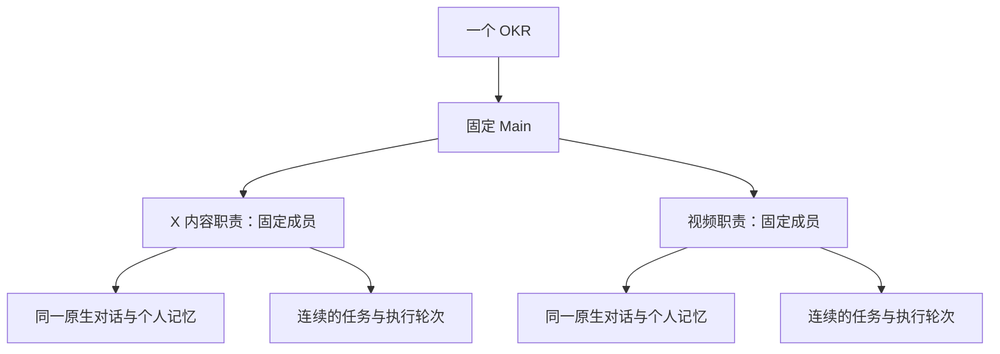

# 长期成员与执行轮次

关联 [#656](https://github.com/ybz21/Roami/issues/656)。这是下一阶段设计，尚未表示宿主已完成迁移。

## 产品设计

一个 OKR 有一个长期 Main，每个职责有一个长期成员。成员不是某一轮任务的名字：工作改变，成员身份、原生对话和个人笔记继续保留。默认团队只展示职责与当前实例，历史轮次从该成员进入，不把 x-content-r2 这样的历史工作项当作新的职责。

群聊默认交给 Main。Main 根据真实成员身份继续其任务，成员收到请求后在原对话执行；用户也能直接进入该原生对话。未派发任务不等于没有成员，成员身份应能独立于任务存在。

## 用户故事与验收

- 连续三轮追加同一职责的工作，成员数量不变，原生对话身份不变，三轮的实际产物和验收分别保留。
- 成员等待依赖或用户验收时仍能预览和交流；空闲不等于任务已完成，完成一轮也不自动关闭成员。
- 关闭页面再回来仍是同一个成员；终端断开后恢复同一个原生 provider conversation。物理终端可以重建，长期对话身份不能偷偷替换。
- 旧写入结果不明时，报告阻塞并核对已有结果，不重复派发，不创建同职责替代者。
- 首页 Main、项目 Main、成员分别处理自己的消息；跨实例仅显式转交并保留来源与返回通道。

## 技术设计

当前模型以 swarm_work_item 绑定一个 task，task_revision 再绑定 attempt。原 task_steer 已保持 task/native branch；CLI 会话存在时可继续原 session。但 Main 为失败任务另建成员、未派发成员没有实例、终端消失后的原生会话恢复，都不能只靠改展示名解决。

下一阶段分离三层身份：

| 层 | 持久信息 | 不随新一轮变化 |
| --- | --- | --- |
| 职责成员 | stable member ID、所属 OKR/Swarm、职责、执行器 | 身份与个人记忆位置 |
| 智能体实例 | Roami conversation 或可信 provider conversation、项目与工作区 | 对话上下文及来源 |
| 任务/轮次 | task/revision/run、依赖、输入、产物、回执与验收 | 历史记录不可覆盖 |

新一轮优先继续该成员原任务/实例，而非增加成员；新增真正的职责与追加任务应在协议上明确区分。尚无任务的职责也需要可预览的成员身份，不能借占位的成功任务伪造初始化。

宿主保存成员到原生对话的真实绑定，恢复时验证 owner/node/project/member、执行器、原对话、工作区及停止/结果证明。不能从显示名、目录或最近活跃会话猜测。恢复由现有 Go 会话与工作区控制实现，保留原生生命周期、写入围栏和幂等回执；Python 不另造终端控制器。

团队记忆在 `.roami/okr/memory/team.md`，重要事项在 `decisions.md`，个人笔记在 `members/<stable-member-id>/memory.md`。文件知识与原生上下文互补，不能替代交付证据。

## 历史迁移

对当前重复职责先提交显式映射：固定职责、保留的当前实例、历史工作项。独立核对 task/revision/run、原生对话与资源状态，再做 CAS 变更；保留所有旧任务、文件、验收和消息来源。不得正则裁掉名字后缀就推断同一个职责，也不得把运行中或 unknown 的旧实例直接关闭、移动或标记完成。

当前只读核对的两个新轮次实例都仍可解析且停在 Codex 提示符，宿主分别为 waiting_user 与 unknown。后者虽然报告候选成片，也不据此修改宿主状态；当前实例保持原样，等待可信回执核对。此阶段尚未实现独立成员实体或迁移操作。
