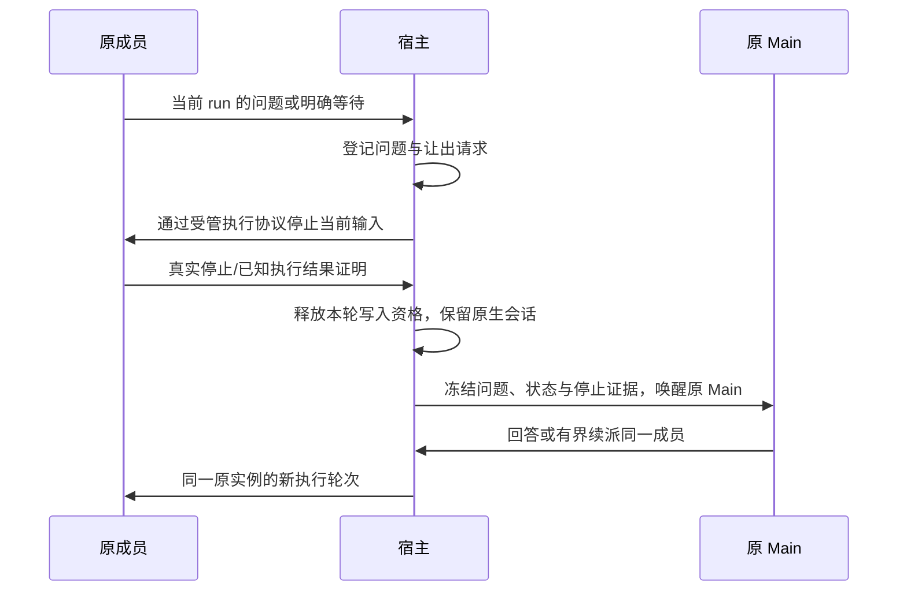

# 原 Main 的运行中监督与成员让出

## 产品设计

持续目标需要 Main 在成员卡住时接回指挥，而不只在成员最终结束后才出现。用户不应替 Main 盯原生界面、逐次点按或重复催“继续”。成员等待指挥时，原实例和记忆保持，当前工作有明确的让出与接续回执。

本设计不取消项目写入隔离，不以工作时间长短判失败，不增加全局 cron 或替换 Main。适用所有 OKR，宣传项目用于验证。

## 用户故事

- 成员提出具体问题后，Main 能回复；成员无须一边占着项目写入资格，一边无限等待 Main。
- 成员原生客户端进入已识别的等待/拒绝状态时，宿主能形成真实观察并触发监督，而不是永久只显示 running。
- Main 回答后，原成员在同一原生会话继续；任务轮次、审核版本和发布业务键不串到其他项目或旧 run。
- 用户暂停时，监督静默；未知外部提交只对账，不重发。

## 代码核验与因果链

1. `storage/swarm_inbox.py` 只将 question、blocker、handoff 等需要回应的消息送入 Main 收件箱；普通 progress 不唤醒，避免每条进度都触发模型。这部分行为有合理目的。
2. `storage/swarm_goal_start.py`、`swarm_daily_goal.py`、`swarm_completion_bridge.py` 和 `swarm_inbox_wakeup.py` 分别处理首次启动、日期唤醒、完成与收件箱。当前没有运行中监督观察任务。
3. `GoalContinuation.active_next_steps` 把当前 running 原任务当成已存在的下一步。这证明任务在运行，不证明业务持续推进或不存在原生等待。
4. `dispatch/scheduler.py` 将 native Main 的 turn.run 与成员 task.run 都纳入 occupied_directories；同目录成员在运行时，Main 被延后。
5. `internal/agentexecution/session-lifecycle.go::continueSession` 也要求 claimWorkspace 后才能提交新原生输入。只改 Python 排队条件，Go 写入保护仍会拒绝；同时删除两处保护则引入写冲突。

因此存在可能的互等：成员等待 Main → 成员仍 running/占目录 → Main 无法启动 → 成员无法得到回答。增加一个 Main 定时器无法单独解决它。

## 技术设计

### 原生观察接口

原生适配器输出绑定 project/Main/member/task/revision/run/provider 的观察：当前模型活动、工具活动、已识别的原生等待/拒绝、最后业务回报和已知错误。执行活跃、成员自述、业务进展、输入停止和平台事实分别保留。宿主未识别的界面不得猜成权限拒绝或批准。

复用 Go 的原生状态/停止证明入口及 Python 的事件、jobs，不让新的观察器直接读写生命周期文件。观察和模型输入证明是不同接口；后者缺口由 #974 处理。

### 有界监督

拟新增 `storage/swarm_supervision.py` 管理带 delegation/revision/run 的观察 job 与幂等回执，`dispatch/member_supervision.py` 处理有界检查；接入现有 Scheduler，不加第二套 cron。

只覆盖明确持续目标选中的当前成员，Main 不忙且证据有变化时合并唤醒；无变化退避。暂停、撤销、归档、换 revision/run 后，旧观察失效。监督周期只决定何时检查，绝不是任务执行超时，更不能据此杀视频编码、模型思考或未知提交。

只增加唤醒还不够：观察必须与下面的让出协议衔接，否则 Main 仍被同目录写入资格挡住。

### 成员让出协议

初版使用 `storage/swarm_member_yield.py`：当前 run 的注册 question/blocker 或可信原生等待事件 → 幂等请求让出 → 通过现有执行控制入口停止当前输入 → 校验真实停止证明 → 持久保存等待 Main 的状态 → 允许冻结协调批次并运行 Main。

让出不能仅靠提示词要求“请自行结束”，也不能把发消息成功当成已经释放。实现须明确区分：

- 原生输入停止仍未知：保留写入保护，不启动新写者，登记实际恢复事件。
- 输入已停止、平台提交未知：原平台尝试仍 unknown，Main 可续派同一成员做只读对账，不能再次提交。
- Main 已回复：沿用既有 task_steer 与 provider 绑定，新 revision/run 保留前轮来源和发布业务键，不重建成员或原生会话。

等待 Main 应有明确语义，不能冒充用户尚未批准、任务失败、任务完成或平台已发布。新增状态如涉及产品展示，需沿用现有 i18n/任务状态组件，并完成相应验收。

### 授权与原生能力边界

Main 的回答仍受真实用户授权限制。成员帖子、观察器、Main 新指令或被停止的旧 run 都不能产生额外账号权限、发布同意或跨项目控制。原生提供者不能证明让出时，明确报告能力缺口，不强制清 busy、不删除目录锁、不造停止回执。

## 验收标准

1. 原成员在运行中提问后，宿主自动完成受管让出；原 Main 自动收到同一问题并回复，原成员在原 provider 中接续，期间无人发“继续”。
2. 已识别原生等待可自动形成真实观察；健康长任务不会因为时长被停止。
3. 模拟服务重启、重复观察/问题、迟到 Stop、旧 revision/run 与其他项目回执，不发生重复输入、双写或串任务。
4. 原生停止未知保持保护；平台提交未知保持同一尝试并只读对账。用户暂停后不唤醒模型。
5. 最后以“制作→独立审核→原通道提交→平台回执→取数→复盘→下一轮”的真实运行验证，不能只凭 job 建立、任务 running 或群聊投递验收。

## 状态

这是基于实际代码的机制设计；显式让出初版正在实现，监督观察部分尚未实现。#975 对齐当前指令投影、#977 修复 Main 启动前忙闲竞争，均不能替代本协议，也不等于 #974 的原生输入证明已接通。

### 实施收敛：显式申请让出，不隐式取消所有提问

第一步复用任务绑定的 `swarm_post` / `roami swarm post --file`，为 question/blocker 增加显式 `yieldToMain: true`，携带当前问题与稳定 messageKey。普通问题可以是不阻塞其他工作的讨论，不一律停输入；只有显式等待 Main 的回报请求让出。旧宿主未提供该字段时，Skill 明确报告缺口，不猜命令。

事务中核验当前原成员、task/revision/run、原 Main 与持续目标，幂等保存问题、原有 swarm_commands 消息回执和 task.yield 控制 job；先返回 acceptedOnly，不宣称已停止。原生成员的公开回报通过当前 Swarm 消息事务落账，不同于原生 Main 的 tool_calls 路径；不能等待不存在的同名工具回执。控制 job 必须核验已经提交的原消息及命令回执，才通过既有取消执行入口请求停止。禁止原始生命周期文件或 busy 写入。

可以复用已有 interrupted 状态表达“当前输入已让出”，但必须有 `yieldedToMain` 原因和真实停止证明，不能标成用户放弃任务、业务完成或等待用户批准。若该语义无法由现有组件清楚表达，再显式增加等待 Main 状态并完成产品验收，不靠未经记录的临时字段遮盖。

普通用户停止、暂停与新 steer 必须覆盖旧让出请求；旧 job、旧 revision/run 或已撤销目标不能在稍后恢复成员。只有原 Main 真正回答并通过既有 task_steer 才产生下一轮；等待 job 不自动生成替代任务。原 provider/会话保留。

单独的让出实现只解决协作互等；原生异常观察、有界监督和模型输入证明仍分别验收，不能提前关闭本设计对应的 #979。

### 真实观察的范围（2026-11-19）

只读检查当前原 X 执行：Go 状态为 running、result 为空、progress 摘要为空；同一原生 provider 的近期模型请求及用户/助手记录仍在更新，未见新的 API 错误。这只能说明宿主缺少业务进展投影，不能据此断定客户端已死或允许自动超时终止。隔离目录准入复现确认了另一独立事实：同目录成员 running 会推迟 Main，成员停止后该目录才可准入。监督实现必须区分这两类证据，不用“运行太久”替代停滞证明。

实施模块：storage/swarm_member_yield.py 负责请求、当前身份及落账回执校验；既有 SwarmPlans.post 的消息事务原子建立让出 job；Scheduler 的 control 组处理它；Runner 在真实停止后登记 interrupted/awaiting_main 原因。以实际取消事件身份识别让出，后来的普通用户停止或 steer 事件覆盖旧请求，不把所有 cancelling 误认成让出。Main 回答后仍走原 task_steer。初版代码已接入，当前验证结果见下节；尚缺原生会话端到端验证及生产验收，不能宣称可用或关闭 #979。

### 初版实现验证（待完整检查与生产验收）

当前实现覆盖显式 yieldToMain 消息、同事务持久化、原请求幂等、当前目标/成员/task/revision/run 校验、已落账命令回执核验、受管停止、目录保留、后到停止证明对账、原 Main 排队与原实例下一轮。新增停止证明未知时保留 cancelling 和目录占用；原执行监控继续对账同一 launch key，不生成替代任务。停止证明从未知变已知使用独立执行回执与核验事件身份，保留原观察，不覆盖成成功。普通用户停止事件覆盖旧让出请求。

29项让出专项及190项Python组合回归、CLI传输专项与ruff通过。其中原生停止回执由测试桩提供；调度器、数据库、Main问题批次和续派逻辑真实运行。保留原session/provider来源得到宿主元数据联动验证，尚未以真实原生客户端完成生产验收，不能把该回归当作平台发布或完整自主运营证明。

未完成：可信原生异常观察、非打扰式运行中监督、生产实例接续和业务闭环；#974的原生模型输入证明也独立未完成。先前完整检查在重启窗口回归失败后主动停止，不能作为通过记录；修正后的源码已重新执行完整检查并通过。本段不声明已部署。

### 重启与停止观察的恢复

服务可能恰好在让出请求已提交、Python task.run job 尚未收尾时重启。若恢复器只处理 preparing/running，残留 running job 会阻止 CodingExecutor.poll 观察 cancelling 原执行。恢复器现在只收尾相同 task/revision/run 的旧 Python 准入 job，由既有原生监控继续读取同一 launch key；不重新提交输入，不生成新会话，也不推断输入已停止。

“已请求停止”与“仍被允许让出给 Main”分别判断。即使用户后来停止任务或撤销目标，也必须继续对账原执行的真实停止证明、维持未知状态时的写入保护；只有原目标和原取消事件仍有效，已知停止才标记 yieldedToMain。用户停止或撤销后得到真实证明，正常收尾取消，不恢复旧目标。旧未知观察保留于执行回执，不改写成已知成功。

回归覆盖上述重启窗口、停止证明缺失/为假再补齐，以及用户停止/目标撤销后补证明。以上测试使用隔离数据库与受控 Go 回执；真实原生适配器接续和业务闭环仍需独立验收。

### 完整检查结果

修正后的冻结源码通过 full：Go 全套、Python 5165 passed / 48 skipped / 6 subtests passed（1661.85秒）、前端 typecheck/i18n/hover/生产构建、Secret scan 与 staged file policy。运行时代码在这次检查期间未改。提交前只补本机制文档的实际结果，比较冻结树确认运行时相同，再执行 quick 和提交钩子。

这是显式让出、停止恢复和调度原语的代码验收；原生停止回执在联动测试中仍为受控 fixture，尚未部署。运行中监督、原生诊断桥接、对用户和 Main 的等待原因投影、真实原生接续及业务闭环继续由 #979/#982 跟进，不能据此关闭它们。

### 收敛下一步：先区分历史错误与当前可恢复等待

真实原 X 的下一轮出现过分类失败，之后又有成功工具结果，说明 reportedToolError 不能直接触发停止。native-tool-diagnostics.md 的宿主事件只保留历史来源。本节是 #979 的下一步设计，尚未实现控制器，不能将其作为上线功能。

Go 观察层还需给出同一原 provider/prompt 的最新工具调用/结果、较晚的成功或新活动、实际未决调用及稳定来源标识。已完成结果优先走既有对账；只有历史错误、耗时或客户端活动时，均不得推断当前阻塞。新观察抵达后使旧决策失效；旧run、已暂停/撤销目标和其他项目不进入恢复。

复用现有只返回结构化 verdict 的宿主模型评估方式，拟在 dispatch/member_supervision.py 对真实观察做有界判断，而非新建团队负责人或把原 Main 原生会话并发写入同一目录。评估读取原目标、当前任务、业务未决状态和来源，只可建议继续观察、等待已登记恢复或申请受管让出；它不执行工具、不产生发布批准、不替成员发问题，不改变既有模型路由/参数/权限。每组新的真实来源最多登记一次评估，无变化不重复调用；调用失败按既有调度退避。

宿主必须再次核对当前来源与原身份，只有仍满足明确恢复条件的建议才可转为控制 job。主机观察源使用真实事件ID，独立于成员 post 和注册 tool_call；不得冒用它们的身份。原取消/让出协议应显式支持此来源类型，事务验证原目标、原轮次与来源，再请求停止。完成证明未知仍保留原目录，不恢复旧目标。当前原生适配器不能证明安全让出时不自动取消；需要先补适配与隔离/真实客户端回归，再开放该提供者的自动控制能力。

原 Main 只在真实停止证明后接回控制、解释阻塞并正式续派同一 provider。平台提交未知的下一轮只对账原尝试；这与执行取消结果是否已知分开。监督决策和最终业务验收分别留证，未进行真实原生端到端验证时保持 #979/#982 开放。产品主视图只显示当前动作、下一步、恢复或需要处理；历史诊断留在执行详情。
