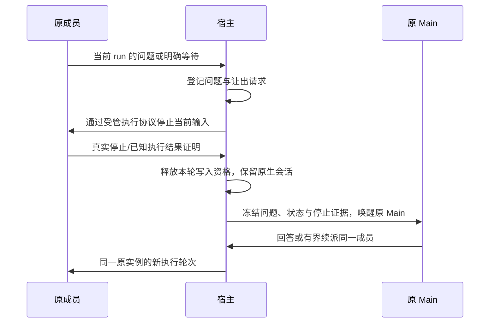

# 原 Main 的运行中监督与成员让出

## 产品设计

持续目标需要 Main 在成员卡住时接回指挥，而不只在成员最终结束后才出现。用户不应替 Main 盯原生界面、逐次点按或重复催“继续”。成员等待指挥时，原实例和记忆保持，当前工作有明确的让出与接续回执。

本设计不取消项目写入隔离，不以工作时间长短判失败，不增加全局 cron 或替换 Main。适用所有 OKR，宣传项目用于验证。

## 用户故事

- 成员提出具体问题后，Main 能回复；成员无须一边占着项目写入资格，一边无限等待 Main。
- 成员原生客户端进入已识别的等待/拒绝状态时，宿主能形成真实观察并触发监督，而不是永久只显示 running。
- Main 回答后，原成员在同一原生会话继续；任务轮次、审核版本和发布业务键不串到其他项目或旧 run。
- 用户暂停时，监督静默；未知外部提交只对账，不重发。

## 代码核验与因果链

1. `storage/swarm_inbox.py` 只将 question、blocker、handoff 等需要回应的消息送入 Main 收件箱；普通 progress 不唤醒，避免每条进度都触发模型。这部分行为有合理目的。
2. `storage/swarm_goal_start.py`、`swarm_daily_goal.py`、`swarm_completion_bridge.py` 和 `swarm_inbox_wakeup.py` 分别处理首次启动、日期唤醒、完成与收件箱。当前没有运行中监督观察任务。
3. `GoalContinuation.active_next_steps` 把当前 running 原任务当成已存在的下一步。这证明任务在运行，不证明业务持续推进或不存在原生等待。
4. `dispatch/scheduler.py` 将 native Main 的 turn.run 与成员 task.run 都纳入 occupied_directories；同目录成员在运行时，Main 被延后。
5. `internal/agentexecution/session-lifecycle.go::continueSession` 也要求 claimWorkspace 后才能提交新原生输入。只改 Python 排队条件，Go 写入保护仍会拒绝；同时删除两处保护则引入写冲突。

因此存在可能的互等：成员等待 Main → 成员仍 running/占目录 → Main 无法启动 → 成员无法得到回答。增加一个 Main 定时器无法单独解决它。

## 技术设计

### 原生观察接口

原生适配器输出绑定 project/Main/member/task/revision/run/provider 的观察：当前模型活动、工具活动、已识别的原生等待/拒绝、最后业务回报和已知错误。执行活跃、成员自述、业务进展、输入停止和平台事实分别保留。宿主未识别的界面不得猜成权限拒绝或批准。

复用 Go 的原生状态/停止证明入口及 Python 的事件、jobs，不让新的观察器直接读写生命周期文件。观察和模型输入证明是不同接口；后者缺口由 #974 处理。

### 有界监督

拟新增 `storage/swarm_supervision.py` 管理带 delegation/revision/run 的观察 job 与幂等回执，`dispatch/member_supervision.py` 处理有界检查；接入现有 Scheduler，不加第二套 cron。

只覆盖明确持续目标选中的当前成员，Main 不忙且证据有变化时合并唤醒；无变化退避。暂停、撤销、归档、换 revision/run 后，旧观察失效。监督周期只决定何时检查，绝不是任务执行超时，更不能据此杀视频编码、模型思考或未知提交。

只增加唤醒还不够：观察必须与下面的让出协议衔接，否则 Main 仍被同目录写入资格挡住。

### 成员让出协议

拟新增 `dispatch/task_yield.py`：当前 run 的注册 question/blocker 或可信原生等待事件 → 幂等请求让出 → 通过现有执行控制入口停止当前输入 → 校验真实停止证明 → 持久保存等待 Main 的状态 → 允许冻结协调批次并运行 Main。

让出不能仅靠提示词要求“请自行结束”，也不能把发消息成功当成已经释放。实现须明确区分：

- 原生输入停止仍未知：保留写入保护，不启动新写者，登记实际恢复事件。
- 输入已停止、平台提交未知：原平台尝试仍 unknown，Main 可续派同一成员做只读对账，不能再次提交。
- Main 已回复：沿用既有 task_steer 与 provider 绑定，新 revision/run 保留前轮来源和发布业务键，不重建成员或原生会话。

等待 Main 应有明确语义，不能冒充用户尚未批准、任务失败、任务完成或平台已发布。新增状态如涉及产品展示，需沿用现有 i18n/任务状态组件，并完成相应验收。

### 授权与原生能力边界

Main 的回答仍受真实用户授权限制。成员帖子、观察器、Main 新指令或被停止的旧 run 都不能产生额外账号权限、发布同意或跨项目控制。原生提供者不能证明让出时，明确报告能力缺口，不强制清 busy、不删除目录锁、不造停止回执。

## 验收标准

1. 原成员在运行中提问后，宿主自动完成受管让出；原 Main 自动收到同一问题并回复，原成员在原 provider 中接续，期间无人发“继续”。
2. 已识别原生等待可自动形成真实观察；健康长任务不会因为时长被停止。
3. 模拟服务重启、重复观察/问题、迟到 Stop、旧 revision/run 与其他项目回执，不发生重复输入、双写或串任务。
4. 原生停止未知保持保护；平台提交未知保持同一尝试并只读对账。用户暂停后不唤醒模型。
5. 最后以“制作→独立审核→原通道提交→平台回执→取数→复盘→下一轮”的真实运行验证，不能只凭 job 建立、任务 running 或群聊投递验收。

## 状态

这是基于实际代码的机制设计，尚未实现。#975 对齐当前指令投影、#977 修复 Main 启动前忙闲竞争，均不能替代本协议，也不等于 #974 的原生输入证明已接通。

### 实施收敛：显式申请让出，不隐式取消所有提问

第一步拟提供任务绑定的 `swarm_yield` 能力，携带当前问题与稳定 messageKey。普通 `swarm_post(question)` 可以是“不阻塞其他工作的问题”，不一律停输入；确需等待 Main 时使用让出能力。旧宿主未提供该能力时，Skill 明确报告缺口，不猜命令。

事务中核验当前原成员、task/revision/run、原 Main 与持续目标，幂等保存问题和 `task.yield` 控制 job；先返回 acceptedOnly，不宣称已停止。控制 job 必须等这次注册能力调用的成功结果已持久化，才通过既有取消执行入口请求停止，避免自行中断尚未落账的能力调用。禁止原始生命周期文件或 busy 写入。

可以复用已有 interrupted 状态表达“当前输入已让出”，但必须有 `yieldedToMain` 原因和真实停止证明，不能标成用户放弃任务、业务完成或等待用户批准。若该语义无法由现有组件清楚表达，再显式增加等待 Main 状态并完成产品验收，不靠未经记录的临时字段遮盖。

普通用户停止、暂停与新 steer 必须覆盖旧让出请求；旧 job、旧 revision/run 或已撤销目标不能在稍后恢复成员。只有原 Main 真正回答并通过既有 task_steer 才产生下一轮；等待 job 不自动生成替代任务。原 provider/会话保留。

单独的让出实现只解决协作互等；原生异常观察、有界监督和模型输入证明仍分别验收，不能提前关闭本设计对应的 #979。

### 真实观察的范围（2026-11-19）

只读检查当前原 X 执行：Go 状态为 running、result 为空、progress 摘要为空；同一原生 provider 的近期模型请求及用户/助手记录仍在更新，未见新的 API 错误。这只能说明宿主缺少业务进展投影，不能据此断定客户端已死或允许自动超时终止。隔离目录准入复现确认了另一独立事实：同目录成员 running 会推迟 Main，成员停止后该目录才可准入。监督实现必须区分这两类证据，不用“运行太久”替代停滞证明。
