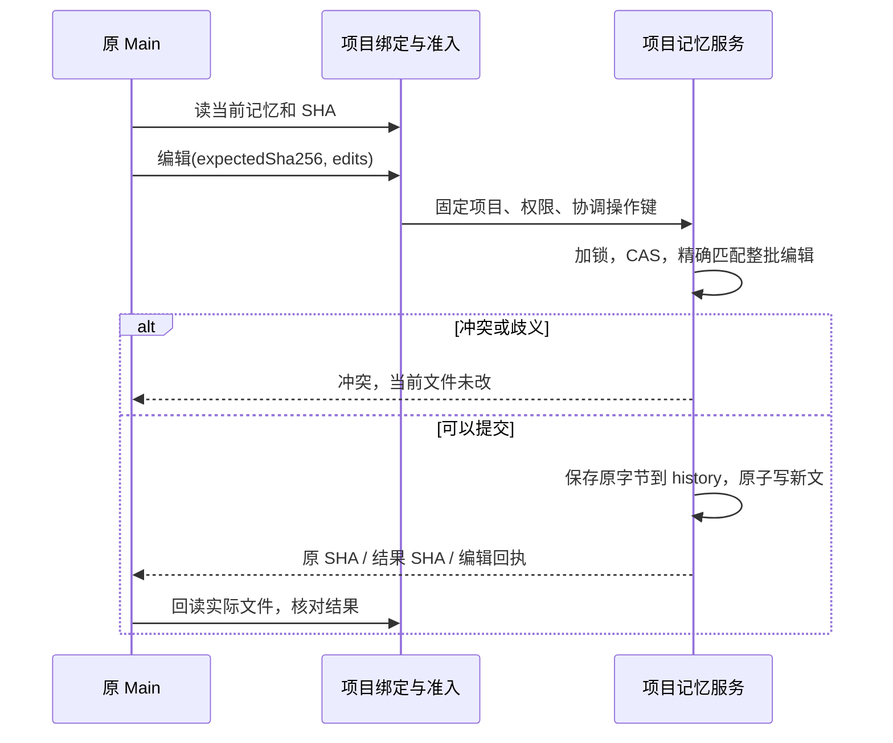

# 当前团队约定的局部修改

状态：核心、迁移与 Main 工具已实现，正在检查；尚未部署。关联 #822、#656、#761。

## 产品设计与用户故事

长期团队记忆包含当前约定和历史事实。Main 更正一条约定时，不能只在末尾追加相反说明，再报告原段落已经修改。真实项目已出现此问题：CAS append 成功，下一轮使用新目录，但记忆顶部旧目录规则仍然存在。

现有完整 CAS 替换能够改文档，不过一行修改需要模型重新输出约 44KB 的记忆。新增小范围受管编辑，让 Main 提交当前 SHA 与精确旧文/新文；宿主完成替换、归档和回执。用户仍只与 Main 讨论规则，不增加配置页面或日常确认步骤。

- Main 能更正当前规则，不搬动已冻结或历史文件，不丢其他成员的记忆。
- 另一个成员在读取后追加新事实，Main 的旧 SHA 会冲突；重读后合并，不能覆盖新事实。
- Main 遇到返回丢失时查原操作，不用新键重新编辑；“已追加”“已修改”“冲突未改”是不同结果。

## 技术设计

### 输入与匹配

Go 原项目 memory 接口增加 `mode: "edit"`，字段为 `expectedSha256`、`edits` 与持久 `operationKey`。模型工具由宿主按原 Main 回合/协调批次固定键，不让模型自行换键重试；开发 CLI 保存同一真实编辑的键。edit 不混用 content；append/replace 不接受 edits。每项为 `{oldText,newText}`，不提供路径、SQL、正则或可执行代码。

- oldText 非空且不同于 newText；最多 16 项，总输入和最终记忆都受现有字节上限约束。
- 所有匹配都针对同一份原文：每项必须精确出现一次，匹配区间不能重叠。先验证整批，再按逆序位置替换，避免前一项生成后一项的目标。
- SHA 不符、旧文不存在/重复、重叠或超限时整批不写。旧文和新文保持 UTF-8 字节语义，不进行模糊匹配、Unicode 折叠或自动换行转换。
- 被替换原文完整存于 memory/history/<原SHA>.md。若需要在当前文档保留历史说明，由 Main 明确把它写进 newText；宿主不自行改写知识。

### 模块与版本

`backend/okr` 增加记忆编辑实现，复用 bundle 锁、路径检查、原子文件写入与 project_operations 回执。HTTP 和开发 CLI 的 memory help 明确三种模式；当前 workspace 提供 memoryEditsSupported 信号。旧宿主没有该信号时不把 append 降级成“编辑成功”。

现有 project-okr schema3 的表约束只允许 review/observation/memory_append。实施采用 schema4 事务迁移，扩展 memory_edit，逐字保留原 intent/receipt、时间、键和 rowid，并恢复两条不可变触发器；不伪装成 append，也不改账目库或 Python schema。发布前先用旧兼容入口备份 schema3，再启动新入口迁移；迁移到4后只允许兼容4的 Go 入口恢复服务，不拿旧入口或旧备份覆盖新增事实。

`project_okr_memory_edit` 绑定本项目，输入没有 projectId 或文件路径。Swarm 提供同义编辑能力，绑定当前团队和原 Main；工作成员只有读权限。协调批次使用独立的稳定 memory_edit 操作键，既有 append 语义保留，不扩大 shell、项目或账号权限。

普通 Main 可调用项目能力；已授权的协调回合通过其实际目录调用团队编辑能力。发现、帮助和拒绝恢复明确区别：append 添加新知识，replace 提交完整文档，edit 只修改明确匹配的片段。

### 持久回执与恢复

请求摘要固定 edits，不把重试时的新 CAS 当新意图。首次检查当前 SHA 后，将计算出的结果与前后摘要作为 prepared 意图持久保存，再写 history/当前文件并完成回执。

- 同键、同编辑返回原回执；同键改编辑冲突。
- 写文件后回执未落盘，重试通过当前结果 SHA 或后续 history 中的结果 SHA 识别已执行，不重复改动。
- 后来已有新知识，旧操作返回原回执和当前读状态，不能把当前文件恢复成旧结果。
- 回执返回前后 SHA、记录时间与编辑身份；读回明确给出当前 SHA。一次局部修改不返回完整 OKR 工作区或让模型复制全部记忆。

## 验收计划

1. 精确单处/多处编辑，未修改字节保持一致，历史保留原文件。
2. 旧 SHA、缺失/重复匹配、重叠、超限、非法 UTF-8/路径攻击均不写；并发编辑最多一个占用同一版本。
3. prepared 前失败、文件写后失败、回执完成后丢响应，以及后来新增知识后的重试均不重复或回滚新事实。
4. HTTP/CLI 与 Main 工具走真实处理器；普通、协调、成员和跨项目权限分别核验。旧宿主明确不可用，不尝试现场写入来猜 schema。
5. 原 Main 实际更正项目顶部旧规则，回读原文、结果、history 与 SHA；核对原团队/任务/其他事实保留，以及下一轮实际目录。Main 自述不能代替文件核验。

数值看板已确认、复盘已保存、下一轮已续派属于另行验证的业务事实；本设计不据此声称局部记忆编辑已经完成或自动目标已经全部达成。

普通 Main 与协调 Main 均须通过真实 Foundation 命令目录发现并执行编辑：project_okr_memory_edit 对应 roami project okr memory edit；swarm_memory_edit 对应 roami swarm memory edit。只注册 Python handler 而漏掉 commands.json 不算可用入口。回归直接经过 tool_list 与 bash 的注册命令路由，不以 handler 调用代替。
