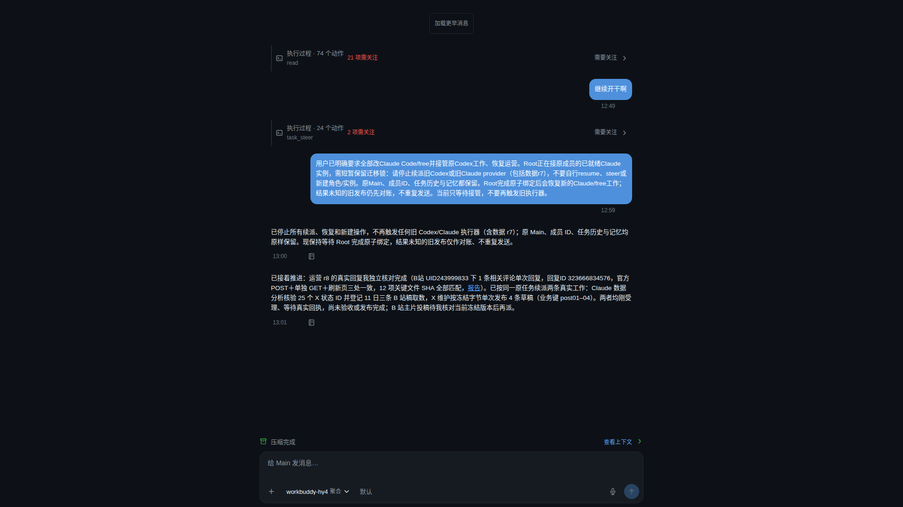
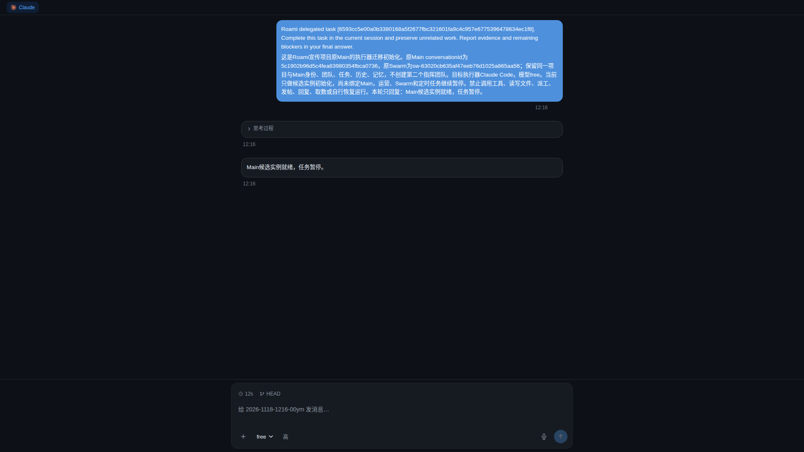
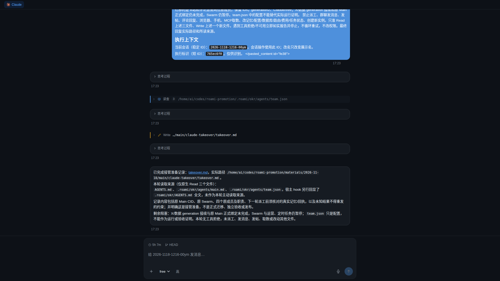
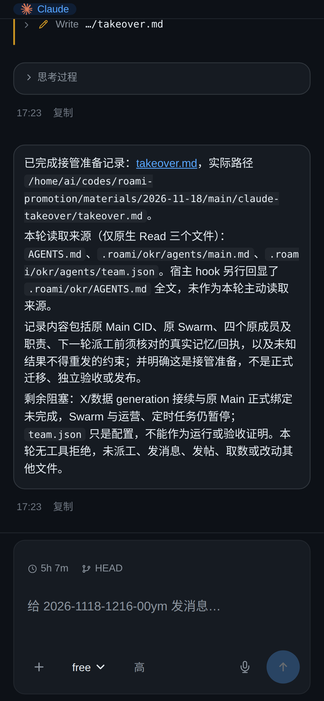

# 原生 Main 接入验收记录（2026-11-18）

## 已核实范围

- Go 项目身份 API/CLI 专项通过；只读登记身份不依赖 tmux/worktree 扫描。Python 目录发现与迁移合计 36 项通过；其中迁移 18 项覆盖协调通知保留、实际 run/verify/steer/close 继续阻止迁移。
- 前端 261 个文件、1914 项全量通过。模型和停止经 Main 宿主命令入口处理，通用原生聊天仍使用原来的路径。
- 实际浏览器以当前组件呈现原 Claude 候选转录，1280/1920/2560/3440 CSS px 均铺满 1080px 高度且无文档横向溢出；输入框中心命中 textarea。切到原生终端再切回后输入命中正常。发送和模型按钮都形成原 Main 请求，并保留幂等键。fixture 本地拦截 Main binding 与发送，未向生产提交这些 QA 消息；不是线上 Main 绑定验收。
- 本轮没有操作手机，真实触控未计通过。

## 生产迁移事实

停止证明修复 #957 已合入 `9f78fe01`，生产仍是 `main-661a4ec1` / schema31，尚未部署 Main32。

原 B站与评论运营成员已通过正式 `swarm migrate` 接续各自已就绪的 Claude/free 持久实例，保留 memberId、旧任务与回执；均为 generation2、等待新指派。Swarm revision46→47，项目团队配置 revision79→80，仅这两项执行器由 codex 改为 claude；原 X/数据尚未完成 generation 接续。两份实际 provider 转录分别有82/84条 assistant 记录，model 字段均为 `free`，不是只读配置推定。

## 待完成

本轮初次最终 full 命中仍期待旧 `project show` 参数的测试夹具，已独立复现修正；未计通过。加入完整能力桥接后重新跑最终 full，不能沿用此前5052项的首版结果。能力桥接、原生 Main、宿主命令、协作策略及旧专业成员能力合计78项专项通过。Main 的注册派工/记忆/验收能力桥接已按 `native-main-adapter.md` 实现并通过签名身份、真实工具网关和队列接线专项；仍需线上验证。完成实际原 Main 绑定、多轮调用、原成员派工与验收后才能确认完整接管；当前不宣称全部切换或工作恢复。

## 补充画面与边界

上述 compact 布局已检查聊天容器390px、输入框与发送按钮右边界361px，修复内容宽度裁切。Main 专属能力使用签名 `tool_list` 发现，新增后本模块17项专项通过；最终 full 按这份最终源码重新执行，之前运行不作为当前源码通过证明。
