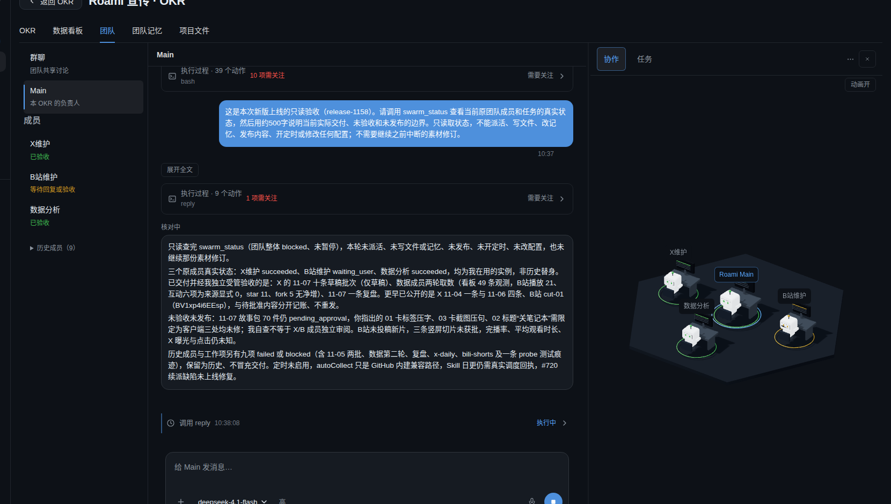

# 2026-11-07：共享对话与通信基础上线验收

本轮已实际激活 `okr-team-1158d22c`，不是仅构建或离线探针通过。代码为 main `8668a32ae57e28952f861d6ffe6f4751a33319e3`（PR754、755、756），树 `1158d22c8d9f113135fc8be324a0c348ae8efba5`；随后 main `2d9fc4a7` 仅新增恢复设计，与候选运行时、前端及 Skill 输入相同。

## 产品与用户场景

首页与项目 Main 使用同一会话组件。用户可在最终回复前看到真实生成的正文及工具执行状态，核验不通过的候选撤下；点击停止只中断当前回合。项目 Main、原成员与首页身份保持独立，没有重建替代团队。

生产原宣传项目 Main 已实际进行只读状态查询：

- 收到 40 次 `reply.preview`，首次比最终 `message.completed` 早 82.56 秒；浏览器实际显示“生成中 / 核对中”，不是最终结果的前端打字机。
- 工具调用在最终回复前显示 running / succeeded。一次来源核验拒绝了错误统计和批准边界，候选撤下，修正后仅保留一条正式回复。
- 另起一个明确标识的测试回合，实际通过 `roami chrome` 点击停止；产生 `turn.interrupted`，预览消失，没有正式正文或自动续跑。
- 本次未触手机。既有四档桌面及紧凑模拟证据见 PR755；不把紧凑视口记为真机触控通过。

## 技术切换与保护

用户在具体维护方案后明确要求 PR、合入与部署，本轮据此实施。维护前无活跃 turn / job，两个无关首页旧任务保留原状态，不取消、不改 busy、不伪造结束。

停止 writer 后，官方 `roami db backup` 保存 19 个登记数据库、179 个附件及 164 个原生会话文件；逐项 SHA 与数据库完整性检查通过。旧插件守护进程持有 storage 读锁，确认 watching=0 后只暂停该守护进程；未删锁文件，Web 恢复时自动拉起。Web 正常退出会关闭它启动的 Chrome，因此维护时以临时 runtime unit 设置仅终止 Web 主进程，保留原 Chrome、tmux 和人工标签；设置已移除，正常 KillSignal 已恢复。

只新增两份 ExecStart override，选择候选自带 Python；原服务环境、配置与旧 unit 原字节保留。CLI 原子切换。schema22→23→24→25 后先恢复 Agent，再恢复 Web。生产 index 与冻结包 SHA 一致，7 个入口 JS/CSS 逐项一致。

- 二进制 SHA256：`bace0d1b582d806963b39e3eec7def5dc091f011efec9fca5c8880252f522f17`
- index SHA256：`72b9e4d168b589bfad20c9bfaf98c0740a2304ee831baae69e4aba22cd8d9012`
- 原项目 / 首页 Main 和分支身份一致，三名原成员的任务、轮次及会话身份保留；旧消息、事件、turn ID 全部仍在。完整性检查通过、外键错误为零。
- 团队文件记忆、49 条看板观测原字节保留。原 6907 条模型调用账目完整保留，验收调用正常新增账目。模型配置及目录内容保持一致；模型目录仅因新构建自动更新 revision，不手工改路由、价格或账目。

## 仍未完成

schema25 中的协调基础表不会自动授权历史团队。本轮没有启用事件/日程生产者，也没有声称 Main 已能无人值守续派。失败批次恢复仍是设计；正常 Main→原成员续派还须真实交接验收。#744、#720、#746 按各自范围继续跟踪。

实际状态查询回合结束后，自动上下文压缩返回 `MODEL_HTTP_400`。正文已核验并完成，但压缩失败仍属 #738，不能将本轮流式验收算作压缩问题已解决。

迁移后禁止直接启动旧 schema22 runtime，或用旧备份覆盖新消息和账目。恢复采用兼容 schema25 的候选或向前修复。私有逐项证据保存在本机 `/tmp/okr-team-release-20261107/`，生产状态与备份位置记录在该目录，不提交认证信息或原始业务消息。
