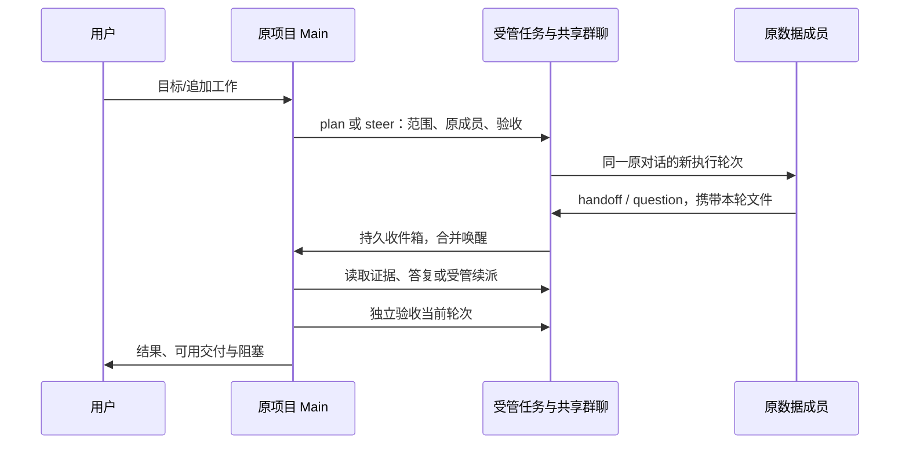
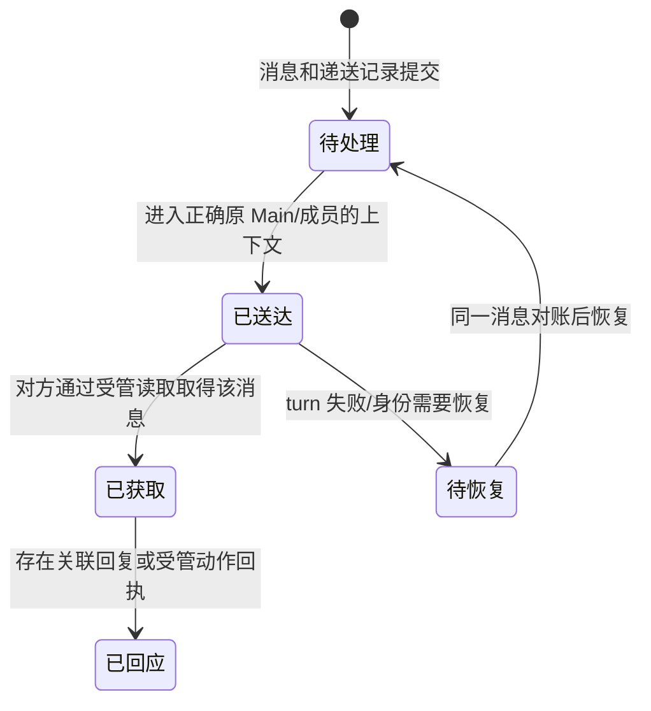

# Swarm 互通、Main 收件箱与长期成员

状态：设计提案，尚未实现新增通信协议。2026-11-06。关联 #744；与 [SQLite 和读取层设计](../20261104-okr-studio-project-ownership/sqlite-data-design.md) 一起评审。

## 用户看到的协作方式

用户优先与本 OKR 的 Main 聊。群聊汇总所有成员的进展、问题和交接；点击成员可以进入其原有渲染对话或原生 Codex/Claude/OpenCode/Pi 会话。任务放右侧列表，聊天输入复用全局组件。默认入口不展示 task/run/commandKey 等内部标识。

“互联互通”采用 **共享群聊 + 原 Main 统筹 + 定向收件箱**。成员可以共享信息、向另一成员提问，但改变任务、续派、分配依赖与独立验收仍由 Main 负责。第一版不让所有成员收到每条群消息后都自行启动模型或互相追加任务。

## 先核对当前代码的真实能力

| 入口 | 当前行为 | 不能据此声称 |
| --- | --- | --- |
| `swarm_post` / 绑定身份的 CLI post | 以 Main 或当前成员 task/revision/run 写共享群聊 | 另一成员已收到终端输入、Main 已被唤醒 |
| 人的 `swarm say` / 群聊发送 | 缺省投给本项目 Main；定向成员走原任务受管续派 | 所有成员都执行、任务已经完成 |
| Main 的 `task_steer` | 继续原任务并记录群聊/成员线程交接 | 成员本轮已运行并经独立验收 |
| `swarm_status` / chat / board | 读取共享讨论、任务及实际状态 | 读取前已发生可靠后台提醒 |

依据当前 `dispatch/swarm_plans.py` 的 post/send、`storage/swarm_mentions.py` 和 `tools/swarm_catalog.py`。成员 post 校验本群、最新 task/revision/run 和允许状态，但普通 post 只落记录，缺少“成员问题到 Main 的可靠处理”闭环。仅在正文写 `@Main` 无法补齐该闭环。

本机 session skill 的旧 add/done/--as 示例已过时；执行以当前 `roami swarm help` 与受管接口为准，不把旧命令复制进项目新手册。

## 消息与任务是两种对象

消息最少包含：messageId、swarmId、可信作者、kind、目标、replyTo、来源任务/修订/运行、正文、证据引用、创建时间和幂等键。作者与项目从真实工具上下文取得，不能由正文指定。显示名用于阅读，稳定 ID 用于路由。

建议扩展 `swarm_post` 的 kind，旧请求缺省为 note：

| kind | 作用 | 默认处理 |
| --- | --- | --- |
| note/progress | 普通讨论与进展 | 共享可读，不启动额外模型 |
| question | 需要答复的问题 | 持久送入原 Main 收件箱；指定同群成员时也建立其待办引用 |
| blocker | 当前任务不能继续 | 原 Main 收件箱，保留真实阻塞与任务身份 |
| handoff | 提交产物/依赖供核验 | 原 Main 收件箱；任务完成与验收仍独立 |
| reply | 对具体问题的答复 | 链接原 messageId，写共享记录及接收方收件箱 |

成员不能借 message kind 创建任务、接受自己交付或扩大账号权限。回复可补充事实与建议；Main 若改变执行范围，必须通过真实受管续派。一个群消息可以被多个成员读取，但只存在一个业务消息和可对账的递送记录。

## 三条主要链路

### 用户与 Main / 群聊

用户在群聊的普通发送默认交给本项目 Main，不回落首页 Main；明确选择成员时，页面重新核对当前 work/task/revision/run/provider/会话，再投给原实例。输入框保留草稿与附件，未知投递沿用原 key，不因切页改 key 重发。

群聊中的旧任务或 session 引用只作为历史线索；进入前验证当前身份。会话关闭时按可信 provider 绑定恢复原对话；缺证据就显示可操作的恢复状态，不创建替代实例。

### Main 与成员

Main 发任务时使用 plan/steer，记录当前源请求和有界指令；不能把包含其他工作的整段用户消息重放给成员。持续复用原 member/task/provider 对话，新的修订和实际 run 以启动回执为准。

成员发回 question/blocker/handoff 时，事件保存在收件箱并指向原 Main。Main 回答事实或调整任务后，消息关联真实 reply/steer 回执。群聊不伪造人的署名，Main 不用 `swarm say` 给自己下指令。

### 成员与成员

同群成员可定向提问、回复与交付依赖，按稳定 memberId 路由并在群聊留共享线索。Main 同时看到需要协调的问题，拥有后续任务控制权。

接收方可通过当前绑定身份读收件箱；运行中的原生 TUI 不接受未经协调的并发注入。第一版保证消息持久可读和 Main 协调；自动递送到忙碌成员的执行上下文需要利用宿主受管安全边界，能力不存在时保持待处理，不能假称实时送达。Main 可在对账后续派原接收方处理该问题。

## Main 收件箱与唤醒

新增的是宿主能力，不依赖 Agent 自己每秒轮询群聊：

1. 在落消息的同一事务建立递送记录与待处理标记，绑定 swarm/project/original Main。进程退出后记录仍在。
2. 调度器按 Main 合并待处理消息；普通进展不唤醒，多个问题进入同一个待处理批次。不会每条消息启动一个负责人。
3. Main 空闲时，通过项目绑定的内部 wake 能力提交一次协调轮次。忙碌时等待状态事件；等待用户回答时保留消息，不替用户答复或强行打断。
4. 唤醒信封明确来源为团队事件，并给出 messageId/来源任务等结构化数据。它不是新的用户授权；可执行范围继承原有效委托，成员文本不能授予发布或跨项目权限。
5. Main 读取收件箱和具体证据，回复、续派或记录仍待解决。仅“创建了 Main turn”不能标为已处理。
6. Main turn 失败时保留待处理记录与错误，进入恢复流程；不无限重复相同失败唤醒。新信息或明确恢复后再对账继续。

自我唤醒保护：Main 自己的进展、自己的回帖和处理确认不会再次唤醒自己；同一消息/目标使用同一递送 key；一轮失败不能换 key 创建第二个 Main。事件合并与去重控制的是重复工作，不额外设模型费用或请求配额。

## 递送状态与任务状态

这些状态描述可观察回执，不证明模型已理解，也不代表 task=succeeded。Main 独立读取当前轮文件并记录验收后，任务才按宿主验收规则结束。已读游标与问题解决状态分开：读过却未解决的问题仍留在待处理视图。

用户界面只需要简短显示“Main 待处理 / 处理中 / 已回复 / 需要恢复”；详情再给证据与执行记录。任务列表继续使用真实任务状态，不把消息绿色状态映射为任务成功。

## 记忆、Skill 与通信的结合

- 成员在群聊交接“本轮结果、路径、证据、阻塞、建议沉淀的知识”；个人长期笔记沿用稳定成员目录。
- Main 核验后以当前哈希更新团队记忆，重要决定保留来源与替代历史；原始消息和文件不被摘要删除。
- 日/周/月/年复盘引用具体消息、轮次、数据修订与交付；未解决的问题进入下一轮，不用一句“已复盘”消除阻塞。
- `swarm-execution` Skill 给 Main、成员和操作者分别说明可用入口，列出真实 CLI/工具与回执；新收件箱入口仅在代码交付后写成可执行命令。
- 有效交接和恢复经验经验证更新项目 Skill，再脱敏提炼到 `skills/okr-development`；通知文本不能自行改团队授权规则。

## 模块与协议落点

| 模块 | 责任 |
| --- | --- |
| `storage/swarm_repository.py` / 新 inbox 存储模块 | 消息、目标、reply 链、读游标、递送与处理回执 |
| `dispatch/swarm_plans.py` / 新 inbox 调度模块 | 沿用 post/steer，事件驱动合并与原 Main wake |
| `tools/swarm_catalog.py` | kind/目标、绑定身份读取与处理确认的工具协议 |
| `server/swarm_routes.py` / Go CLI | 受管读写入口，旧 post 保持兼容；人的 say 与 Agent post 分开 |
| 现有 OKR 群聊/成员目录 | 简短递送状态与原实例跳转，复用全局聊天框 |
| 项目 AGENTS 与 `swarm-execution` Skill | 精确操作方法、幂等/未知结果恢复与记忆交接 |

收件箱保存在宿主协作数据库，不能放进看板业务 SQLite 或靠项目文件制造已送达记录。只有同 owner/project/swarm 的真实成员身份可访问；旧 run、已关闭/已替代身份、跨项目引用必须拒绝或保持只读历史。

## 独立验收场景

先在隔离实例用可控执行器验证，不向真实团队发送 probe/test：

- 用户给项目 Main 的消息及成员链接不会进入首页或其他项目。
- Main 有界续派原成员，群聊留下当前轮次；收到的是本轮指令而非整段协调者请求。
- 原成员提出问题，Main 忙时持久等待，空闲后只被唤醒一次；Main 自己回复不形成循环。
- Main 等用户、失败、进程重启时消息不丢；重试同 key 对账，不重复发任务。
- 成员间定向问答指向同群原身份；旧 revision/run 与注入任意 sessionId 无法路由。
- 成员交付后，送达/读取/回复与独立任务验收分别可观察；旧轮次文件不能替代。
- 原生 CLI 与 Roami 成员都能用实际绑定入口发回消息，身份不伪装为 human。

通过上述场景后，再在原宣传项目进行一项有真实用途的交接：数据成员给 Main 当前来源证据，Main 独立核验并发布，最终看板与本轮任务验收对应。未完成这些真实环节前，#744 保持未关闭。
