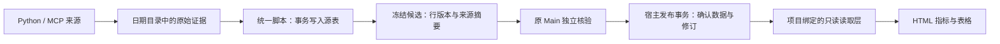

# 项目 SQLite、读取层与模板设计

状态：设计提案，尚未实现。2026-11-06。关联 #743、#744。

先看 [交互式设计稿](data-and-swarm.html)，再看本文与 [Swarm 通信设计](../20261104-okr-main-workspace/swarm-communication-design.md)。已有 AGENTS.md/手册已在 #742 合入；它们描述当前机制，不代表本提案的 SQLite、表格 SDK 或通信收件箱已经可用。

## 产品目标与用户故事

用户只需要跟项目 Main 讨论目标、查看看板与文件。Main 带领原成员长期执行；取数、确认、展示和复盘能够追溯，开发细节放 Studio 与项目文件。

- 用户说“增加一个 B 站稿件表”，Main 能定义表、来源 Skill、指标与展示，预览后应用到同一 OKR。
- 数据成员每日执行 Connector，保存真实原始证据，并用通用脚本写入项目库；Main 核验后，看板在原页面更新。
- 自定义 HTML 作者通过稳定的读取接口拿到有标签、单位、时间与质量状态的数据，不需要接触数据库文件或凭据。
- 新项目复制完整模板、填写目标与来源后，有明确的初始化与运行步骤；现有项目能保留全部事实、原 Main 和原成员。
- 成员的提问、交付和阻塞会可靠到达 Main，Main 继续原任务；群聊与执行不再靠“看见了应该会做”的假设。

## 先明确取舍

建议每个 OKR 使用一份项目级 `.roami/okr/data/okr.sqlite`。SQLite 适合此类本机、小团队、结构化查询的项目数据；写入用短事务串行协调，不能假定多个写入者同时持有写事务。依据 [SQLite 官方适用说明](https://www.sqlite.org/whentouse.html) 与 [事务说明](https://www.sqlite.org/lang_transaction.html)。

最终态选择 **SQLite 作为已发布项目状态与看板数据的唯一权威**。O/KR、页面和 Skill 仍保留可编辑文件；每次发布把它们的确认定义与资源摘要一并记入库中。JSONL、确认指针和导出 JSON 是兼容导出，不与数据库争夺当前版本。

不采用“直接写一张表，页面立刻展示所有数据”：Connector 的采集结果需要保留来源和 Main 的核验。也不长期保留“SQLite 与文件各有一个当前版本”的双写权威，因为进程中断时无法把两处独立提交当成一次原子操作。

这是最终设计选择。第一阶段可在现有文件机制旁先验证 SQLite 采集库与通用脚本，但这一过渡阶段的文件确认机制仍是权威，不能称为已完成数据库迁移。

## 项目目录与职责

```text
AGENTS.md                         每位成员都读的共同规范与操作入口
.roami/okr/
  AGENTS.md                       宿主提供给 Main 的同步工作流
  okr.json                        O/KR、方法、指标与来源的编辑输入
  dashboard.json                  视图入口、允许读取的指标/数据集
  dashboard/                      用户 HTML / CSS / JS
  datasets/                       表格字段、标签、单位、筛选与映射定义
    bili-videos.json               示例名称，按项目实际需要建立
  connectors/<source>/
    SKILL.md                      账号/来源、取数、证据、失败处理
    scripts/                      Python 实现，或 references/ 中的 MCP 契约
  skills/
    dashboard-storage/            初始化、建表、读写、备份的统一入口
    dashboard-authoring/          组合表/指标/HTML 与确认发布
    metric-collection/            取数与 Main 交接
    swarm-execution/              真实通信、续派与验收
    daily-operations/             原 Main 的日程唤醒
  data/
    schema.json                   用户业务表的声明
    migrations/                   经核验的结构迁移记录
    okr.sqlite                    实际工作时初始化；模板不带数据库二进制
  memory/                         团队/决定/稳定成员的 Markdown 记忆
  manuals/                        数据库、看板、协作、记忆、定时手册
  schedules/daily.json             禁用提案与调度绑定说明
YYYY/YYYYMM/YYYYMMDD/              原始证据、交付、发布回执与复盘
```

宿主运行时数据库继续管理真实会话、任务、轮次与调度。它与项目业务库职责不同；项目脚本不编辑这些运行记录。发布素材和原始响应按日期留文件，不把视频、图片或 Cookie 塞进 SQLite。

## 数据流：采集与发布各有回执



1. Connector 读取确认来源与 Skill 版本，采集一次，保存账号/稿件、截至时间、采集时间、字段与原始证据摘要。
2. 通用写入脚本根据 schema 检查字段，在短事务中保存源行的新版本与 ingest 回执。相同 writeKey/内容重试返回原回执；同 key 改内容拒绝。
3. 候选包固定源行 ID/版本、schema/Skill 摘要与证据。后续再次采集不得悄悄改变正在验收的候选。
4. Main 读取本轮证据与候选，检查来源、单位、日期窗口和未知；通过受管项目操作发布。无需把一次普通数据更新重新变成人工审批，但外部账号发布仍遵守已有授权。
5. 宿主用一个 SQLite 事务检查 expectedRevision、去重键和源行版本，提交确认观测、批准数据集及发布回执，再发更新事件。
6. 读取层仅返回当前项目已发布修订的数据；HTML 通过共享更新刷新。数据写入回执、发布回执和成员任务验收保持独立。

## 表结构与通用写入脚本

用户业务表使用 `src_` 前缀。示例：`src_bili_videos` 记录账号、BVID、时间及来源实际提供的播放/互动字段，`src_x_posts` 记录已核实的帖子与统计。字段由项目 schema 决定，不把这两个业务固定进所有模板。

宿主维护的元数据包括：项目与 schema 版本、确认修订及配置摘要、写入/发布去重回执、源行版本、确认观测和批准数据集成员。表名使用保留的 `okr_` 前缀；正常脚本只通过约定接口维护。

| 数据 | 写入者 | 原则 |
| --- | --- | --- |
| 来源明细与行版本 | Connector 经通用写入层 | 候选可追加；修正保留前版 |
| 指标/页面/来源的确认定义 | Main 经 save/sync | 检查当前修订与完整资源 |
| 确认观测及数据集批准记录 | Main 经 record/发布操作 | 固定被核验的行版本与证据 |
| 写入和发布回执 | 各自提交事务 | 同 key 对账，未知结果不换 key 重放 |
| JSONL / current.json | 宿主导出器 | 可修复的兼容导出，最终态不作为读写权威 |

拟实现脚本接口如下，**当前不是可直接执行的交付命令**：

```bash
python3 .roami/okr/skills/dashboard-storage/scripts/sqlite_store.py \
  --project-root "$project_root" --project-id "$project_id" init

python3 .roami/okr/skills/dashboard-storage/scripts/sqlite_store.py \
  --project-root "$project_root" --project-id "$project_id" schema apply --file schema.json

python3 .roami/okr/skills/dashboard-storage/scripts/sqlite_store.py \
  --project-root "$project_root" --project-id "$project_id" write \
  --table src_bili_videos --file current-run-rows.json --key "$write_key"

python3 .roami/okr/skills/dashboard-storage/scripts/sqlite_store.py \
  --project-root "$project_root" --project-id "$project_id" read \
  --dataset bili-videos --filter-file filters.json
```

`init` 幂等建立空库、宿主元数据与已声明源表；不填示例观测。`schema apply` 默认只做新增表、可空字段等可兼容变更；删列、改单位/键或重解释旧数据必须作为显式迁移核验。`write` 参数化写入、检查类型/空值及幂等键，整批失败整批回滚。逻辑更新保存新行版本，不覆盖已经批准的旧版本。`read` 使用声明的数据集与筛选参数，不要求 Agent 拼接未经约束的 SQL。

备份用 SQLite backup API 或已验证的完整一致性备份，不能只复制处于 WAL 模式的主文件；写入者/读取者与 Python 连接的事务处理按 [Python sqlite3 文档](https://docs.python.org/3.12/library/sqlite3.html) 实现。此处是可信项目工作区的约定与受支持入口，不将本机文件所有者能编辑的数据库宣传成权限沙箱。

## 统一读取层：标签、数据与 HTML

`datasets/<id>.json` 声明稳定 datasetId、用户标签、源表、允许字段、类型/单位、默认排序/筛选及指标映射。标签与口径由定义驱动，不在各张 HTML 卡片里重复猜。

```json
{
  "id": "bili-videos",
  "label": "B站稿件",
  "sourceTable": "src_bili_videos",
  "columns": [
    {"key": "bvid", "label": "稿件", "type": "text"},
    {"key": "views", "label": "播放", "type": "number", "unit": "次"},
    {"key": "asOf", "label": "截至时间", "type": "datetime"}
  ],
  "defaultSort": [{"key": "asOf", "direction": "desc"}],
  "publication": "main-reviewed"
}
```

上例是设计结构，不含真实观测。日期窗口、聚合与 source/metric 映射必须在定义中补齐；播放量与完播率始终是不同指标。源表存在不自动成为公开看板，manifest 只允许当前页面声明的数据集与字段。

现有 `okr.data.read(metricId)` / `subscribe` 保持兼容。拟新增的表格入口：

```js
await okr.ready();
const table = await okr.data.table('bili-videos', {
  filters: {dateRange: ['YYYY-MM-DD', 'YYYY-MM-DD']},
  limit: 20
});
// table: {id, label, revision, columns, rows, asOf, quality, nextCursor}
```

读取层接收声明过的 datasetId、筛选/排序/分页参数，绑定当前节点、项目、允许字段与已发布修订。它不接收 iframe 任意 SQL、DB 路径或其他项目 ID。游标绑定查询及修订；过期查询不能把晚回的数据送给已切换的项目。

表格拟提供 `okr.data.subscribeTable(datasetId, query, callback)`，返回取消订阅函数；同一项目共用更新通道与查询缓存，数据修订变化后统一重读，关闭/隐藏暂停，切换项目清理旧订阅。

数字卡使用现有指标数据，表格使用 table 接口，趋势图继续复用宿主 ECharts；页面以每个独立数据表/指标组一张卡片组织。复用共享更新，不为每张卡创建轮询。缺失为 null/未知，确证零值为 0；来源失败保留最后有效数据并标明陈旧/失败状态。

## 原子发布、恢复与迁移

资源与证据先按内容摘要写入不可变文件，再在数据库事务中引用它们并切换确认修订。失败事务不产生可见的新发布；事务已提交而 JSONL 导出失败，API 仍返回真实已提交状态，并由导出修复任务重建兼容文件。不能因导出失败让调用者重新发布另一批。

现有项目迁移流程：

1. 检查实际主机支持新存储协议；取得当前确认修订和项目级写入占用，保留原团队/任务/对话。仅禁止本项目发布，不改全局 busy。
2. 备份旧确认快照、完整观测/批次/复盘、页面资源及来源；从同一个固定修订建立候选数据库。
3. 核对全部 ID/顺序/来源/数值、同日修正、旧 sourceKey、未知与 0、资源摘要及现有批次去重结果。
4. 发布写入口统一持有项目级迁移/写入边界，再核对原修订没有变化。候选库先标为 prepared，最后在同一库事务中提交确认修订和 active 标记；新宿主只采用有效且 active 的项目库，prepared 库不接管读取。旧文件随后转为导出，不再另外维护一个权威切换指针。未具备能力的宿主继续旧机制；上线/回退入口必须阻止旧写入者与新模式同时发布。
5. 对比实际 API 和看板；迁移前失败直接保留旧模式。切换后若需回退，先停止本项目发布并导出至最新确认修订，校验完整性后显式切回；不能盲用旧备份覆盖新数据。

## 模板、真实项目与 AGENTS.md 的交付

模板交付完整文件骨架、空库初始化 Skill、schema/dataset 模板、读写/备份脚本与分步手册。只复制定义，不携带 `.sqlite` 二进制、示例事实、账号凭据、原生实例 ID 或启用的日程。

鲁米宣传按当前真实数据和来源初始化，并对比既有看板；不得拿模板示例数替代旧事实。项目根 AGENTS.md 与宿主工作流入口都要写明：数据库位置、何时 init、怎样定义表、如何保存来源证据、如何读/写/确认、哪个回执证明看板更新，以及失败/冲突如何对账。操作命令只在对应能力实际交付后写成可执行步骤。

个人/团队与日周月年记忆继续用可读 Markdown；SQLite 保存结构化数据，记忆只存结论和证据链接。复盘得到的改进经验证更新项目 Skill；跨项目经验脱敏回提 `skills/okr-development`，不会用数据库写入权限替代协作或发布授权。

## 实施顺序与验收

| 阶段 | 完成内容 | 放行依据 |
| --- | --- | --- |
| 0 设计 | 本提案、通信状态机、目录与原型 | 解决权威数据源与消息投递定义，先不实施新协议 |
| 1 源库与 Skill | 通用初始化/建表/事务读写、完整模板及真实项目候选验证 | 空库初始化、重试、回滚、未知/零、schema 演进与备份测试；不声称已迁移权威 |
| 2 发布与迁移 | SQLite 确认状态、同一 API 与兼容导出 | 故障注入、并发 CAS、旧完整数据/去重语义保留 |
| 3 读取层与 HTML | dataset 标签、允许字段、表格/筛选/分页及更新 | 真正从确认数据库经宿主读到页面，跨项目与过期请求隔离 |
| 4 团队通信 | 持久收件箱、Main 唤醒、续派与回执 | 见通信设计；不把 post 当执行 |
| 5 日常闭环 | 原 Main 与原成员取数、确认、看板、复盘、Skill 改进 | 真实当前轮次文件与独立验收，真实定时记录另验收 |

各阶段独立 PR 与验收；源码/CLI/原生 Skill/运行服务的版本要分别核实。此设计不把模拟数据、离线模型或紧凑视口当成真实每日运行与真机通过。
