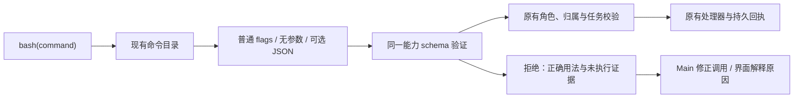

# Main 普通 CLI 参数与调用拒绝说明

## Product Design

用户截图中的 `roami agent reminder ls` 对应已经注册的提醒查询能力。Main 原先只把 `命令 --input JSON` 识别为受管调用，普通 CLI 帮助里的无参数查询、flags 写法会落入兜底拒绝，返回 `USE_REGISTERED_CLI_CAPABILITY`。这不是项目工作区缺失，也不是提醒功能没有安装。

对截图对应历史轮次的只读核对还发现：Main 在同一轮中反复尝试普通参数、管道、重定向和组合命令。历史回执通常只有错误码，没有正确用法；界面则统一写“执行未能完成”，容易误认为命令实际运行后失败。

强制 JSON 是额外的语法负担，不是权限边界。去掉这项要求：普通标量参数使用常规 flags，无参数查询直接调用；对象、数组保留可选 JSON 形式。会话归属、禁用能力、当前任务与持久执行回执仍走原有处理器，不增设审批或执行额度。

## User Stories

1. Main 直接执行 `roami agent reminder ls`，查询当前对话的提醒，不需要补 `--input '{}'`。
2. Main 使用 `reminder add --text "检查工作" --after-seconds 3600` 和 `reminder cancel --id ID`，完成真实创建与取消。
3. 用户看到“未执行”和具体原因，展开后可以核对原始输入、错误码、正确用法；实际非零退出仍显示运行失败。
4. 已存在的 JSON 调用和持久历史继续有效。修复后的成功步骤不会抹除先前的拒绝记录。

## Technical Design

- `tools/command_families.py`：将 schema 的标量字段映射为 `--kebab-case`，支持 `--flag value`、`--flag=value`、布尔开关、空输入及两种 `--input` 写法。未知参数、重复参数和混合格式明确拒绝。
- `tools/foundations.py`：命令发现、帮助、解析和错误修复提示使用同一份注册路径及能力 schema。简单命令优先展示普通写法；复杂必填对象仍展示可选 JSON 入口。
- `tools/gateway.py`：已知命令的参数拒绝返回 `expectedCommand`、schema 和修复建议，不回显错误输入值，不启动处理器或子进程。
- `conversation/activity.py` 与前端活动协议：投影显式 `executionStarted`，同时兼容可确定未执行的历史命令拒绝码。
- `AgentActivity.tsx`：保留真实 failed 状态，显示“未执行”及本地化原因；详细错误码和结构化回执留在展开区。
- Main 指令和 Roami 内置 Skill 同步说明普通参数写法，避免帮助与实际调用契约相互冲突。

受管调用是一个可追踪动作，并不经过 Shell 执行。管道、重定向和多命令脚本不能作为一个受管回执提交；错误会明确说明这点，返回结果可直接读取。普通 Shell 工具保持现有行为。这一轮没有把整个 Roami CLI 或专业终端的原有位置参数重新定义为受管操作，也没有把未知命令静默放行。

## Acceptance

### 机制验证

`agent-runtime/tests/test_cli_arguments.py` 覆盖真实提醒创建、查询、取消、跨对话拒绝、能力禁用、三种角色、布尔参数、JSON 兼容、组合命令拒绝、无副作用回执、流式活动中的未执行证据。既有参数修复与重复拒绝停止机制继续保留。

前端活动测试覆盖历史拒绝、显式未执行证据和实际非零退出的区别。新增产品文字提供中文与英文；模型恢复指令、命令和协议字段沿用 i18n 的内部工具内容例外。

### 真实模型

[真实模型记录](evidence/live-model.json)：沿用节点保存的 Main 路由与参数，未修改提供商配置；在独立数据库中以自然语言请求创建一小时后的提醒、查询、取消、再次确认。六次工具调用全部成功，实际使用普通 flags 与无参数查询，提醒最终禁用。该样本不等于整体错误率改善证据。

### 桌面与手机

[桌面布局断言](evidence/desktop-layout.json)：1280、1920、2560、3440 CSS px，各验证工作台打开与关闭。无文档横向或纵向溢出，消息流高度可用，关闭工作台后消息流收回宽度。

真实 Redmi Note 8（1080×2340，DPR 2.75）通过 HTTPS 访问隔离实例：ADB 点按展开过程与参数错误详情、真实滑动后消息流 scrollTop 从 0 增至约 311；顶部操作命中高度 44 CSS px，底部导航 60 CSS px；392 CSS px 宽下无横向溢出。真实点按工具、设置、项目、首页四个底部入口并确认路由变化；英文与浅色桌面活动页也通过基本检查。

手机 `roami chrome --cdp` 返回 `CHROME_BROWSER_IDENTITY_UNAVAILABLE`，使用同一 ADB 调试转发的直接 CDP 读取断言；真实触控仍用 ADB。桌面调整视口后重新加载页面，避免旧断点状态。

截图保留为本机验收产物，不提交主线：`/tmp/main-cli-desktop-after.png`、`/tmp/main-cli-phone-after.png`、`/tmp/main-cli-phone-details.png`。改前证据为用户提供的原始截图。

### 质量检查与部署边界

- 定向 Python 回归 89 项通过；新增普通参数测试 13 项通过。
- 前端全量 186 个文件、1329 项测试通过；typecheck、i18n、hover 和生产构建通过。
- 全仓 quick 质量门通过：Go 全量、Python 3427 项通过 / 48 项跳过、ruff lint/format、CLI/安装审计、前端 typecheck/i18n/hover、秘密扫描。运行命令为 `env -u ROAMI_HOME -u ROAM_HOME -u TTMUX_HOME scripts/dev/quality/check.sh quick`；清除当前会话继承的路径别名，避免既有环境别名测试被外部值污染。生产构建另行通过。
- 本轮没有部署或重启生产服务；历史失败记录不回写为成功。

PR 准备时同步到主线 `c8a2a766`，保留主线新增的按名称发现能力，同时让该入口与命令族帮助返回一致的普通参数用法。上述 3427 / 1329 计数对应同步前验收；同步后的 full 质量门与前端全量回归另记于 PR。
