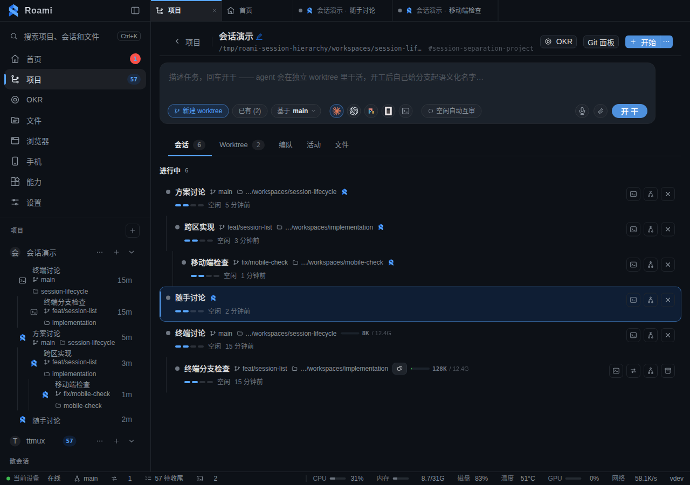
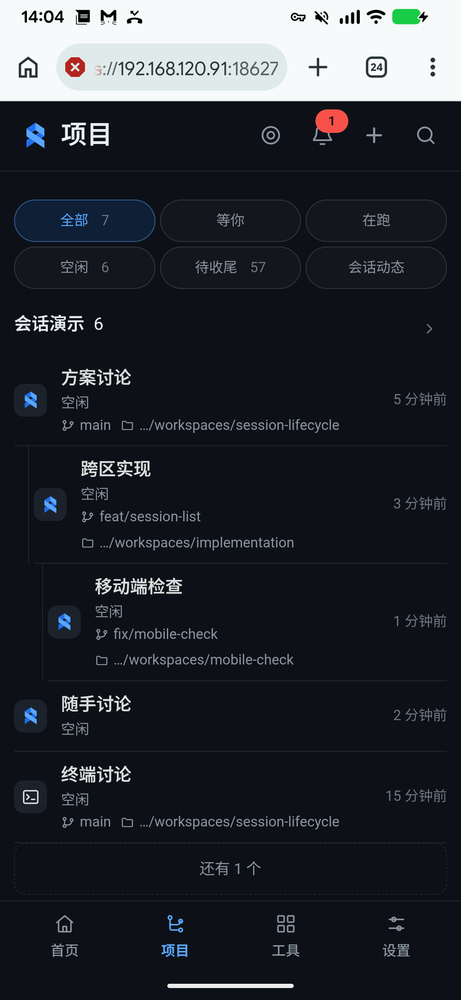
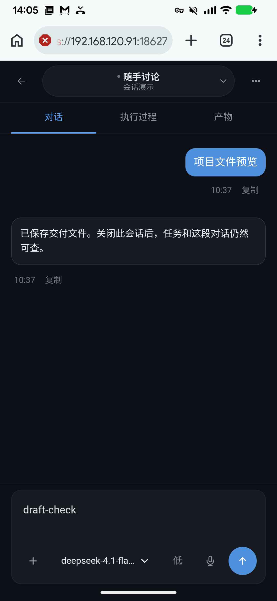

# 验证记录

2026-11-05，修订版。使用 `/tmp/roami-task-session-acceptance` 隔离实例及其私有 tmux socket、测试任务和会话；未操作生产会话或任务。项目名称为“会话演示”。

## 已验证的行为

- Roami 与普通会话共用列表行、分组、排序、搜索、菜单和项目计数；没有专属“内置智能体”标签、任务结论标签或行尾移除按钮。
- Roami 会话通过普通工作区标签打开聊天；桌面侧栏、手机切换单、独立聊天页均识别同一会话身份。打开的标签可以恢复，清单尚未返回时不会误删标签，也不阻塞普通会话恢复。
- Android 真机长按“首页布局核验”，用普通菜单改名为“布局讨论”。API 确认会话名称改变，任务目标仍是“首页布局核验”，状态仍为 `waiting_user`。
- 真机再次长按，通过普通关闭确认关闭该会话。清单中不再出现它；关闭记录为 `closed`，任务仍为 `waiting_user`，任务详情仍能查看结果及会话记录。工作目录与 `draft.txt` 保留。
- 创建时固化初始会话名；旧数据升级时从初始任务主题回填。后续追加需求不改名。迁移与真实任务续接的回归测试覆盖此行为。
- 手机输入 `draft-check`，切换后草稿仍在；真实键盘与 ADB 滑动、返回操作均检查。聊天输入复用现有组件，粗指针底部保留触控空间。
- worktree 占用判断包含 Roami 会话，避免把仍有会话的工作区列为孤儿清理对象。

## 布局与刷新

桌面在 1280、1920、2560、3440 CSS px 下检查导航和检查面板开关，共 16 个场景。列表填满画布，没有横向文档溢出；聊天内容高度为 835 CSS px。打开检查面板后，聊天宽度分别由 992 / 1632 / 2272 / 3152 收回为 672 / 1312 / 1952 / 2832 CSS px。没有将 Roami 句柄发往 tmux 探测、抓屏或发送路径。英文界面同样检查。

Android Redmi Note 8（`216d6a43`）实测项目列表、长按菜单、改名、关闭、普通会话聊天、任务记录、键盘和草稿。页面没有横向溢出。完整屏幕截图与 Web 内容截图均保存在验证目录，PR 使用 Web 内容截图。

旧生产包原始采样在 11 秒内初读清单 1 次。本版共享清单每节点 5 秒刷新；稳定窗口 22 秒观察到 4 次清单请求，多个界面不各开循环。进入已结束任务详情后，再观察 11 秒，没有周期详情请求。未作 CPU 或内存下降声明。

## 回归与边界

- `scripts/dev/quality/check.sh quick`、`full` 均通过。Go 全套、Python lint/format 与 3474 项测试通过，48 项跳过。
- 前端 typecheck、i18n、hover 审计、195 个测试文件 / 1396 项测试、生产构建均通过。
- 同步 main 后保留其成员会话的 21 号升级，会话名称升级顺延至 22；版本 1–22 的备份恢复以及两项迁移一并检查。合并后的完整 quick/full 再次通过。
- 初次检查发现旧迁移测试比较整个行字典，需要适配新增的独立名称字段；补充初始名称及旧字段保持不变的断言后，全套重跑通过。
- 真机实际提交续聊消息成功，同一会话进入新任务版本；保存的模型路由返回 `MODEL_HTTP_401`。因此没有把本机验证计为真实 AI 回复成功。运行时回归覆盖成功续聊并复用原会话与分支；聊天界面对模型认证失败给出可理解提示，保留继续输入能力。未覆盖或替换节点保存的模型配置。
- 原始改前截图来自首轮 main 基线，包含尚未关闭的测试会话；本版改后截图是在改名及关闭操作后拍摄。交互稿中的回复为示意，不作为模型执行证据。

截图通过 `pr-shots` 提供，不提交到主分支。提交复用此次已通过的 quick/full 结果，单独校验提交信息，保留仓库 hooks 配置。

原始证据：`revision2-desktop-layout.json`、`revision2-request-profile.json`、`revision2-removal.json`、`revision2-integrated-quick.log`、`revision2-integrated-full.log`、`revision2-integrated-storage.log`、`revision2-integrated-vitest.log`（均在本机验证目录）。

## 派生层级、位置与活动时间补充（2026-11-05）

本轮运行代码：`32d831ee`；证据位于 `/tmp/roami-session-hierarchy`。本轮只修改 Go、前端与设计文档，Python 无变更。`quick`（提交 hook）与 `full` 均通过；full 使用 `230aac4d..32d831ee` 的明确范围判断 Python 检查范围，沿用上轮通过的 Python 回归结果。前端 197 个测试文件、1401 项测试通过，typecheck、i18n、hover 与生产构建通过。

- `/sessions/overview` 接口回归验证：没有 Worktree 时，父会话、目录与实际最近活动字段仍完整保留。
- 关系及组件回归验证：三级派生、子会话先返回、父会话缺失/循环、跨目录、相同分支不同目录，以及筛选后只剩子会话。截取列表前先恢复父子顺序，避免活跃子会话把父会话挤到“更多”之外。
- 无工作区回归：会话仍可见、能打开；项目详情不把未知位置归入主仓库，普通目录不会显示未经确认的 Git 状态。子会话保留自己的位置与打开目标。
- 时钟回归：概览快照保持不变时，时间仍能从“刚刚”推进到“几分钟前”；时钟不触发额外请求。
- 最终生产包的桌面布局：1280 / 1920 / 2560 / 3440，导航及检查面板开关共 16 个场景，工作区宽高与滚动正常，无横向溢出，Roami 句柄误入 tmux 请求为 0。记录见 `hierarchy-desktop-layout.json`。
- Android Redmi Note 8，序列号 `216d6a43`，通过 ADB 真触控验证展开、打开无工作区会话、返回、长按及关闭。关闭后会话从共享列表消失，同一任务仍返回 HTTP 200、状态保持 `succeeded`；记录见 `closure.json`、`closed-roster.json`。未发送新的模型请求。
- 手机稳定观察 22 秒：概览 4 次、Roami 清单 4 次、误入 tmux 为 0；见 `phone-profile.json`。排查期间发现手机列表自行轮询与共享概览重复，改为共享入口后复测通过。桌面既有项目概览仍有独立刷新，本轮不声称消除全站重复请求，也不声称 CPU 或内存下降。

截图为隔离实例的测试数据，包含真实 Git 主检出、两个 Worktree，以及从旧测试记录复制的 Roami 对话。原版、上一版和本版截图使用的样本名称与会话数量不同，具体行为由上面的回归与触控记录验证。

文档提交 hook 的一次重跑中，已有的 `TestClaudeCancellationStillNeedsIdleAndStopProof` 和结构化续接的 `pi` 分支报告进程状态尚未确认；本轮未改动对应实现。两项单独重跑通过（1.824 秒），随后重新执行提交门禁。保留 `docs-commit.log` 与 `timing-recheck.log` 记录此次波动，不将单次重跑等同于修复这些测试的时序问题。
