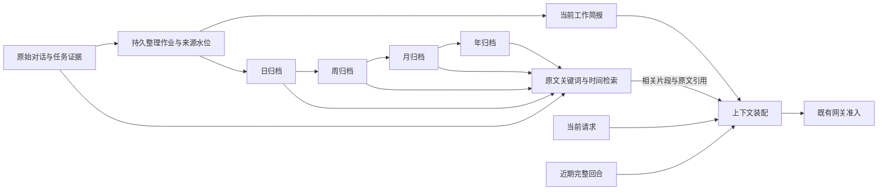

# 首页上下文自动整理与历史检索

状态：设计草案，未实现、未启用定时任务，也未修改线上配置。

## 产品设计

采用「近期原文 + 当前工作简报 + 相关历史检索」。按日、周、月、年整理历史，但各层摘要保存在归档中，不全部常驻模型上下文。时间决定如何归档，当前任务的相关性决定本轮读取什么。

首页长期保持原 Main、原对话和原任务关系。整理改变发给模型的内容，不删除聊天、不创建替代会话，不把后台整理过程追加到首页聊天流。

### 当前实现与缺口

以本次工作区源码为依据，尚未核对线上实例的实际配置与执行情况。

| 当前能力 | 代码依据 | 本次设计要补的部分 |
| --- | --- | --- |
| 请求前检查阈值，回合结束后可以排队自动压缩 | `context/prompt_builder.py` 的 `build` / `after_turn` | 加入时间与空闲触发；不能只等窗口快满 |
| 默认阈值为模型容量的 75%，容量未知时阈值为 None | `server/configuration.py` 的 `threshold_for`；`compaction_ratio=0.75` | 展示实际生效值和容量未知状态；日常整理独立于比例阈值 |
| 压缩保留近期原文，默认目标 20,000 tokens；旧摘要可增量复用 | `context/projection.py`、`context/summary_input.py` | 将「保留所有旧约束」改成有来源、分作用域的当前工作简报 |
| Main 隐藏多数旧助手与工具内容，但仍保留旧用户消息和交接回执 | `context/main_history.py` | 过期的一次性要求也应退出常驻上下文 |
| 自动召回有来源的记忆，默认最多 8 条、2,000 tokens | `context/remembered.py` | 按当前主题选择归档片段，去重并校验时效 |
| `memory.daily` 已有后台作业，按本地日界调度；日摘要主体是计数 | `memory/jobs.py`、`memory/daily.py` | 新增对话要点归档，不能把任务计数当成语义摘要 |
| `memory_search` 检索已提炼记忆；`conversation_history` 分页读取原文 | `retrieval/memory_search.py`、`conversation/history_read.py` | 为旧原文增加按关键词和时间范围的检索；保留现有分页读取能力 |

75% 是代码默认值，不是对线上设置的断言。公式为 `floor(当前角色模型容量 × compaction_ratio)`；例如容量为 128,000 时默认阈值为 96,000。`keep_recent_tokens` 是压缩后原文的保留目标，不是触发阈值。当前 TOML 可配置这两个值，网页没有直接修改入口。

### 一轮请求带哪些内容

| 内容 | 默认策略 | 退出条件 |
| --- | --- | --- |
| 系统规则、当前用户请求、当前完整工具轮 | 必须保留；不拆开工具调用与结果 | 当前回合结束后按来源归档 |
| 近期原文 | 提议近 48 小时，最多 20 个完整回合；再按模型容量和现有近期保留目标收敛 | 时间或长度超出近期窗口，且已完成归档交接 |
| 当前工作简报 | 当前主题、有效约束、未完成事项、待用户决定、关键成果引用 | 任务结束、取消、被新要求替代，或与当前主题无关 |
| 明确的长期偏好 | 复用现有有来源、分作用域的偏好机制 | 用户修改、撤回或遗忘 |
| 相关历史片段 | 按本轮问题自动检索后加入；默认沿用现有 2,000-token 召回目标 | 请求结束后不自动转为永久常驻内容 |
| 日／周／月／年摘要 | 归档与检索入口，默认不整份注入 | 只按需提取相关条目及其证据 |

48 小时、20 回合是建议默认值，尚未确定为产品配置。正在进行的工作、未解决的约束和当前回合不受按日期移出的规则影响。一个超长的当前请求不能为了满足近期窗口而被悄悄截断；沿用真实模型容量与现有准入错误处理。

滚动简报提议以约 800–1,500 tokens 为阅读目标。这里的目标只用于上下文选材，不是请求次数、Token 消耗或费用配额；最终模型准入和配额判断继续由 Go 网关负责。

### 怎样识别“无关紧要”

- 执行日志、工具输入输出、已恢复的临时失败、重复进度和已经交付的长结果，留在原任务或历史记录中；常驻简报只保留成果引用和必要限制。
- “这次列五条”“今天查一下”等一次性要求随对应工作结束退出简报，不提升为用户长期偏好。
- “暂时不要部署”“还缺手机验收”等未解除的任务约束随任务保存，不能因跨天或摘要变短而丢失。
- 数字、路径、链接、日期和用户原话保留证据引用；摘要不能把推测写成事实，也不能把执行器声称完成改成已验收。
- 新要求替代旧要求时记录替代关系；用户长期偏好、项目约束和单次任务指令分别处理，不扩大作用域。

### 时间分层

| 层级 | 整理内容 | 建议运行时机 | 默认读取方式 |
| --- | --- | --- | --- |
| 滚动简报 | 当前工作、有效约束、未决事项、少量关键引用 | 完整回合结束后记录增量；空闲 10 分钟时合并待整理内容 | 与当前请求相关的部分常驻 |
| 日归档 | 当天主题、决定、结果、遗留事项及来源 | 每天 02:10 整理上一完整自然日 | 问“昨天／那天”时检索 |
| 周归档 | 跨天进展、已确认决定、持续未决事项 | 周一 02:30 整理上一 ISO 周 | 问“上周／最近几周”时检索 |
| 月归档 | 阶段成果、重要变更和仍有效的长期事项 | 每月 1 日 03:00 整理上月 | 问月度变化或阶段回顾时检索 |
| 年归档 | 里程碑、长期决定、重要成果索引 | 每年 1 月 1 日 04:00 整理上年 | 问长期变化时检索 |
| 原始记录 | 完整对话、工具证据、任务和产物 | 持续保存 | 查关键词、时间或原话时精确读取 |

上述时间按用户配置时区解释，Asia/Shanghai 仅作本次讨论示例。现有记忆默认 UTC，实施时应明确显示实际时区，不能静默把 UTC 日界当作北京时间。归档记录自己的时区；切换时区不改写既有记录。夏令时按本地日期边界计算，不假定一天恒为 24 小时。

没有新增内容的周期直接跳过模型调用。周、月、年不重复扫描全部原文；使用下层有效条目和结构化事实索引。缺少完整下层来源时标记未覆盖范围，不把“尚未整理”当作“没有发生”。

原始记录在这个方案中不按天删除。高层摘要也不替代低层来源；历史删除或保留期限属于独立的数据管理规则。

### 自动触发与异常恢复

1. **回合触发**：每个完整回合结束后推进整理水位，更新任务与约束条目。后台合并可复用有效旧摘要和新完成的回合。
2. **时间触发**：即使使用大窗口模型、长期未达到 75%，仍按本地日界整理。空闲合并和周期归档可以共用持久作业队列。
3. **容量兜底**：保留现有比例阈值。最终装配后的系统规则、工具声明、简报、近期原文和召回内容一起计算，不能只看聊天正文。
4. **活跃期间**：固定来源水位，只处理已完成回合；新消息继续进入近期窗口。旧简报在新版本完成校验前继续有效，不重启对话、不打断正在运行的工具链。
5. **服务离线**：重启后根据未覆盖的时间段和水位补齐；优先最近缺口。使用既有队列租约和重试语义，不依赖页面打开或浏览器定时器。
6. **失败／配额拒绝**：保留上一个有效版本与尚未交接的必要原文，记录失败并退避。模型调用沿用节点已保存的路由和参数，由网关决定准入，不临时换模型或绕过配额。
7. **容量未知**：不捏造模型窗口或默认绝对容量。时间整理仍可处理有界小批次；遇到容量拒绝时提示配置问题并保留原始资料。

冷历史不再默认回灌所有全文。若摘要失效，使用近期原文、已验证约束和真实任务状态形成最小可用上下文，后台修复缺口；涉及缺失旧决定时检索证据，查不到则明确说明。只有来源归档与检索已就绪、有效约束已交接且未决要求没有被遗漏，旧内容才可退出自动保留区；条件不满足时保留相关原文，不直接按日期丢弃。

## 用户故事

- 今天接着昨天的工作，仍知道没完成的验收和“不要部署”的限制。
- 换一个无关问题，不再背着过去几个月的工具日志和一次性清单。
- 问“上周为什么决定这样做”，自动找到决定、日期和原话，而不是凭月摘要猜测。
- 跨月继续一个未完成任务，回到原 taskId 和当前 revision，不从摘要重复派发任务。
- 用户撤回一条偏好后，日、周、月、年摘要与检索都不把它重新带回来。
- 一个月没有打开首页，后台仍能整理；设备或服务离线期间的工作在恢复后补齐。

### 示例

10 月曾要求“这次输出三条”，11 月仍有一个未完成任务要求“先验收、不要部署”。

- 当前问题与两个任务都无关：不带“三条”要求，也不加载两个任务的执行日志。
- 继续 11 月任务：工作简报带上原任务引用、未决验收与禁止部署的原话来源。
- 问“10 月那个输出限制是什么”：检索命中原文，回答它属于当次任务；不会把它变成现在的默认要求。

## 技术设计

### 架构

### 模块边界

路径均相对 `agent-runtime/src/roami_agent/`。

| 模块 | 调整职责 |
| --- | --- |
| `context/main_history.py` | 使用近期窗口和当前工作简报，不再长期保留所有旧用户消息；保护当前工具轮与来源交接 |
| 新增 `context/working_brief.py` | 汇集任务约束、未决事项与关键引用，按当前请求筛选；状态来自任务存储 |
| 新增 `context/retention_policy.py` | 计算时间窗口、完整回合边界和实际模型装配目标 |
| 新增 `context/maintenance.py` | 计划空闲／日／周／月／年整理作业，管理待覆盖范围 |
| 新增 `memory/period_summaries.py` | 生成语义周期归档、下层依赖和增量版本；独立于现有日计数摘要 |
| 新增 `retrieval/conversation_search.py` | 原始记录的作用域、关键词和时间范围检索，输出有限片段与精确引用 |
| `context/projection.py` | 沿用来源指纹、分支／记忆版本检查和原子激活；扩展投影身份以包含保留策略与简报版本 |
| `context/prompt_builder.py` | 统一装配、去重与最终用量估算，接入既有准入流程 |
| `dispatch/scheduler.py` | 执行持久作业、恢复和退避；交互请求优先于历史补齐 |
| `tools/main_catalog.py`、`conversation/history_read.py` | 扩展现有历史读取入口的关键词与时间过滤，保留精确消息分页；不因检索扩大整份历史投影 |

### 数据与来源

拟增加 `context_briefs`、`period_summaries` 及周期依赖记录，复用既有 `memory_sources` / `memory_edges` 的来源验证语义；具体迁移以实施时的 schema 核对为准，不直接复用以日统计为用途的表。

- 简报：owner、会话／分支、项目、策略版本、来源水位、分支／记忆版本、结构化条目、来源指纹和状态。
- 条目：类型、正文、作用域、taskId／revision、原文引用、生效／替代／解决时间。长约束保留原文指针，不依靠摘要模型自行补全。
- 周期归档：粒度、起止日期、时区、来源范围、子摘要版本、要点、未覆盖范围和失效状态。
- 原文索引：消息身份、作用域、时间、可检索人类正文与内容版本；索引候选不等于有权读取，返回前再次验证所有者、分支血缘、删除与遗忘状态。

作业以作用域、周期、时区和策略标识去重，在同一作业中推进来源水位。来源变更后生成新版本；同一输入不重复激活。迟到的任务结果使对应日及其上层归档变脏，按依赖增量修正，不把旧“进行中”当成现在的状态。

来源被修改、遗忘或删除时，立即停止使用受影响简报／归档并使后代失效，再后台重建。源消息、引用片段和派生条目都须验证；不能仅因高层摘要未出现原词就绕过遗忘。

继续遵守当前 branchEpoch、memoryEpoch、完整来源身份和激活 CAS。未来若优化全局版本失效范围，必须另行设计与证明，不能在本次方案中省略这些检查。

### 检索与装配

1. 从当前请求提取主题、项目／任务身份、时间范围和精确引用需求。自包含问题可以不召回历史。
2. 优先搜索相关记忆、周期条目与原文索引；“查原话”直接定位原文，不强制逐层读完年、月、周、日摘要。
3. 合并同一根来源的重复命中；摘要用于定位，精确数字和引文回到源记录。保留日期、作用域、revision 和历史属性。
4. 将命中片段作为本轮历史参考加入，不提升为新指令或外部操作授权；下轮重新选择，不永久追加。
5. 已被简报覆盖、又被原文或检索命中的内容按来源去重。当前请求、有效约束、近期上下文和查询证据的优先级显式记录。
6. 候选过长时减少无关命中或继续分页；不能通过一次检索恢复整段执行日志。无结果与索引未覆盖分别报告。

第一期使用有作用域的 SQLite 全文索引与日期筛选；向量检索不是上线前提。后续引入语义召回时，也必须经过同一来源和权限校验。

### 摘要质量与权限

- 高频重新压缩会损失细节；长期偏好、当前约束与未决事项维护结构化台账，不在日到年的递归概括中反复改写它们的语义。
- 高层归档依赖下层条目，也保留到原始证据的可追溯路径。对精确引用、数字、路径和状态做回源校验。
- 模型生成的摘要是候选。验证来源覆盖、作用域、条目引用、版本和取消／替代关系后才激活；这些结构检查不冒充语义准确率证明。
- 当模型无法确定某个约束是否已解除时，保留其任务作用域内的未决状态，不自动推广为全局偏好。
- 历史摘要永远不是完成证据、发布授权或可执行指令；当前用户要求、真实任务状态与验证结果仍是依据。

### 配置和界面

提议配置包括：自动整理开关、近期保留天数／回合目标、比例阈值、时区和日整理时间。`compaction_ratio` 继续保留为容量兜底，暂不建议仅靠调低它解决长期噪声。默认开启自动整理属于拟议产品行为，本轮不实际修改任何设置。

状态放在现有上下文详情中，显示最近成功时间、实际模型容量与触发比例、近期原文范围和覆盖缺口；失败提供重试，容量未知明确提示。保留“立即整理”和查看来源入口。首页不新增常驻整理日志、日历卡或刷新工具栏。

### 迁移与分期

1. **第一期：常驻上下文变小。** 近期窗口、当前工作简报、自动日整理、原文关键词检索和来源交接。先用离线历史夹具比较新旧输入与回答，再按会话切换投影版本；原 Main 不迁移为新会话。
2. **第二期：周期归档。** 建立周、月、年索引、依赖与迟到结果修正；没有完整下层归档时不得伪造完整覆盖。
3. **第三期：可观测与调优。** 提供少量可理解的配置与来源浏览。根据准确率、回源成功率和实际输入量调整近期窗口，不先开放大量高级选项。

旧历史以持久游标按完整回合分批补齐，复用已验证摘要和索引；不把多年全文一次性交给模型。补齐期间明确记录未覆盖范围，当前交互优先。生成新简报、验证新投影及记录活动版本使用可回滚的切换；失败仍可读取原始历史。

## 验收设计

本轮仅完成源码核对与设计，没有运行模型验收，也没有创建实际周期任务。

| 场景 | 必须验证的结果 |
| --- | --- |
| 大窗口长期低于 75% | 到期仍触发日整理；无新增数据不调用摘要模型 |
| 容量未知 | 不伪造窗口，时间整理可调度；容量错误可恢复 |
| 一次性清单、闲聊、已恢复错误 | 不长期占用简报；原始证据仍可检索 |
| 跨天／跨月任务 | 未决约束保留，复用原 taskId 与真实 revision，不重复派活 |
| 用户修改要求或解除限制 | 旧条目被替代，保留变化时间及来源 |
| 年摘要遗漏精确细节 | 能跳过摘要层级，从原文检索并正确引用 |
| 遗忘、删除、分支切换和并发修改 | 所有受影响派生内容失效；旧作业不能覆盖新版本 |
| DST、时区切换、周跨月与跨年 | 周期边界、来源归属、补齐及去重正确 |
| 摘要失败、服务重启和网关拒绝 | 原文不丢、版本不半激活、重试不重复生成，交互继续可用 |
| 当前请求或工具输出超长 | 不拆断协议、不静默删要求，遵守真实模型准入 |
| 多年历史增长 | 对无关当前问题，常驻输入不随历史总长度持续线性增长；按同一模型路由与统计口径比较 |

质量评估同时比较旧约束保留、过期约束退出、事实／状态正确性、精确引用、检索漏召回和无结果处理。实际请求输入量、缓存命中、摘要模型调用量、延迟与 CPU／内存分别测量，不把 Token 减少直接当成其他性能改善。

## 讨论建议

优先确认第一期的混合方案：近期原文建议近 48 小时、最多 20 个完整回合，必要的未完成工作独立保留，旧内容走搜索。日／周／月／年归档作为历史组织方式逐步补齐，不把所有层级摘要重新塞回首页。
