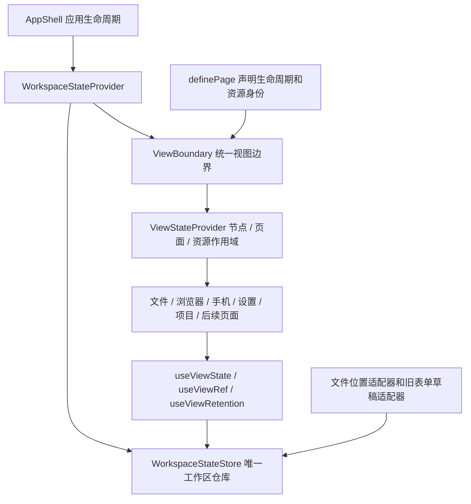

# 统一工作区状态架构

## 产品设计

文件、浏览器、手机及后续页面共用一套状态保存协议。页面切走后保留操作进度，重型运行资源可以释放。缓存预算不能淘汰未保存内容；凭据和草稿只留在当前登录应用的内存中，不新增磁盘或浏览器存储。

## 用户故事

- 用户在文件页保留标签、分栏、编辑模式和未保存文本，切页后恢复；干净正文按需重读。
- 浏览器普通页面和任务绑定页面分别恢复自己的目标和地址，不把一个任务的状态带到另一个任务。
- 切换节点时停止旧控制器，并分别恢复该节点的状态；本地节点与名为 `local` 的远端节点也不能混用。
- 新页面使用统一 Hooks 声明要恢复的数据，不需要再增加页面名称白名单或实现一套缓存。
- 页面已经卸载时，未保存草稿仍受缓存保护，刷新警告仍然有效。

## 技术设计



### 一个数据仓库

`frontend/src/workspace-state.ts` 是唯一的快照存取、订阅和缓存淘汰实现。`AppShell` 创建 `WorkspaceStateProvider`，生命周期覆盖应用工作区；嵌套 Provider 复用相同仓库。注销或重建应用后不再保留旧仓库。

`store.node(nodeId).child('page', pageId)` 取得页面作用域；文件、任务浏览器等再使用 `child(...)` 细分资源。路径由字符串段构成并统一编码，不靠字符串前缀拼接。节点 ID 保留 `null` 与字符串的区别。`ViewStateScope` 只是同一仓库的访问句柄，没有另一份数据 Map。

`useViewState` 用 `useSyncExternalStore` 订阅具体字段。更新直接同步写入仓库，多个消费者读取同一值；不再用组件当前值和恢复 Map 两边同步。Hook 中只保存默认值，作为字段重置后的回退。功能更新从仓库读取最新值，支持同批事件连续更新。`useViewRef` 保留原来的 ref 形状，但仓库里只存其数据值，不存 React ref。

仓库接受无环的普通数据，拒绝 DOM、编辑器、连接、函数和其他资源实例。Monaco 光标快照在文件适配器中转换为普通数据。读取结果按 React 的不可变数据约定更新。

### 按数据用途控制内存

| 策略 | 内容 | 释放规则 |
| --- | --- | --- |
| `view` | 选择、筛选、路径、标签、模式、当前滚动位置 | 明确关闭且没有未保存内容时清理 |
| `draft` | 未保存文件的基线与编辑文本、未提交表单 | 不参与缓存淘汰；保存或明确放弃后删除 |
| `cache` | 可重新读取的目录列表、历史文件位置快照 | 统一 LRU，默认最多 200 项、估算数据载荷 2 MiB |

容量是可重建缓存的数据预算，不是整个应用的 V8 堆上限。正在订阅的缓存值暂时保留，避免读取中的页面被淘汰；订阅释放后继续执行预算。体积较大的干净文件正文不进入状态仓库，只在激活的文件控制器中持有。

关闭页面时，统一清理它的作用域；若存在 `draft`，保留恢复该草稿所需的视图元数据，清理可重建缓存。明确关闭文件由文件业务适配器清理整个文件资源作用域，包含源码模式、草稿和位置快照。

根 Provider 集中检查受保护草稿并处理刷新警告。警告不依赖某一个表单是否仍然挂载。

### 一个生命周期边界

`ViewBoundary` 组合状态作用域、页面活动范围、滚动恢复、弹层宿主和进行中操作的暂留计数。它不了解文件、浏览器或手机的页面名称。

`definePage(content, options)` 默认在隐藏后卸载内容；`resource` 声明资源身份，`scroll` 声明谁拥有滚动。已经接入快照的文件、浏览器和手机使用默认卸载。已有复杂表单、首页对话等仍有局部 React 交互状态的页面，显式声明 `lifetime: 'retain'` 保留控制器；其轮询、镜像和重型子资源仍按活动范围暂停 / 释放。这是统一边界的一种声明策略，不代表自动序列化任意组件内部 state。

`usePageEffect` 继续承担活动范围内的连接、订阅和周期任务；效果的返回函数必须释放资源。`useViewRetention` 用于保存、上传等不能因切页丢失结果的操作，完成后调用返回的释放函数。

### 业务适配层

- `file-workspace-state.tsx` 只负责文件工作区作用域和关闭文件，没有独立存储实现。
- `fileview/file-view-state.ts` 将编辑器、Markdown、CSV、HTML 的位置映射到同一仓库的有界缓存，没有模块级位置 Map。
- `settings-draft.tsx` 兼容已有表单的基线 / 恢复接口，将未保存快照写入统一仓库的节点草稿作用域，没有模块级草稿 Map。
- 用户长期偏好继续使用现有 preferences；服务器业务数据继续由对应业务数据层负责，不混入视图恢复协议。

## 新组件接入

在路由定义中声明内容和资源身份：

```tsx
report: definePage(<ReportPage />, { resource: reportId, scroll: 'content' })
```

页面及其子组件通过统一接口读写状态，连接仍归组件清理：

```tsx
function ReportPage() {
  const [query, setQuery] = useViewState('query', '')
  const scope = useViewScope()
  const retain = useViewRetention()

  usePageEffect(() => {
    const connection = connectReport()
    return () => connection.close()
  }, [])

  // 仅在确有未保存内容时使用 draft 策略；保存成功或放弃后删除。
  // scope.set('edit', { baseline, text }, 'draft')
  // scope.delete('edit')

  // 保存操作：const release = retain(); try { await save() } finally { release() }
  return <input value={query} onChange={event => setQuery(event.target.value)} />
}
```

多个独立实例用 `ViewStateProvider scope={parent.child('resource', id)}` 划分作用域。组件只声明必要的恢复数据；DOM、编辑器、镜像画面、WebSocket、定时器始终留在组件生命周期内。使用长期偏好初始化时，仍须遵守 preferencesLoaded 的晚到值规则。

## 验收

架构与迁移验收见 [architecture-acceptance.md](architecture-acceptance.md)；此前的状态保留和内存优化记录继续保留，不用架构抽象本身推断内存下降。
