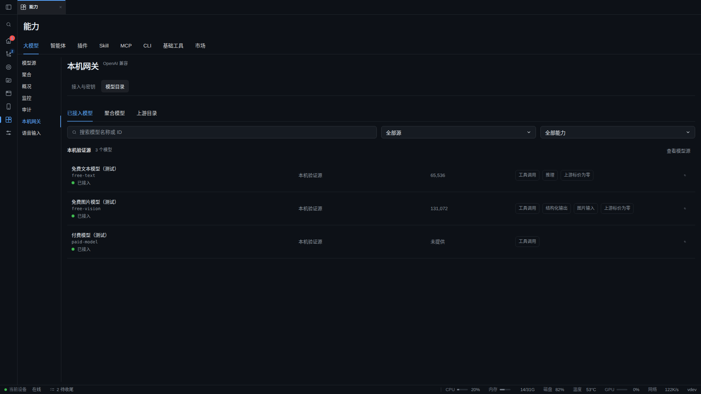
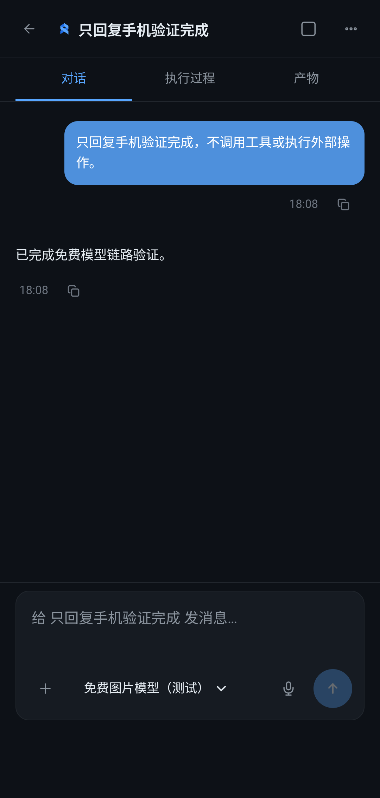
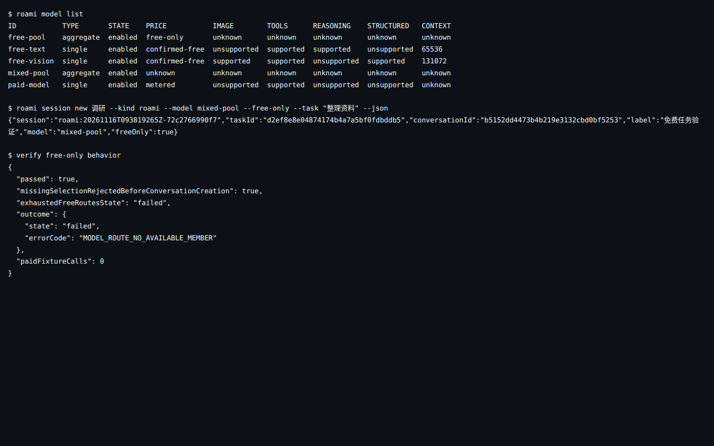

> 历史记录：以下证据对应简化前的 `40de2934`。独立会话切模、预校验和选模表已撤回；当前版本见 [简化验收](simplification-acceptance.md)。

# 模型选模运行验收

日期：2026-11-16。使用本任务私有实例 `/tmp/roami-model-implementation/instance`，启动与清理统一经过 `scripts/dev/isolated-roami.sh`；没有改动宿主模型设置。

## CLI 与真实推理链路

- `roami model list`：列出已接入模型与聚合池，展示能力声明与未知值。
- `roami model list --refresh --all --json`：从本机协议夹具读取上游目录，未接入条目保持 `configured=false`。
- `roami model list --capability image --json`：只保留声明支持图片的具体模型，不把聚合能力并集当作保证。
- `roami agent new --model free-pool --free-only`：实际创建独立对话并保存选择。
- `roami session new --kind roami --model mixed-pool --free-only --task ... --key model-selection-task --json`：原生任务执行成功；主执行请求落到免费成员 `fixture/free-text`，没有调用 `fixture/paid`。
- 用同一个幂等键与同一请求重试，返回完全相同的会话、任务与对话 ID。
- 桌面、手机均实际创建并完成原生任务。手机按图片能力筛选后选择 `free-vision` 并开启仅免费，主执行请求到达 `fixture/free-vision`；当前记录未出现 `fixture/paid` 调用。
- 故意将夹具的免费计价规则改成未知后创建测试任务：结果为 `failed / MODEL_ROUTE_NO_AVAILABLE_MEMBER`，未回退付费成员；测试结束后恢复原计价规则。
- 原生会话内从池切换到单模型，Worker 默认设置仍为 `default-worker`；重启隔离服务后选择记录保持。
- 无效模型返回 400，未创建对话。调用记录中，独立的后台记忆工作仍使用保存的 Worker 默认模型；没有把单个任务的免费约束描述为整个节点费用承诺。

## 自动检查

- 前端全量：259 个文件、1885 项通过。
- 迁移回归：9 项通过；新增表的空状态不影响历史数据快照比较。
- `scripts/dev/quality/check.sh full` 通过：Go 全量、Python 全量（4903 通过、48 跳过、6 项 subtests 通过）、i18n、hover、TypeScript 与生产构建均通过。
- 首次实现提交的 `quick` 提交钩子通过；收尾改动再按影响范围运行 Go 与前端检查。
- 受管智能体不能经新增 CLI 入口绕过注册的任务准入；CLI 在创建资源前拒绝此类调用。停用的已保存模型保持可见，需选择启用模型才能应用。

## 浏览器与手机

- 生产构建已运行。桌面 Chrome 检查 1280、1920、2560、3440 CSS px；详情面板打开时占用宽度，关闭后全部归还，文档与目录均无水平溢出。
- Redmi Note 8（Android 真机）：392 CSS px、粗指针、返回按钮 44 × 44；文档宽高均与视口一致。真实触控完成网关目录、详情、返回、新建会话、能力筛选、选模与提交。
- 软键盘展开为 314 CSS px 时，表单仍在自己的滚动容器内，并成功提交，未依靠 DOM click 绕过触控命中。
- 技术设计与原型 HTML 均已重新打开；无脚本异常，技术设计显示当前 `roami model list` 命令。

## 证据

结构化回执见 [runtime-acceptance.json](runtime-acceptance.json)。截图经 `scripts/dev/pr-shot.sh 939` 上传到独立的 `pr-shots` 分支，不提交截图到主分支。

