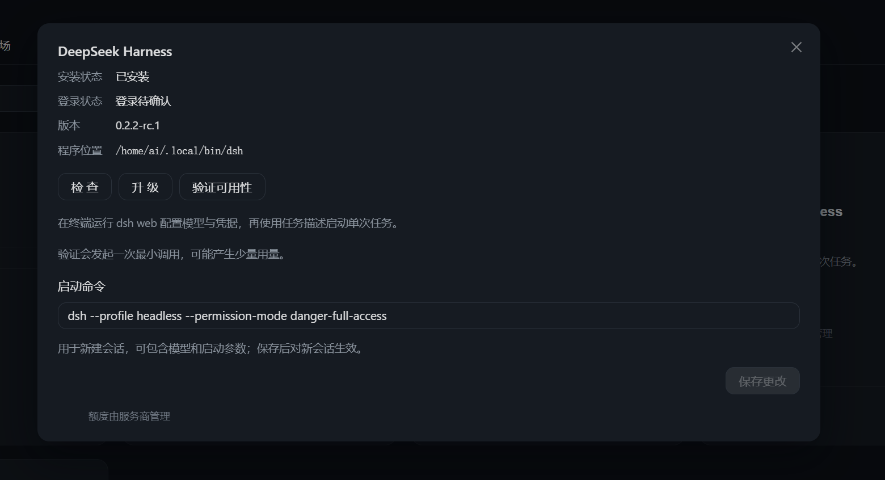
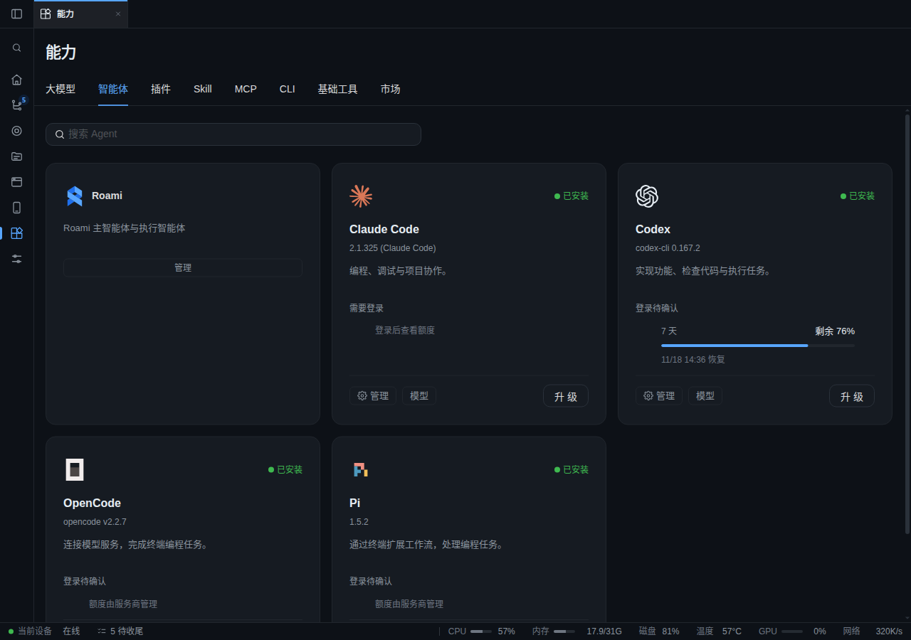
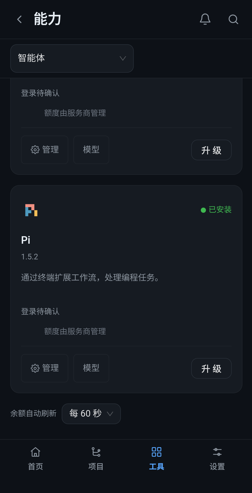

# 移除独立 DeepSeek Harness

## 产品设计

撤下独立 DeepSeek Harness 执行器，不再在智能体目录、安装升级、任务派发与新建会话中提供它。删除本分支尝试过的 Web 嵌入、headless 交互包装与原生模型配置适配。

DeepSeek 仍可作为 API 模型源，沿用 Roami 模型网关和既有 Agent 的界面。保留通用 Agent 注册机制、历史任务与用户配置，不卸载用户自行安装的 `dsh`。

## 用户故事

- 用户选择执行器时，只看到系统实际支持的 Agent。
- 用户使用 DeepSeek API 模型时，继续通过已有模型配置与会话流程工作。
- 旧任务仍可查看；对已撤下执行器的新派发明确失败，不创建无用资源。

## 技术设计

- 删除 `internal/agent/deepseek.go`，统一注册表自然收敛目录、CLI 帮助、安装升级和新会话入口。
- 删除 Harness 凭据探测、品牌图标与专属说明；其他 Agent 的通用能力代码保持原有契约。
- 撤回 `internal/deepseekcli`、CLI 终端适配以及 `internal/agentproviders` 中的 Harness YAML 配置代码，恢复原有网关绑定与模型目录流程。
- 将注册表、进程树与任意 headless 执行器测试改为通用样例；增加已撤下执行器拒绝启动且不创建资源的回归。
- 模型网关中的模型名称与协议兼容能力继续保留；历史设计仅标注为历史，保留验收来源。

## 验收

- 构建并运行实际 CLI：catalog 仅列出 Claude、Codex、OpenCode、Pi；以 `deepseek` 请求单次与持久执行均返回 `INVALID_EXECUTOR`。
- 同步 `main@af4dc220` 后，前端 253 个测试文件、1821 项测试通过；typecheck、i18n、hover 和生产构建通过。
- 桌面 1280、1920、2560、3440 CSS px 无文档溢出；Codex 配置可正常打开与关闭，旧 DeepSeek 路径没有可操作详情。
- Redmi Note 8 / Android Chrome 真机：392 CSS px、`compact`、`coarse`；触控进入配置与返回、合成手势滚动到列表末尾通过；页面及顶部和底部栏无溢出。
- Go 首轮检查中 Codex 生命周期用例失败，单独复测与整套重跑通过。最终 `scripts/dev/quality/check.sh quick` 与 `full` 均通过。
- Python 源码与测试保持原样，按仓库范围判定跳过 Python runtime 全套检查。通用测试中的任意执行器名称不代表主机注册或安装能力。
- 临时服务和本次验收页面已关闭；隔离 tmux 通过同一启动入口清理。

截图保存在 `pr-shots`，不进入主分支：

本机复核资料保留在 `/tmp/roami-ds-cleanup/`：`catalog.json`、`registry.json`、`layout.json`、`mobile-layout.json`、测试日志和 PNG 截图。
